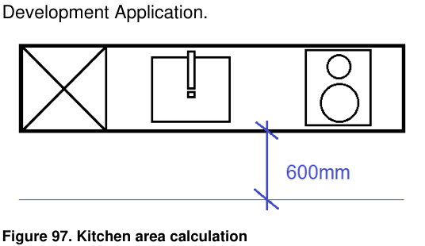

### 5.4 Boarding House and Co-Living Housing

#### Kitchen Facilities

P26. A private kitchenette should include at minimum a sink, cupboards and cooktop. Laundry facilities can be integrated into the kitchenette. An area with a minimum width of 600mm immediately in front of the kitchen joinery must be provided for the purpose of kitchen. Details are to be included on the Architectural Plans submitted with the Development Application.

> [Picture on page 21: a picture, saved as a picture (images/section-05-other-development-provisions-page-21-8.gif, 150 dpi).]

#### Figure 97. Kitchen area calculation

P27. Where communal kitchen rooms are provided within a development, these must be situated adjacent to the communal living area and must comply with the following requirements. Details are to be included on the plans submitted with Development Applications.

| Class 1b Kitchen | A communal commercial grade kitchen area with kitchen sink and facilities for food preparation, tables and chairs in a central location, accessible to all residents with a minimum area of 6.5m2 for one to six residents or 11m2 for 7-12 residents |
|---|---|
| Class 3 Kitchen | A commercial grade communal kitchen and dining area with a minimum area of 15m2 plus 1m2 per additional person above the minimum 12 persons. |
| Kitchen Requirements | The following must be provided in any kitchen as a minimum: • One sink for every six people with running hot and cold water. • One stove top cooker for every six people. • Exhaust ventilation. • A lockable drawer or cupboard for food storage for each guest in the kitchen area. |

#### Laundry Facilities

P28. For co-living housing developments, private laundry facilities must be provided within each individual room.

P29. For boarding house developments, adequate laundry facilities will be available within the premises and could be provided as private, communal or a combination of both.

P30. Where a communal laundry is provided, it is to provide: 1 washing machine/dryer (or combo) for every 8 rooms or part thereof, and 1 large laundry tub with running hot and cold water for every 8 rooms or part thereof.

P31. A least one outdoor clothes drying area shall be provided and located to maximise solar access. The outdoor clothes drying area must be well integrated within the
