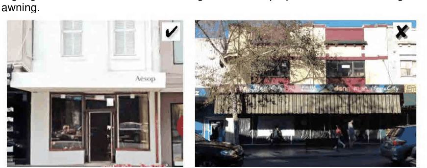
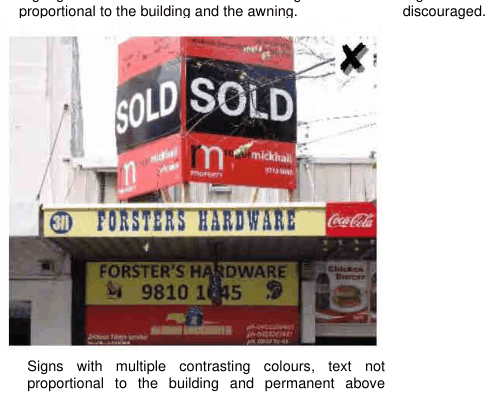

### 5.6 Signage and Advertising

Signage on awning extensions. Signage on window blinds or shutters. Fly or bill posters on public property. Large advertising balloons. Flashing, moving or running signs. Advertising on parked vehicles, trailers, shipping containers, whether or not registered, where the principal purpose is for advertising. Corporate colour schemes, comprising the painting of all, or large parts, of the building’s exterior, as such schemes generally obscure architectural features of the building. Signage with multiple contrasting colours or rainbow colours.

P2 Signage should be of limited contrasting colours and proportional to the building and awning.

> [Picture on page 42: a picture, saved as a picture (images/section-05-other-development-provisions-page-42-15.gif, 150 dpi).]

Signage text should be of limited contrasting colours and proportional to the building and the awning.

> [Picture on page 42: a picture, saved as a picture (images/section-05-other-development-provisions-page-42-18.gif, 150 dpi).]

Signs with multiple contrasting colours or rainbow colours are discouraged.

Signs with multiple contrasting colours, text not proportional to the building and permanent above awning signs are not permitted.

P3 New signage schemes should be taken as an opportunity to remove or replace earlier inappropriate signage types. In all cases, new signage will be considered on the basis of its cumulative impact upon the visual presentation of a building, having regard to any existing signage which is proposed to be retained.

P4 Council discourages signage prone to deterioration in appearance and may order removal of redundant, unsightly, dilapidated or objectionable signage.

P5 Council may require a provision for maintenance of signage and discourages signage on common boundaries where maintenance difficulties could occur.
