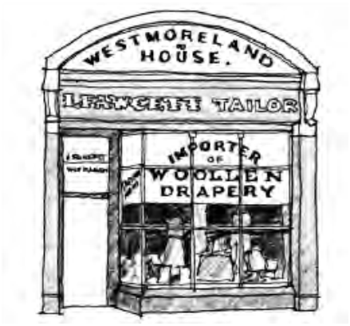

### 5.6 Signage and Advertising

> [Picture on page 46: a picture, saved as a picture (images/section-05-other-development-provisions-page-46-2.gif, 150 dpi).]

#### Figure 98. Traditional Shop Signage Example

Opportunities for Modern Signage

P3 Modern signs can, at times, also be accommodated as follows:

Under awning signs. Window signs. Low level sign (below ground floor window sill level).

Guidelines

P4 The following additional matters should be taken into consideration in heritage areas:

(a) As the external colours applied in different historical periods varied and were more limited in range than those available today, it is wise to research appropriate colour ranges for buildings in heritage areas. Generally, however, the following muted colours are suggested dark green, maroon, brown, terracotta, charcoal, etc. highlighted with creams, pinks, ochres and earth tones.

(b) Heritage lettering styles may involve shaded letters, the mixing of styles and letters and ornamental scrolls as relevant to the period of the building.

#### Advisory Note:

These controls are in addition to the provisions under the heritage sections.
