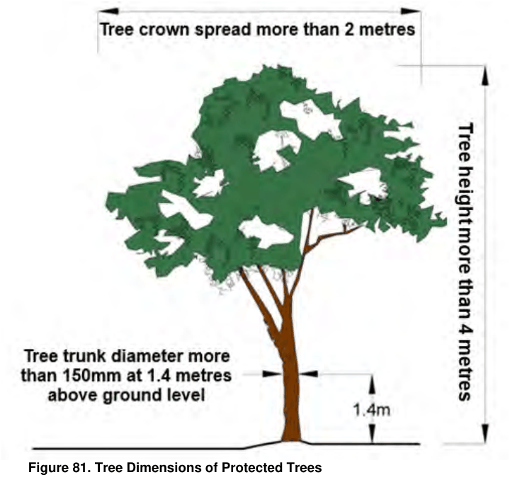

## 6         Environmental Management

### 6.1 Preservation of Trees and Vegetation

#### Aims

This Section of the DCP is made in accordance with Chapter 2 of State Environmental Planning Policy (Biodiversity and Conservation) 2021 and aims to:

Define what trees are protected within the Burwood LGA;

Explain when Council approval is required prior to undertaking tree works or activities, and how to apply for a Tree Permit application or Development Application for tree works or activities;

Outline the criteria Council will use to assess Tree Permit applications or Development Applications involving tree works or activities;

Explain the requirements for providing replacement trees;

Provide information regarding conditions of approval, review and appeal rights, and the penalties for breaching the provisions of this DCP.

#### Objectives

The objectives of this section of the DCP are :

Secure and maintain protected trees and the amenity of the urban forest. Preserve and protect existing trees from injury or destruction. Promote trees for ‘carbon sequestration’, solar access and shade. Increase urban tree canopy cover in the Burwood LGA to 25% by 2030, in accordance with Council’s Sustainable Burwood Strategy. Allow for the orderly removal of trees from inappropriate locations. Require the planting of replacement trees with consideration of available site conditions. Require landscaping and new tree planting as part of new developments

Provide appropriate assessment criteria for Tree Permit applications and Development Applications for tree removal and/or pruning.

#### 6.1.1 Protected Trees

Protected trees are trees protected by this DCP, and include:

any tree with a height equal to or greater than 4 metres above ground level (existing) or any tree with a trunk diameter of 150mm, measured at a distance of 1.4 metres above ground or any tree with a tree crown spread equal to or greater than 2 metres

Ringbarking, cutting down, topping, lopping, removing, injuring or wilfully destroying any protected tree without a valid Tree Permit or Development Application approval is strictly prohibited, unless this DCP explicitly provides otherwise. Failure to comply is a breach of section 9.56 of the Environmental Planning and Assessment Act 1979 and will incur penalties.

> [Picture on page 2: a picture, saved as a picture (images/section-06-environmental-management-page-2-1.gif, 150 dpi).]

#### Figure 81. Tree Dimensions of Protected Trees

#### 6.1.2 Allowable Tree Works or Activities (no approval required)

A permit or approval is not required for:

(a) the removal of vegetation that the council is satisfied is a risk to human life or property, or

(b) clearing for a traditional Aboriginal cultural activity, other than a commercial cultural activity.

A permit is not required for the removal of vegetation that the council is satisfied:

(a) is dying or dead, and

(b) is not required as the habitat of native animals.

Where a tree of any species does not exceed the dimensions illustrated in Figure 81, the tree is not considered to be a protected tree and may be pruned or removed without a Tree Permit or Development Application approval from Council.

Additionally, a Tree Permit or Development Application is not required for the following works or activities, provided they are carried out in accordance with AS 4373-2007 Pruning of amenity trees and Safe Work Australia’s Guide to managing the risks of tree work 2023:

Pruning of dead branches and/or torn storm-damaged branches that do not have hollows or provide habitat for native fauna.

Pruning of a shrub or hedge (hedge being defined as a group of two or more trees whether planted in the ground or otherwise, so as to form a hedge and rise to a height of at least

2.5 metres above existing ground level) by no more than 20 per cent of its height and width in a 12-month period.

Removal of any species of mistletoe or parasitic plant from a tree.

Pruning of less than 10 per cent of the crown of a tree in a 12-month period to reduce interference with roofs, gutters and walls of buildings only.

Up to 5% pruning of root systems in a 12-month period to reduce interference with footings of buildings.

Tree works or activities carried out under the Fire Brigade Act 1989, State Emergency Service Act 1989 or State Emergency & Resource Management Act 1989 or works or activities carried out by Council, the State Emergency Services, or a person authorised by either of them for safety reasons in response to an emergency.

Tree works or activities carried out under the Electricity Supply Act 1995, the Electrical Supply (General) Regulation 2001.

Tree works or activities if permitted under the State Environmental Planning Policy (Exempt and Complying Development Codes) 2008.

Tree works or activities carried out under the Rural Fires Act 1997.

Tree works or activities carried out under the Roads Act 1993.

Tree removal, pruning, maintenance and replacement by Council, on land owned by, or under the care, control and management of Council.

#### Advisory Note:

The owner of the tree must provide consent before any Allowable Tree Works or Activities are undertaken. Council does not mediate Allowable Tree Works to neighbouring trees. For more information regarding the process of applying to prune trees located on a neighbouring property please refer below to Making an Application – Trees on Neighbouring Property.

#### 6.1.3 Exempt Species of Trees

Unless such trees are on land within a heritage conservation area, or on land that is or forms part of a heritage item, or where the tree forms part of an Aboriginal object, or is located within an Aboriginal place of heritage significance, the tree species listed in Table 6 may be removed or pruned without a Tree Permit or Development Application approval. If you are unsure whether the tree is an Exempt Species please contact Council.

#### Table 6. Exempt Species of Trees

| Common Name | Species Name |
|---|---|
| Bamboo | (all species) |
| Privet | (Ligustrum species) |
| Rubber Tree | Ficus elastica |

| Loquat | Eriobotrya japonica |
|---|---|
| Rhus Tree | Toxicodendron succedaneum |
| Umbrella Tree | (Schefflera species) |
| Willow | (Salix species) |
| Populus | (all species) |
| Robinia | (all species) |
| Cocos Palm | Syagrus romanzoffianum |
| Mulberry | (Morus species) |
| Banana | (Musa species) |
| Citrus | (all species) |

Fruit trees or a tree that is grown for the purposes of fruit, or is harbouring fruit fly, except Australian native trees

Refer to the NSW Weedwise website for list

Any tree that has been declared a priority weed on the NSW Department of Primary Industry’s Priority Weeds List of the Greater Sydney (Burwood)

#### 6.1.4 Trees that are considered an imminent risk to human life or property

In accordance with Clause 2.7 of State Environmental Planning Policy (Biodiversity and Conservation) 2021, a Tree Permit application or Development Application is not required for the removal of a tree, provided that Council is satisfied the tree is a risk to human life or property before any tree works or activities are undertaken.

Before any tree works or activities are undertaken Council will contact the owner of the tree in writing to confirm if the tree is a risk to human life or property and that tree works or activities may be undertaken. If Council is not satisfied that the tree is a risk to human life or property Council will advise that a Tree Permit application or Development Application approval is required.

#### 6.1.5 Approval Pathways – Tree Permit Application or Development Application

Unless otherwise explicitly specified in this DCP, any works or activities involving a protected tree must be approved by Council through a Tree Permit application, a Development Application or an approval issued to Council or Public Authority for public or infrastructure works under Part 5 Infrastructure and environmental impact assessment of the Environmental Planning and Assessment Act 1979 before the works or activities are undertaken. Tree Permit applications and Development Applications are to be submitted to Council via the NSW Planning Portal.

#### Table 7. Type of Application Required

| Location | Proposed Works | Type of Application |
|---|---|---|
| Land within a heritage conservation area, on land | Any tree works or activities involving a protected tree | Development Application |

| identified as or forming part of a heritage item, forms part of an Aboriginal object, or is situated within an Aboriginal place of heritage significance | (including those involving Exempt Species of Trees) that are not classified as Allowable Tree Works or Activities under this DCP |  |
|---|---|---|
| All other land | Tree works or activities ancillary to or associated with new construction or development Tree works or activities involving a protected tree that are not classified as Allowable Tree Works or Activities under this DCP, and are not ancillary to or associated with new construction or development | Development Application Tree Permit Application |
| Land owned by Council or Public Authority where works are permitted to be undertaken via Part 5 Infrastructure and environmental impact assessment of the Environmental Planning and Assessment Act 1979 | Any tree works or activities involving a protected tree (including those involving Exempt Species of Trees) that are associated with public or infrastructure works undertaken by Council | Public or infrastructure works undertaken by Council or Public Authority and authorised under Part 5 Infrastructure and environmental impact assessment of the Environmental Planning and Assessment Act 1979 |

#### Tree Permit Application required

A Tree Permit application is required for any works or activities involving a protected tree, unless the works are classified as Allowable Tree Works or Activities under this DCP or the tree is an Exempt Species.

A Tree Permit application must also be submitted where the proposed tree works or activities are not related to, or part of, new construction or development on the site. In such cases, the tree works or activities are considered a stand-alone matter and are not associated with any other form of development.

However, if the tree is located within a heritage conservation area, on land identified as or forming part of a heritage item, associated with an Aboriginal object, or within an Aboriginal place of heritage significance, a Development Application is required instead of a Tree Permit.

#### Development Application required

Tree works or activities that are ancillary to or associated with new construction or development on the site will be considered through the Development Application process under Part 4 of the Environmental Planning and Assessment Act 1979.

Tree works or activities involving any protected tree, including to Exempt Species of Trees, situated on land within a heritage conservation area, on land identified as a heritage item, where the tree is part of an Aboriginal object, or where it is located within an Aboriginal place of heritage significance, require a Development Application unless classified as Allowable Tree Works or Activities under this DCP.

The standard Development Application process will apply. In addition to satisfying the information requirements for Development Applications, a landscape plan must be prepared and submitted in accordance with Council’s Landscaping Code, including the details outlined in section 6.5 of the Code.

Advisory Note: Tree works or activities in accordance with a valid and current development consent issued by Council where the tree works or activities are ancillary to proposed building works or activities or other development do not require any other kind of approval or permit from Council.

#### 6.1.6 Making an Application - Property Owner

The written consent of the owner(s) of the property where the tree stands is to be provided with all applications.

Applications must be submitted to Council using the NSW Planning Portal. The application is to be accompanied by the nominated fee set out in Council’s Schedule of Fees and Charges.

The application is to provide supporting information in regard to the following:

The name/s and contact details of the tree owner or applicant, to permit access to the

trees for inspection purposes The location of the tree The species (if known) The condition of the tree The size of the tree The reason for the proposed works or activities to be carried out to the tree.

Council may require the applicant to obtain a report from a qualified arborist, practising Structural Engineer, Licensed Plumber or other consultant or expert to assist Council in assessing and determining the application.

#### 6.1.7 Making an Application – Trees on Neighbouring Property

The owner of a property affected by overhang from a tree or trees on an adjoining property may also apply to Council to prune that part of the tree or trees overhanging the boundary their property. The same supporting information as outlined in section 6.1.6 is to be provided, including but not limited to written owners consent.

Any consent granted by Council under this section does not authorise the applicant (or someone engaged by the applicant) to enter any neighbouring property in order to carry out the approved works or activities. Council cannot order a neighbouring resident to remove a tree located on their property.

Alternatively, pursuant to section 7 of Trees (Disputes Between Neighbours) Act 2006 (the Trees Act) a person may apply to have their matter heard by the Land and Environment Court where they seek to remove or prune a neighbour’s tree and cannot resolve the issue.

Further information including the relevant forms can be found on the Land & Environment Court website. There are a number of matters the Court will consider under Section 12 of The Trees Act, before making a decision on an application. Please refer to Section 12 of the Trees Act for further details of such matters.

#### 6.1.8 Assessment Criteria for a Tree Permit Application or Development Application

The applicant must provide a justification for undertaking the tree works or activities.

In determining an application for tree activities, pruning, works or removal, the consent authority must have regard to the following assessment criteria:

1\) Risk Assessment

Evaluation of the risk to human life or potential for injury is determined by several factors, including:

o The potential or likelihood of whole tree or limb failure o Any history of previous branch or structural failure o The size and extent of the defective part of the tree o The level of use and occupancy of the area potentially affected by failure

A high safety risk in regard to human life or possibility of injury will be given substantial consideration during the assessment of an application. It is important to note that evaluations of dangerous trees are conducted with reference to the risk posed under normal weather conditions;

2\) Health and Condition of the Tree

The structural condition and overall health of the tree will be evaluated for visible indicators of decline or deterioration. Such indicators may include reduced foliage density, the presence of deadwood within the canopy, fungal fruiting bodies, excessive sap exudation from the trunk, and signs of insect infestation—particularly borer activity;

3\) Damage to Property

The potential for the tree to cause damage to property is considered. This includes species known for extensive root systems that may compromise building footings or contribute to blockages in domestic sewer and drainage infrastructure;

4\) Tree Location in Proximity to Existing Lawful Residential Buildings

Consideration will be given to the appropriateness of retaining a tree or vegetation, where the trunk base at ground level is located within 3 metres of any existing lawful residential accommodation building with a floor area greater than 25m²;

5\) Contribution to Landscape, Precinct and Streetscape Character

Consideration will be given to the tree’s contribution to the surrounding landscape precinct and streetscape character, its role in shaping the existing and desired future character of the area, and its relationship to the surrounding natural, built or social environment, including any historical, aesthetic or cultural value or significance;

6\) Heritage Impact

Consideration will be given to any potential impact on a heritage item or heritage conservation area, where applicable.

7\) Tree Species and Tree Longevity

Consideration will be given to the species' propensity for branch or limb failure, as well as its sensitivity to environmental changes that may impact on its long-term viability in the existing location. Relevant factors include alterations to soil levels, significant root disturbance from construction activities, changes in water availability, competition from surrounding vegetation (particularly invasive climbers), and soil compaction—

especially in high-traffic areas such as car parks. The expected lifespan of the tree will also be considered;

8\) Threatened Species, Ecological Communities or their habitats

Consideration and determination will be given to whether the proposed tree removal, tree works, development or activity is likely to significantly affect threatened species, ecological communities or their habitats, in accordance with the requirements of Part 7 of the Biodiversity Conservation Act 2016 and Part 7A of the Fisheries Management Act 1994. Such considerations are to include whether the tree is an endangered or rare species, or whether it contributes to ecological connectivity by linking bushland and reserve areas, thereby supporting native habitat.

9\) Termite Infestation

Each instance of termite activity will be assessed on a case-by-case basis, taking into account the specific circumstances and severity of the infestation;

10\) Proximity to power lines and other essential infrastructure

Consideration will be given to the proximity of the tree to power lines and other essential infrastructure, where applicable;

11\) Impact on public infrastructure

Consideration will be given to the removal of a tree if it can be demonstrated that the tree is causing, or is likely to cause, substantial damage to public infrastructure, or if it creates a safety risk to the public including trip hazards on raised footpaths. Removal will only be supported where feasible and cost-effective alternatives to address the issue while retaining the tree have been explored and found not to be practicable.

12\) Human Health Impact

Consideration will be given to the effect that the tree in question is injurious to the health of the resident or residents. A Doctor's certificate (from a registered medical specialist practitioner) is produced.

#### Advisory Note:

In the case of a Development Application, the assessment will be conducted in accordance with Part 4 of the Environmental Planning and Assessment Act 1979. Section 4.15 of the Act specifies the considerations to be taken into account when determining a development application. These considerations include, but are not limited to, the factors outlined in points 1 to 8 above.

The following reasons are not considered valid reasons for removing or pruning a tree:

To improve or enhance views; Natural occurrences such as the shedding of leaves, flowers, fruit, resin, sap, seeds, or small pieces of deadwood; Damage to buildings, structures, or underground services where feasible alternatives exist to address the issue while retaining the tree; Root-related damage to water, drainage, or sewer systems that are aging, deteriorating or in poor condition; Nuisance caused by insects or animals associated with the tree; To reduce minor shading caused by the tree;

Any tree works or activities that are contrary to AS 4373—2007 Pruning of Amenity Trees, including to reduce height; Minor lifting of driveways, walkways, or paving, or minor damage to outbuildings, garden features, walls, or landscaping structures; To allow for construction of structures (e.g. fences, driveways, swimming pools, or dwellings) where alternative suitable locations are available; To improve sunlight access to solar energy systems; Damage to unauthorised building works.

#### 6.1.9 Determination of Tree Permit Applications and Development Applications

Upon lodgement of a Tree Permit application or Development Application, Council may require the applicant to provide a report from a practising AQF Level 5 Arborist, Landscape Architect, Structural Engineer, Licensed Plumber or other consultant or expert to assist Council in assessing and determining the application.

For applications that Council considers involve significant tree works or activities, or for any other application for which Council considers community consultation is appropriate, Council may conduct community consultation in accordance with Council's "Community Consultation Protocol". Development Applications that involve tree works or activities will be subject only to the notification requirements of the Burwood Community Engagement Strategy.

All applications will be determined by approving the application subject to conditions, or by refusing the application.

#### Conditions of Approval

Tree works or activities must be carried out in compliance with the AS 4373-2007 Pruning of amenity trees and SafeWork NSW’s Amenity tree industry code of practice.

Council will impose conditions, including that replacement trees be provided, and the work is carried out by an arborist with a minimum Australian Qualifications Framework (AQF) Level 5 in Arboriculture.

Where replanting is a condition of consent, replacement plants are to be protected and cared for until maturity so they remain in good condition and attain their natural size and form.

A Tree Permit granted by Council remains valid for one (1) year from the date of issue. A development consent that includes an approval for tree works or activities is valid for up to five

(5) years.

A Tree Permit or development consent granted by Council must be made available for inspection on request by any Council staff member during the carrying out of any work permitted under such permit or consent.

#### Replacement Trees

On merit, conditions of approval may require replacement trees to be planted on private land at a ratio of two (2) or three (3) replacement trees for every tree approved for removal. The required ratio will be determined by Council having regard to the significance of the tree removed, the extent of canopy loss, and the site’s capacity to accommodate replacement planting. This control assists Council in achieving the Burwood LGA’s urban tree canopy cover target of 25% by 2030.

Replacement trees must be planted on the same site in an appropriate location, as directed by Council, and must be maintained by the applicant in a healthy and vigorous condition until they reach the definition of a “protected tree” under this section of the DCP.

The container size and mature height of replacement trees will be determined by Council, taking into account available land area and the urban forest canopy target, with a preference for advanced container sizes. Replacement trees must be planted in appropriate locations and should not be planted within 3 metres of any existing or proposed building, 1.5 metres swimming pool or spa (or result in a breach the Swimming Pool Act 1992 fencing requirements), or 1 metre property boundary.

#### 6.1.10 Reviews and Appeals Internal Review

If an application for a Tree Permit is refused, the applicant may seek a review of Council’s decision if they believe:

a. Council has erred in its judgement; or

b. Council’s decision is harsh or unreasonable; or

c. Additional information has become available subsequent to the inspection by Council.

A review must be lodged with Council within three (3) months of the date of the application’s determination. Council may require the appellant to provide reports or other suitable documentation from appropriately qualified consultants or experts relevant to the basis of the appeal.

If an application for a Tree Development Application is refused, the applicant may seek a review of Council’s decision pursuant to s8.2 of the Environmental Planning and Assessment Act 1979.

#### External Appeals

If an application for a Tree Permit is refused by Council, an applicant may appeal to the Land and Environment Court. The appeal must be made within three (3) months of the date on the determination.

Any such appeal is to be made within three (3) months after the date on which the applicant is notified of the decision or within 3 months after the council is taken to have refused the application (whichever is the later).

In the case of Development Applications, Section 8.7 of the Environmental Planning and Assessment Act 1979 (the Act) gives you the right to appeal to the Land and Environment Court in accordance with the timeframes set out in Section 8.10 of the Act.

#### 6.1.11 Reported Breaches

On receiving a report of a breach of the State Environmental Planning Policy (Biodiversity and Conservation) 2021 and of this section of the DCP, a Council officer may attend the site and order that any contravening works cease immediately.

The Council Officer may gather any necessary information including:

The name, address and contact details of the person or organisation carrying out the work.

The name, address and contact details of the person or organisation that authorised the work. Descriptions, diagrams and photographs of the illegal works, plant, equipment, machinery and persons. The person carrying out the contravening work and/or the Tree Owner (or the person who authorised the work) may be asked to show cause in writing as to why they should not be prosecuted in relation to the breach. Council delegate with the responsibility for compliance matters will determine whether the matter will proceed to prosecution.

#### 6.1.12 Penalties for Breaches

Breaches of the provisions of the SEPP are subject to penalties in Section 9.56 of the Environmental Planning and Assessment Act 1979.

This Section also provides that where a person is guilty of an offence involving the destruction of or damage to a tree or vegetation, the court dealing with the offence may, in addition to or in substitution for any pecuniary penalty imposed or liable to be imposed, direct that person:

(a)  To plant new trees and vegetation and maintain those trees and vegetation to a mature growth, and

(b)  To provide security for the performance of any obligation imposed under paragraph (a).

#### 6.1.13 Arborists’ Reports that are Submitted to Council

When an Arborist’s report is required to be provided with an application, the report is to be prepared by a consulting Arborist who holds a minimum qualification of a Diploma (AQF Level

5\) in Arboriculture.Arborist's reports submitted to Council in relation to an application must contain the following information:

the name, address and telephone number of the qualified consulting arborist who prepared the report (and the company, where applicable) the qualifications of the Arborist who commissioned the report and why the report was commissioned what the report examines the address of the site containing the tree or trees the date the Arborist conducted the inspection the methods or techniques used by the Arborist to inspect the tree or trees an abstract or synopsis of the findings from the Arborist's inspection a map or diagram of the site showing the location of the tree or trees, with the tree or trees numbered to correspond with the text in the Arborist's report the botanical and common name, height, crown spread, trunk diameter at 1.4m above ground level, and form of each tree inspected a discussion of the data collected – this may include, for example, detailed information regarding wounds, cavities, cracks, splits, forking, root-zone, pests and diseases supporting evidence where appropriate, such as photographs testing results should be submitted with clear and legible copies references used must be those referred to in the report data included in the report should be relevant to the application

a discussion of all the options available – why they are recommended or why they are not recommended, e.g., can the built structure be relocated or repaired and the tree retained a recommendation as to the preferred option and the reasons for this recommendation the information in the report should be presented as objectively as possible without attempting to support specific outcomes.

The above list is not exhaustive. The Arborist may choose to include further information or Council may require further information to properly assess and determine the application.

#### Advisory Note:

A list of qualified Arborists can be obtained from the Institute of Australian Consulting Arboriculturalists (IACA) website at www.iaca.org.au. Arboriculture Australia is also be able to supply the details of a suitably qualified Arborist. For more information call 1300 664 374 or visit www.arboriculture.org.au.

#### 6.1.14 Definitions

Arborist - A person with minimum training to AQF Level 5 in Arboriculture that enables the person to competently perform tree work.

Australian Qualifications Framework (AQF) - The national framework for all educational and training purposes in Australia.

Building is as defined in the Environmental Planning and Assessment Act 1979.

Development is as defined in the Environmental Planning and Assessment Act 1979.

Carbon sequestration - The process of trees removing carbon from the atmosphere and storing it in their wood as they grow.

Clear vegetation is as defined in State Environmental Planning Policy (Biodiversity and Conservation) 2021.

Dead tree - A tree with no living vascular tissue.

Destroy - Any immediate or ongoing process or activity leading to the death of a tree.

Height - The distance measured vertically between the horizontal plane at the lowest point at the base of a tree which is immediately above ground and the horizontal plane immediately above the uppermost point of a tree.

Injure - To inflict damage to a tree by an immediate or ongoing process or activity and includes: Lopping and topping. Poisoning, including applying herbicides and other plant toxic chemicals to a tree or spilling (including washing off or directing water contaminated by) oil, petroleum, paint, cement, mortar and the like onto the root zone cutting, tearing, snapping and breaking off branches and roots that is not carried out in accordance with accepted arboricultural practices, does not qualify as "pruning" or is done for invalid reasons such as vandalism. Ringbarking, scarring the bark when operating machinery, fixing objects (e.g. signs) by nails, staples or wire, using tree climbing spikes in healthy trees marked for retention (except for access to an injured tree worker) or fastening materials that circle and significantly restrict the normal vascular function of the trunk or branches or inflicting a blaze on a tree as a marker point.

Damaging a tree's root zone by compaction or excavation, stripping of topsoils, asphyxiation by burial (including unauthorised filling or stockpiling of materials) or the alteration of ground level or water table which causes damage to the tree or any part of the tree. "Underscrubbing", unless carried out by hand tools, such as brushcutters and the like.

Lopping - Indiscriminate cutting of branches or stems between branch unions, with the final cut leaving a stub.

Pruning - The cutting of any stem dead or alive, back to the intersection of another live stem to a swollen area at the intersection called a branch collar, with a final cut at the outer edge of the collar leaving no stub. This also means any act or acts severing any part of a tree so as to cause a reduction of the air space occupied by the branches and foliage of a tree.

Remove - To dismantle a tree or to separate the tree from the ground where it is growing or dislodging it with earth moving equipment in order to kill the tree so that the tree, including its branches, foliage, trunk, stump and root system will not regrow. This includes the poisoning of the stump and/or roots and/or taking away, or grinding or burning out its remains to prevent regrowth.

Risk to human life or property – is where a tree presents an unacceptable level of risk to life or property as per an industry risk assessment methodologies -TRAQ or QTRA. Evidence must be provided to Council in writing by photographic evidence and written evidence by a Qualified Arborist (AQF5).

Top - Cutting away part, or all, of a tree’s crown leaving a trunk and stubbed main branches to reduce its height and spread. This is an antiquated practice which damages a tree, reducing strength and vigour and predisposing it to premature decline.

Tree - A woody perennial plant equal to or exceeding four (4) metres in height with a trunk diameter equal to or exceeding 150mm measured at a distance of 1.4m above ground.

Tree Owner - The owner of a property where the majority of a tree’s trunk meets the ground.

Vegetation – means a tree or other vegetation whether or not it is native vegetation.

Urban Forest – means all trees and vegetation (both naturally occurring and planted) that occur within or near urban areas

#### 6.1.15 Related Information

Street Tree Management Strategy Compliance and Enforcement Corporate Practice Trees (Disputes Between Neighbours) Act 2006 Sustainable Burwood Strategy

#### 6.2.1 Aims and Objectives

This aim of this BDCP section is to achieve effective waste management and minimisation in the Burwood local government area. It applies to all areas of Burwood local government area.

The objectives of this BDCP section are:

To reduce the demand for waste disposal through waste separation and resource recovery in demolition, design, construction and operation of buildings and land use activities.

To achieve the design of waste and recycling storage systems in buildings and land use activities which are hygienic, accessible, quiet to operate, adequate size and visually compatible with their surroundings.

Applicants must familiarise themselves with the requirements of Council’s adopted Local Approvals Policy for Managing Waste in Public Places (Waste Policy). The Policy is available on Council’s website.

#### What is a Waste Management Plan?

This BDCP section specifies Council’s requirements for waste management plans to be prepared and submitted in one or both of the following circumstances:

Type 1 – For the waste management practices associated with the ongoing use of the premises. It must be lodged with Development Applications for:

Change of use of existing premises. Alterations/additions to existing premises which would affect waste management facilities or waste management practices. New development.

Type 2 – for the type, volume, and disposal methods of materials to be generated during demolition and construction. It must be lodged prior to the commencement of any works. It applies to any Development Applications for:

Demolition. Alterations/additions which exceed 20 sqm of existing premises. New development.

#### Type 1 Applications - Ongoing Use of the Premises

Waste Management Plan submission requirements for Development Applications (DA):

| Development type | Waste Management Plan submission requirements | Additional Requirements | Controls to comply with |
|---|---|---|---|
| Dwelling house or Dual Occupancy | Part 1 not applicable Part 2 lodged prior to commencement of any works | Refer to 6.2.2 | Refer to 6.2.2 |
| Multi dwelling housing or Residential flat building | Part 1 lodged with DA Part 2 lodged prior to commencement of any works | Refer to Part 6.2.2 |  |
| Commercial development or Public building or Industrial development | Part 1 lodged with DA Part 2 lodged prior to commencement of any works | Refer to 6.2.2 |  |
| Mixed use development | Part 1 lodged with DA Part 2 lodged prior to commencement of any works | Refer to 6.2.2 |  |

#### Type 2 Applications - Demolition and Construction Waste

Part 2 applies to all Development Applications involving demolition and or construction. It also applies to Development Applications where alterations/additions which exceed 20 sqm of existing premises and new buildings and development.

Submission Requirements

A completed copy of Part 2 of the Waste Management Plan is to be lodged prior to the commencement of any works.

Plans must include the following details:

Location of on-site areas to be used for the sorting of demolition and construction recyclables / waste. Location of on-site areas to be used for the storage of demolition recyclables / waste, including any containers / skip bins. Vehicular access to the site and on-site.

Aims

To maximise the reuse and recycling of demolition and construction materials. To reduce the volume of materials going to landfill. Wherever possible, demolition and construction materials must be sorted and stored on-

site. Council recognises that smaller residential sites may not have space for the storage

of skip bins, therefore refer to Council’s Rubbish Skips Policy for the requirements regarding the placement of waste bins on public places.

Performance Criteria

Documentation regarding the disposal methods and destination of materials must be retained by the applicant. Council may audit documentation so as to monitor compliance with the Waste Management Plan. All demolition and construction must occur in accordance with the conditions of consent applying to a Development Application.

Information

There are many opportunities to reduce the volume of materials generated during demolition and construction going to landfill. Some examples of recyclable materials are provided in the following table:

| Materials on-site | Reuse/Recycling Potential |
|---|---|
| Concrete | Filling, levelling materials, road base |
| Bricks | Cleaned and/or rendered over for reuse |
| Roof tiles | Crushed for reuse in landscaping and driveways |
| Hardwood beams | Floorboards, fencing, furniture |
| Other timber | Formwork, bridging, blocking and propping |
| Doors, windows, fittings | Second hand building materials |
| Glass | Aggregate for concrete production |
| Synthetic and recycled rubber (e.g. under carpets) | Used for safety barriers, speed humps |
| Significant trees | Relocated on-site |
| Green waste | Mulching, composting, reuse as landscaping/fertiliser |
| Soil | Reuse as fill |

#### 6.2.2 Waste Management

#### Design of Waste Management Facilities in Dwelling Houses and Dual Occupancies

Application

This section applies to:

Development applications for new dwelling houses or dual occupancies. Development applications (affecting waste management) for alterations/additions to existing dwelling houses or dual occupancies.

Submission Requirements

Plans must indicate: Location of indoor waste/recycling cupboard (or other appropriate storage space) for each dwelling. Location of an on-site waste/recycling storage area for each dwelling for Council’s waste, recycling and green bins.

On-site location for a compost container. Location of kerb-side collection point for the collection and empting of Council’s waste, recycling and green bins.

Performance Criteria

Each dwelling must be provided with an indoor waste/recycling cupboard (or other appropriate storage). The indoor waste/recycling cupboard (or other appropriate space) must be able to hold a single day’s waste and hold separate containers for general waste, recyclables and compost material. Each dwelling must be provided with an on-site waste/recycling storage area for Council’s waste, recycling and green bins. Council provides each dwelling with:

i. 120 litre general waste bin (red/grey lid), collected weekly

ii. 240 litre recycling bin (yellow lid), collected fortnightly

iii. 240 litre greenwaste bin (green lid) collected fortnightly The measurements for the bins are shown in Appendix 8.1. The on-site waste/recycling storage area must be located or designed in a way in which it does not impact adversely on neighbouring properties and the appearance of the premises. Where possible, the waste/recycling storage area should be located in the rear yard. If the rear yard is not practical, the waste/recycling storage area can be located at the side of the dwelling or in front of the building (behind suitable screening). Between collection periods, all waste/recyclable materials generated must be kept in the bins so that the contents are not able to leak or overflow. Each dwelling must have a nominated kerbside collection point for the collection of the waste, recycling and greenwaste bins. It is the responsibility of each dwelling to present the bins at the nominated collection point the evening prior to collection day and then return the bins to their storage area no later than the evening of collection day. Bins are to be presented close to the kerb, clear of trees and other obstructions, with the handle adjacent to the road. Each dwelling must be provided with an on-site compost container storage area (although current residents may not want to operate a compost container, there is a space for future residents).

Design of Waste Management Facilities in Multi Dwelling Housing and Residential Flat

#### Buildings

Application

This section applies to: Development applications for new multi dwelling housings or residential flat buildings. Development applications (affecting waste management) for alterations/additions to existing multi dwelling dwellings or residential flat buildings.

Submission Requirements

Plans must indicate: Development application must include a completed copy of Part 1 of the Waste management plan.

Location of each dwelling’s indoor waste/recycling cupboard (or other appropriate space). Location of individual waste/recycling storage areas (e.g. for townhouses) or a communal waste/recycling storage room/s for Council’s waste, recycling and greenwaste bins. Location of any waste chute/s. Location of any service rooms (for accessing a waste chute) on each floor of the building. Location of any compaction equipment. A nominated location for individual compost containers or communal compost containers. A nominated kerbside collection point for the collection of the waste, recycling and greenwaste bins. The access way for moving bins from the storage area to the collection point (if storage is away from collection point). The on-site path of travel for collection vehicles (if collection is occurring on-site).

Performance Criteria

Each dwelling must be provided with an indoor waste/recycling cupboard (or other appropriate storage). The indoor waste/recycling cupboard (or other appropriate space) must be able to hold a single day’s waste and hold separate containers for general waste, recyclables and compost material. Residential buildings containing more than three (3) storeys shall provide a system for transportation of waste from each floor level to the waste and recycling room(s) by way of a chute system. Multi dwelling housing and residential flat buildings must include communal waste/recycling storage room/s designed in accordance with Appendix 8.1. Townhouse/villa developments with individual waste/recycling storage areas must be located or designed in a way in which it does not impact adversely on neighbouring properties and the appearance of the premises. There must be an unobstructed and uninterrupted access way (as per Australian Standard 1428) from the waste/recycling room/s or storage areas to:

i. Entry to any adaptable housing (refer to Australian Standard 4299)

ii. Main entrance to each residential flat building

iii. Point at which the bins are collected

When a proposal does not comply with these requirements, Council will consider alternative proposals which seek to achieve a reasonable level of access to waste/recycling storage areas or rooms.

The waste/recycling storage area or room/s must be able to accommodate separate waste, recycling and greenwaste containers, as described in the next point. Council provides the following to multi dwelling dwellings and residential flat buildings:

i. 240 litre general waste bin (red / grey lid) per two dwellings collected weekly or 660 litre

ii. 240 litre recycling bin (yellow lid) collected fortnightly

iii. 240 litre greenwaste bin (green lid) up to 3 bins per unit block collected fortnightly

Bin measurements are provided in Appendix 8.1.

Each dwelling (townhouse or villa developments) must be provided with an on-site compost container storage area (although current residents may not want to operate a compost container, there is a space for future residents). Developments which include at least 10 dwellings will need a dedicated storage area of at least 15 square metres for the temporary storage of bulky items to be removed. Additional dwellings, that is every 10 dwellings, will require extra storage space again. The storage area must be easily accessible to all residents and located close to the main waste/recycling room/s. Between collection periods, all waste/recyclable materials generated must be kept in the bins so that the contents are not able to leak or overflow. Bins are able to be collected from a kerbside location, where number of bins and length of street frontage allow. However, in instances where kerbside collection is not possible bins are to be collected on-site. Bins to be collected on-site are to be collected either from their usual storage area or on-site in a temporary holding area located immediately inside the property boundary and close to a property entrance. Where bins cannot be collected from the kerbside, the development must allow and design for on-site access of collection vehicles to enter and exit the site in a forward direction and so the collection vehicles do not impede access to, within or from the site. If Council waste collectors and/or waste collection vehicles are required to enter a site to empty the bins, then arrangements must be in place, refer to Appendix 8.1. It is the responsibility of residents/owner’s corporation to move the bins to the collection point no earlier than the evening prior to collection day and return the bins to the storage area by no later than the evening of collection day. Bins are to be presented close to the kerb, clear of trees and other obstructions, with the handle adjacent to the road. Residents/owner’s corporation must take responsibility for the management of waste and recyclables generated at the site. Including the management, maintenance and cleaning of all waste/recycling management facilities. Any garbage chutes must be designed as outlined in Appendix 8.1.

Design of Waste Management Facilities in Commercial Development, Public Buildings and Industrial Development

Application

This section applies to: Development applications for new commercial, public buildings or industrial development. Development applications (that affect waste management) for alterations/additions to existing commercial buildings, public buildings or industrial development.

Submission Requirements

Development application must include a completed copy of Part 1 of the Waste management plan. Location of individual waste/recycling storage area/room for each tenancy or location of a communal waste/recycling storage area/room for the development. Location of an indoor waste/recycling cupboard for each (and all) kitchens in the development.

Location of any waste chute/s. Location of any service rooms (to access waste chutes) on each floor of the building. Location of any service lifts used for transporting waste/recyclable materials. Location of any waste compaction equipment. Location of any trade wastewater discharge points. Identified on-site collection point for the collection and emptying of bins. The access way for moving bins from the storage area to the collection point (if storage is away from collection point). The on-site access way for collection vehicles (if vehicles are to enter the site).

Performance Criteria

All developments must include a designated waste/recycling storage area (designed in accordance with details in Appendix 8.1) or a designated waste/recycling storage room (designed in accordance with details in Appendix 8.1). There must be step free access between the point at which bins are collected and emptied and the waste/recycling storage room/area. Depending on the size and type of the development, it may be that a separate waste/recycling storage room/area for each tenancy is required. Between collection periods, all waste/recyclable materials generated must be kept in the bins so that the contents are not able to leak or overflow. The separation of recyclable materials from the general waste must occur in all parts of the development. Arrangements must be made for the movement of recyclable materials and general waste to the main waste/recycling storage room/area. The waste/recycling storage area/room must be of a size to accommodate bins and of a sufficient volume to contain the quantity of waste generated (refer to Appendix 8.1) There must be separate containers for the separation of waste and recyclable materials from the general waste stream. The volume and type of containers used to hold waste and recyclable materials must be compatible with the collection practices of the nominated waste contractor. Waste management facilities must be enclosed, covered and maintained so as to prevent polluted wastewater runoff from entering the stormwater system. Consideration should be given to the time of day at which containers are collected so as to minimise adverse impacts on residential amenity, pedestrian movements and vehicle movements. The size and design of the waste/recycling storage area/room must be capable of accommodating future use of the development. A waste/recycling cupboard must be provided for each and all kitchen areas in a development, including kitchen areas in hotel rooms, motel rooms and staff food preparation areas. Where possible waste/recycling containers should be collected from a rear lane access point. Premises which discharge trade wastewater must do so only in accordance with a written agreement from Sydney Water. Sydney Water defines trade wastewater as “any liquid, and any substance contained in it, which may be produced at the premises in an industrial and commercial activity, but does not include domestic wastewater (e.g. hand basins, showers and toilets)”.

Premises which generate at least 50 litres per day of meat, poultry or seafood waste must have that waste collected on a daily basis or must store that waste in a dedicated and refrigerated waste storage area until collection. Regular maintenance and cleaning of waste management facilities must occur. It is the responsibility of tenants and cleaners to ensure this happens. Any waste chutes must be designed in accordance with the requirements outlined in

#### Appendix 8.1.

Integrated developments require special care to determine if the waste materials generated on-site is such that a particular activity is classified as integrated development.

i. Integrated Development is defined by the Environmental Planning and Assessment Act 1979 Section 4.46 as development that, in order for it to be carried out, requires development consent from Council and depending on activities conducted on-site requires a license from a particular government agency.

ii. When lodging an application for an activity which is classified as integrated development, the applicant is to indicate on the Development Application form the fact that the proposed development is classified as integrated development. Council will then refer the Development Application to the relevant government agency or agencies as part of the development assessment process.

#### Design of Waste Management Facilities in Mixed Use Development

Application

This section applies to: Development applications for new mixed use development (e.g. developments includes both residential space and commercial space). Development applications (that affect waste management) for alterations/additions to existing mixed use development.

Submission Requirements

Development application must include a completed copy of Part 1 of the Waste management plan. Plans submitted with a Development Application which includes residential development must include information as required for residential development. Plans submitted with a Development Application which includes non-residential development must include information as required for non-residential development.

Performance Criteria

The controls listed in section 6.2.2 apply to the residential element of mixed use development. The controls listed in section 6.2.2 apply to the non-residential element of mixed use development. Mixed use development must incorporate separate waste management systems for the residential and the non-residential component. There must be separate waste/recycling storage areas/rooms for the residential and non-residential elements. The residential waste management system and the non-residential waste management system must be designed to efficiently operate without conflict.

The waste management system for the non-residential component must be designed to reduce the potential for adverse amenity impacts upon the residential element. Commercial tenants must be discouraged (through signage and other means) from using the residential waste/recycling bins. Where mixed use developments in business zones also have rear lane access Council may consider use of the rear lane for waste collection subject to the following criteria:

- The lane should in Council’s opinion have adequate width (taking into account any permitted parking along the lane).

- The lane should in Council’s opinion serve low traffic problems such that standing waste vehicles will not unduly impede traffic flow.

- For sites of 12 metres or more in width the development must allow and design for on-site access of a small rigid collection vehicle to enter and exit the site in a forward direction and also not impede access by other vehicles to, within or from the site.

- For narrower sites the collection vehicle will be permitted to stand in the lane and load from the bins brought to the property boundary.

#### Advisory Note:

For advice and requirements relating to the placement of waste containers (i.e. skip bins), refer to Council’s Skip Bin Policy.

#### Appendices

Please see the Appendices section 8.1 for the appendices referred to in this DCP Section 6.2 Waste Management.
