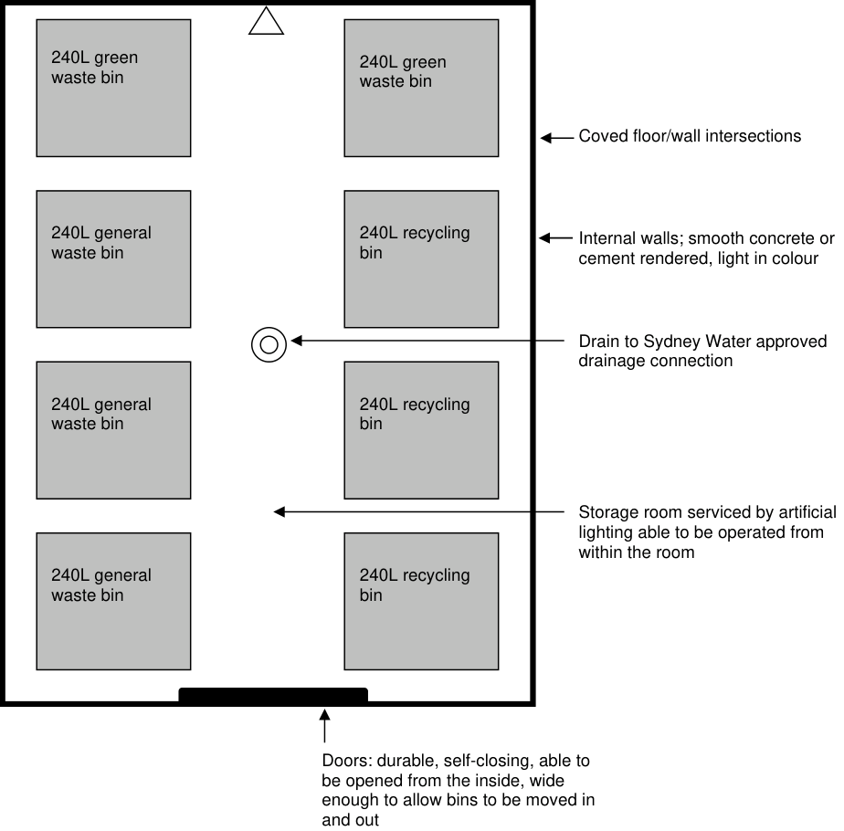
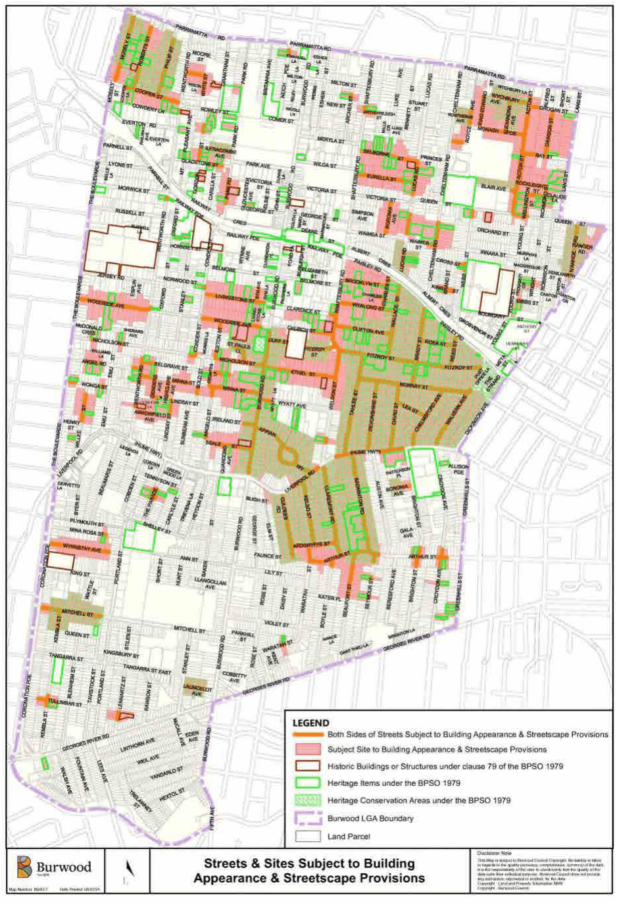
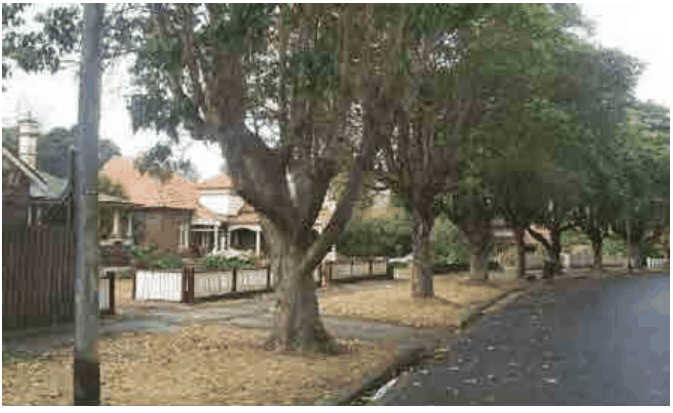
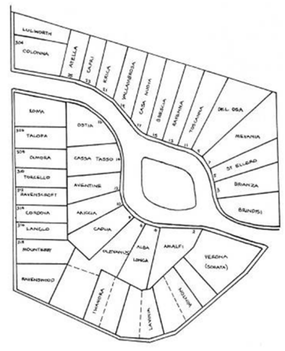
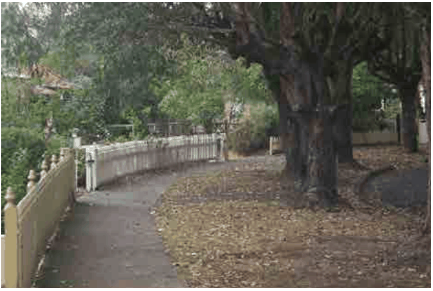
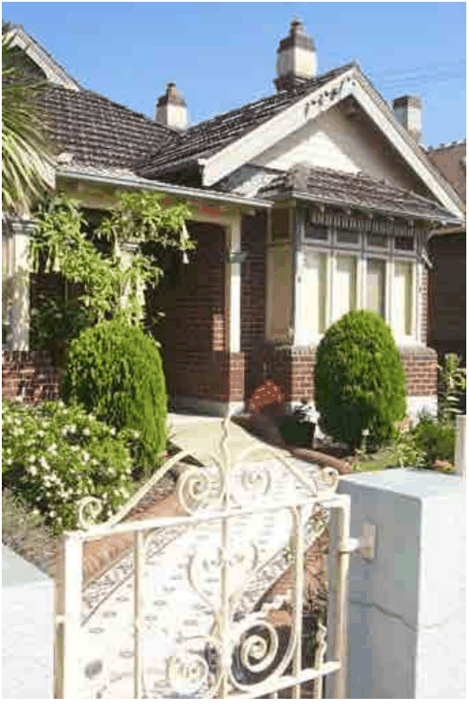
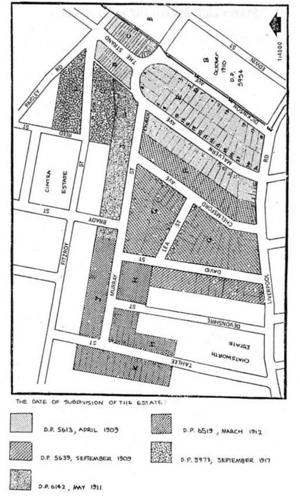
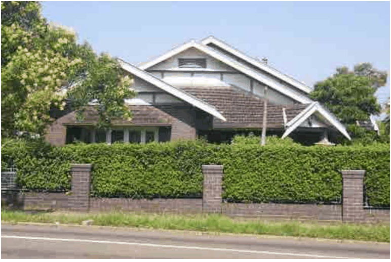

## 8         Appendices

### 8.1 Waste Management (Relates to Section 6.2)

#### 8.1.1 Residential Bin Measurements

| Bin Type | Height (mm) | Depth (mm) | Width (mm) |
|---|---|---|---|
| 120 litre | 945 | 620 | 535 |
| 240 litre | 1100 | 740 | 580 |
| 660 litre | 1220 | 640 | 1340 |

Shape of Council’s 120L and 240L bins.

Diagram: Better Practice Guide for Waste Management in Multi-Unit Dwellings, Resource NSW, 2002.

#### 8.1.2 Waste/Recycling Storage Rooms/Areas

This appendix applies to Development Applications for multi dwelling housing, residential flat buildings, commercial development, public buildings and industrial development which include waste/recycling storage rooms.

Waste/recycling storage rooms/areas must be constructed in accordance with the requirements of the Building Code of Australia (BCA)

Location and Appearance

Waste/recycling storage rooms must be integrated into the design of the overall development. It is preferable that such rooms be located behind the front building line. Wherever possible, the room should be in a basement location within the main building envelope (not a stand alone structure). Building materials and finishes which are visible from outside should be similar in style and quality to the external materials used in the rest of the development. Waste/recycling storage rooms must be located and designed in a manner which reduces adverse impacts on residents of any dwellings on the site and neighbouring properties. The location and design of the room should minimise adverse impacts regarding:

i. Location of the room to any dwellings

### 8.1 Waste Management

ii. Visibility of the room

iii. Noise generated by any equipment located within the room

iv. Noise generated by movement of the bins to and from the collection point

v. Noise generated by collection vehicles accessing the site

vi. Odours associated with the storage room

Size

Waste/recycling storage rooms/areas must be of adequate size to accommodate all waste and recycling bins associated with the development Multi dwelling dwellings and residential flat buildings, the waste/recycling storage room must be able to accommodate bins as described in section 3.2.3 Non-residential development, the waste/recycling storage room must be able to accommodate separate general waste bins and recycling bins which are able to contain the quantity of waste generated between collections.

Layout

Within waste/recycling storage rooms, containers used for the storage of recyclable materials should be separate from general waste storage containers, to reduce the potential for contamination of recyclable material. The storage room/areas floors and any associated access ways must be sufficiently level so that access for the emptying of containers can occur in accordance with WorkCover NSW occupational health and safety requirements.

Access: Waste/Recycling

If on-site emptying of residential bins is to occur, the development must be designed to allow for access by collection vehicles. The development must allow the collection vehicle to enter and exit the site in a forward direction and not impede access to, from or within the site. The design of the development must allow for vehicle access to the site for the collection of non-residential waste, by the nominated waste contractor. The development must allow the collection vehicle to enter and exit the site in a forward direction and not impede access to, from or within the site. Access driveways to be used by collection vehicles must be designed to be strong enough to support the vehicles. If on-site emptying of the bins is to occur, the servicing arrangements must be compatible with the operation of any other loading/unloading facilities on-site. The emptying of waste/recycling storage containers must be able to occur in accordance with WorkCover NSW occupational health and safety requirements.

Access: General

In multi dwelling dwellings and residential flat buildings there must be an unobstructed and uninterrupted access way (as per Australian Standard 1428) to:

i. Entry to any adaptable housing (refer to Australian Standard 4299)

ii. Main entrance to each residential flat building

iii. Point at which the bins are collected

### 8.1 Waste Management

When a proposal does not comply with these requirements, Council will consider alternative proposals which seek to achieve a reasonable level of access to waste/recycling storage areas or rooms.

In commercial development, public buildings, and industrial development there must be convenient access from each tenancy to the waste/recycling storage room/s. There must be step free access between the point at which bins are collected and emptied and the waste/recycling storage room/area. The storage room is not to be accessible to the general public Vermin must be prevented from entering the room

Surfaces

Waste/recycling storage rooms must have a smooth, durable ceiling, smooth concrete floor at least 75mm thick and smooth concrete or cement rendered walls. The floor/wall intersections must be coved. All internal surfaces must be light coloured.

Doors

Doors to waste/recycling rooms must be self-closing. If a roller door is to be used, there must be a sign adjacent to the door on the outside of the room which indicates that the door is to remain closed at all times when not in use. All doors are to be openable from both inside and outside the room. Doors need to be wide enough to allow bins to be moved in and out of the storage room.

Ventilation

Waste/recycling storage rooms should be naturally ventilated by ventilation openings or mechanically ventilated by a system which is isolated from mechanical ventilation systems servicing any other part of the building.

Services

The waste/storage rooms must be serviced by water from a tap located within the room. Residential developments must have a tap supplying cold water. Non-residential developments the tap must provide hot and cold water through a centralised mixing valve. The tap must be protected from the waste containers and must be located in a position which is easily accessible when the storage room is filled with waste containers. The floor must be graded to direct any water to a Sydney Water approved drainage connection located within the storage room Waste/recycling storage rooms must be serviced by artificial lighting which can be operated from within the room.

Signage

Waste/recycling storage rooms must include signage which clearly describes the types of materials which can be deposited into recycling bins, general waste bins and greenwaste bins.

Management

The waste/recycling bins must be cleaned and maintained regularly. Waste/recycling containers must be washed in an area which drains to a Sydney Water approved drainage connection.

### 8.1 Waste Management

Example of a waste/recycling storage room for a residential flat building containing six dwellings.

Tap with hose fitting

> [Picture on page 4: a map, saved as a picture (images/section-08-appendices-page-4-4.gif, 150 dpi); the street names and other small labels are on the picture.]
> Labels printed on the map (copied from the PDF, in no particular order):
> 240L green · waste bin · 240L green · waste bin · 240L general · waste bin · 240L recycling · bin · 240L general · waste bin · 240L recycling · bin · 240L recycling · bin · 240L general · waste bin

Coved floor/wall intersections

Internal walls; smooth concrete or cement rendered, light in colour

Drain to Sydney Water approved drainage connection

Storage room serviced by artificial lighting able to be operated from within the room

Doors: durable, self-closing, able to be opened from the inside, wide enough to allow bins to be moved in and out

#### 8.1.3 Private Property Access Arrangements

Council collects waste which is generated by residential land uses – including general waste, recycling and greenwaste.

At a development, where Council collectors and/or vehicles are required to enter the site for the purpose of collecting waste, Council will set certain conditions upon the consent of the development.

These conditions usually require the registration of an instrument (under sections 88B and E of the Conveyancing Act 1919) upon the title of the affected property. The instrument would set out the terms and conditions of the easement, positive covenant and restriction on the use of the land.

### 8.1 Waste Management

The terms of the right of carriageway would generally be:

1\. full and free right for the Authority Benefited, its employees, contractors and every person authorised by it, to, at all times:

(i) go, pass, re-pass and stand upon the Lot Burdened for the purpose of the removal of general waste, recyclable products and greenwaste products with or without vehicles

(ii) enter upon the Lot Burdened and remain there for a reasonable time for the purpose of the removal of general waste, recyclable materials and greenwaste products

2\. The owner of the Lot Burdened cannot make any claim against the Authority Benefited for any repairs or damage caused to the Lot Burdened as a result of the Authority Benefited exercising its right as set out in clause (1).

3\. the owner of the Lot Burdened indemnifies the Authority Benefited, its employees, contractors and persons authorised by it, against any future claim for damage or loss as a result of the Authority Benefited removing general waste, recyclable materials and greenwaste products from the Lot Burdened, except to the extent that such damage or loss is a result of the negligence of the Authority Benefited, its employees, contractors or persons authorised by it.

#### 8.1.4 Garbage Chutes

Chute Design

garbage chutes must be constructed in accordance with the requirements of the Building Code of Australia (BCA) garbage chutes must be located and insulated in a manner which reduces noise impact upon dwellings chutes, service openings and charging devices must be constructed of material (e.g. metal) which is smooth, durable, impervious, non-corrosive and fire resistant chutes, service openings and charging devices must be easy to clean chutes must be cylindrical and should be of at least 500mm there must not be any bends (or sections of reduced diameter) in the main shaft of the chute internal overlaps in the chute must follow the direction of the waste flow chutes must be deposit garbage directly into a bin or compactor located in a waste/recycling storage room A cut-off device must be located at or near the base of the chute so that the bottom of the chute can be closed when the bin or compacting device at the bottom of the chute is withdrawn or being replaced. The upper end of a chute should extend above the roof line of the building The upper end of a chute should be weather protected in a manner which doesn’t impede the upward movement of air out of the chute.

Service Room Design

The service opening (for depositing waste into the main chute) on each floor of the building must be located in a dedicated service room

### 8.1 Waste Management

The charging device for each service opening must be self closing and must not project into the main chute Branches connecting service openings to the main chute are to be no more than 1m in length Each service room must include containers for the storage of recyclable materials. Signage regarding the materials which can be recycled should be displayed near these containers Each service room must be located for convenient access by users and must be well ventilated and well lit. The floors, walls and ceilings of service rooms must be finished with smooth, durable materials which are easily cleaned Service rooms must include signage which clearly describes the types of materials which can be deposited into the garbage chute and the types of materials which should be deposited into recycling bins

Management

Garbage chutes are not to be used for the disposal of recyclable materials. Signage to this effect should be displayed near service openings. Regular maintenance and cleaning of garbage chutes and any associated service rooms, service openings and charging devices Arrangements must be in place for the regular transferral of recyclable materials (which are stored in service rooms) to main waste/recycling storage room.

> [Picture on page 6: a picture, saved as a picture (images/section-08-appendices-page-6-23.gif, 150 dpi).]

Example of a garbage chute system

Diagram: Better Practice Guide for Waste Management in Multi-Unit Dwellings, Resource NSW, 2002.

### 8.1 Waste Management

Waste Compactors

The installation of waste compaction equipment would not normally result in a reduction in the amount of space which is required to be provided for the storage of waste/recycling bins

Compactors are used to compress waste (and/or recyclable material) so that its volume is reduced. The compacted waste is then deposited into collection containers. The compaction ratio is typically set at around 2:1 (so that after the waste has been compacted it occupies approximately half as much space as it did before compaction). Higher compaction ratios are typically not used as they can result in overly heavy bins. Compactors usually deposit waste directly into a bin.

Compactors are useful for the mixed garbage, cardboard/paper and plastic/aluminium containers. They are less useful for steel and should not be used for glass. Compactors require regular maintenance. Those systems fed from a chute can be prone to blockages or failure of the electronic device, which can result in garbage overflowing or backing up the chute.

#### 8.1.5 Commercial/Industrial Waste/Recycling Storage Area

This appendix applies to applications for commercial development and industrial development which include waste/recycling storage areas.

Building Code of Australia

Waste/recycling storage areas must be constructed in accordance with the requirements of the Building Code of Australia (BCA).

Location and Appearance

Waste/recycling storage areas must be integrated into the design of the overall development. Materials and finishes which are visible from outside should be similar in style and quality to the external materials used in the rest of the development. Waste/recycling storage areas must be located and designed in a manner which reduces adverse impacts on neighbouring properties and the streetscape. The location and design of the areas should minimise adverse impacts associated with:

i. Proximity of the area to dwellings

ii. Visibility of the area

iii. Noise generated by any equipment located within the area

iv. Noise generated by the movement of bins into and out of the area

v. Noise generated by collection vehicles accessing the site

vi. Odours emanating from the area

Size

Waste/recycling storage rooms/areas must be of adequate size to accommodate all waste and recycling bins associated with the development Waste/recycling storage areas must be able to accommodate separate general waste bins and recycling bins which are of sufficient volume to contain the quantity of waste generated (at the rate described).

### 8.1 Waste Management

Layout

The storage room/areas floors and any associated access ways must be sufficiently level so that access for the emptying of containers can occur in accordance with WorkCover NSW occupational health and safety requirements. Within waste/recycling storage rooms containers used for storage of recyclable materials should be kept separate from (but close to) general waste containers, so that the potential for contamination of recyclable materials is minimised.

Access: Waste/Recycling

The development must be designed to allow for access by collection vehicles used by the nominated waste contractor. Where possible the site must be designed to allow collection vehicles to enter and exit the site in a forward direction and so that collection vehicles do not impede general access to, within or from the site. Access driveways to be used by collection vehicles must be of sufficient strength to support such vehicles. Arrangements for the purpose of emptying waste/recycling storage containers must be compatible with the operation of any other loading/unloading facilities on-site. Access for the purpose of emptying waste/recycling storage containers must be able to occur in accordance with WorkCover NSW occupational health and safety requirements.

Access: General

In commercial development, public buildings and industrial development, there must be convenient access from each tenancy to the waste/recycling storage areas. There must be step-free access between the point at which bins are collected/emptied and the waste/recycling storage areas The waste/recycling storage area is not to be accessible to the general public. Vermin must be prevented from entering the waste/recycling storage area

Surfaces

Waste/recycling storage area must have a smooth, durable floor and must be enclosed with durable walls/fences which extend to the height of any containers which are kept within.

Doors/Gates

Doors/gates to waste/recycling storage areas must be durable. There must be a sign adjacent to the door/gate which indicates that the door/gate is to remain closed at all times when not in use. All doors/gates are to be openable from both inside and outside the storage area and must be wide enough to allow the bins to be moved in and out.

Services

Waste/recycling areas must be serviced by hot and cold water provided through a centralised mixing valve. The tap must be protected from the waste containers and must be located in a position which is easily accessible when the area is filled with waste containers. The floor must be graded so that any water is directed to Sydney Water approved drainage connection located upon the site.

### 8.1 Waste Management

Signage

Waste/recycling storage areas must include signage which clearly describes the types of materials which can be deposited into recycling bins and general garbage bins.

Management

Regular maintenance and cleaning of waste/recycling storage areas. Waste/recycling containers must only be washed in an area which drains to a Sydney Water approved drainage connection.

#### 8.1.6 Waste/Recycling Generation Rates

| Type of Premises | Waste Generation | Recycling Generation |
|---|---|---|
| Backpackers’ accommodation | 40L /occupant space/week | 20L /occupant space/week |
| Boarding house Guest house Co-living housing | 60L /occupant space/week | 60L /occupant space/week |
| Food premises: Butcher Delicatessen Fish shop Greengrocer Restaurant, Café Supermarket Takeaway food shop | 80L /100 sqm floor area/day 80L /100 sqm floor area/day 80L /100 sqm floor area/day 240L /100 sqm floor area/day 10L /1.5 sqm floor area/day 240L /100 sqm floor area/day 80L /100 sqm floor area/day | Variable Variable Variable 120L /100 sqm floor area/day 2L /1.5 sqm floor area/day 240L /100 sqm floor area/day Variable |
| Hairdresser, Beauty salon | 60L /100 sqm floor area/day | Variable |
| Hotel Licensed club Motel | 5L /bed space/day 50L /100 sqm bar area/day 10L /1.5 sqm dining area/day | 1L/bed space/day 50L /100 sqm bar area/day 50L /100 sqm dining area/day |
| Offices | 50L /100 sqm floor area/day | 10L /100 sqm bar area/day |
| Retail (other than food premises): Shop less than 100 sqm floor area Shop greater than 100 sqm floor area | 50L /100 sqm floor area/day 50L/100 sqm floor area/day | 25L /100 sqm floor area/day 50L/100 sqm floor area/day |
| Showroom | 40L /100 sqm floor area/day | 10L /100 sqm floor area/day |

8.2 Streets and Sites Subject to Building Appearance and Streetscape Provisions

### 8.2 Streets and Sites Subject to Building Appearance and Streetscape Provisions (Relates to Section 4.5)

> [Picture on page 10: a picture, saved as a picture (images/section-08-appendices-page-10-4.gif, 150 dpi).]

### 8.3 Appian Way – Assessment of Significance

### 8.3 Appian Way – Assessment of Significance (Relates to Section 4.7)

The Conservation Area is one of the finest examples of intact Federation Queen Anne housing and streetscape, listed by the National Trust of Australia (NSW) as:

“Probably the finest Edwardian bungalow precinct in Sydney. By virtue of its architectural cohesiveness, idyllic landscaped environment of street and allotment alike with community related sports reserve, this development sets a high standard by today’s criteria”. (National

> [Picture on page 11: a picture, saved as a picture (images/section-08-appendices-page-11-8.gif, 150 dpi).]

Trust, 1977)

#### Figure 99. A typical view in the Appian Way.

#### Criterion 1: Historical Significance

It is a personal and individual interpretation of the architectural styles of the early 1900’s by George Hoskins and builder/designer William Richards.

Suggested early precedents include 1869 Emery Childs’ Riverside (1600 acres) and residential suburbs in Chicago Illinois by Frederick Law Olmstead and Calvent Vaux, with informally curved roads, tree lined streets and links to open spaces. Concepts of physical and social qualities. Olmstead referred to ‘Happy tranquillity’.

The Hoskins Estate was much more modest than Riverside but the similarities are clear. Other possible influences could have been the first Garden Suburbs in England at Bedford Park 1876 and in Bournemouth.

Ebenezer Howard published a book “Garden Cities for tomorrow” in 1897 promoting integration of recreational and residential areas. Hoskins inclusion of a recreational area may be an idea taken from the Haberfield Estate development of R. Stanton with its provision of recreational facilities including lawns and a community meeting pavilion.

There was no regulation regarding sub-divisions in NSW until 1906.

Although William Richards had migrated from England the designs in the Appian Way are said to be based mainly on local Australian Architecture.

### 8.3 Appian Way – Assessment of Significance

#### Criterion 2: Aesthetic Significance

The area is a rare Federation Queen Anne (sometimes referred to as Edwardian Bungalow) precinct of architectural and constructional excellence.

It represents an almost intact, complete Federation streetscape (though not strictly in Federation style) and is a unique part of the development of Sydney with exceptionally generous landscaped settings of high quality.

> [Picture on page 12: a picture, saved as a picture (images/section-08-appendices-page-12-8.gif, 150 dpi).]

#### Figure 100. The property names of the Hoskins Estate

The ideas that influenced Richards’ design of Hoskins Estate Houses were those of the Federation Queen Anne Style popular from the early 1890s to the start of World War One. The essential character the houses of the estate are related to intersecting gabled roofs, verandahs integrated with the house under the same roofline and turned timber verandah posts.

Generally, the houses are of complex, asymmetrical form, being dominated by extensive verandahs and prominent, irregular rooflines.

The verandahs often have a corner emphasis and as the houses are placed on wide allotments, they tend to feature carefully designed and executed side elevations as well as street façades.

Some roofs incorporate small ornamental turrets. The square turrets of “Vallambrosa”, “Capri” and “Talofa” were positioned above entrance halls and the polygonal turret of “Alba Longa” visually reinforces the shape of the verandah below. The only functional turret is at “Verona”, where the turret encloses a small room.

### 8.3 Appian Way – Assessment of Significance

The interior of the houses are large with many rooms and involved plans based predominantly on the central hallway concept, which had long been the traditional arrangement in house planning. Consequently, all the rooms are clearly defined and linked by corridors, rather than adopting open living spaces.

The Appian Way houses were designed so that their residents would be able to view the recreation ground from their front verandahs. The allotments within Hoskins Estate are generally large, and consequently the gardens are extensive. The width of some allotments has resulted in gardens that virtually surround the houses on all sides, and the houses do not encroach closer than at least three metres to the boundaries of their allotments.

The houses have been positioned so that substantial landscaping was provided at both front and rear of the building.

The gardens of the Federation period possessed an individual character and their essence was a reliance on expanses of trim lawns and isolated individual shade trees and shrubs scattered in small informal beds. Rows of small shrubs were planted in narrow beds surrounding the houses and also along the borders of the allotments.

The trees and shrubs used in the gardens have changed over the years, but the original plantings were probably a combination of Australian natives and exotic species.

“Mounterey” has a garden dominated by small palms. In general, Federation gardens tended to use shrubs rather than massed flowerbeds.

> [Picture on page 13: a picture, saved as a picture (images/section-08-appendices-page-13-22.gif, 150 dpi).]

Figure 101. Low picket fences and many shrubs in front gardens characterise the Appian Way

#### Conservation Area

Previously, the road extended to the footpath providing a more informal edge.

The lots are large and houses are set well back, hence there are large front gardens. Today, these have neat lawns, with shrubs placed to complement the houses, e.g. tall thin trees in front, such as pines, with larger shrubs such as hydrangea ‘softening’ the buildings.

Some gardens have rose beds along the front fences and driveways. The houses originally had shaped flowerbeds, as evident from old photographs. These have been replaced with

### 8.3 Appian Way – Assessment of Significance

lawn. The gardens have their boundaries defined by fences, paths and driveways. On larger blocks, these are curved and extend up to the house.

Within the gardens were features such as small summerhouses and lattice screens. Several gardens included private tennis courts such as at “Colonna” and “Amalfi”. The overall treatment of the gardens indicates that the outdoor environment was an essential part of a resident’s lifestyle.

Another aspect in the landscaping of the estate is the treatment of the roads and recreation

area. The edges of the Appian Way were informal because the trees grew between the pavement kerb and the road. Thus a soft line of soil, gravel, grasses and fallen leaves bordered the road. This situation remains around the recreation area, but on the opposite side the kerb has been moved out past the trees, creating a hard edge. The street trees are box brush, which are part of the original plantings.

All the fences on the estate were timber pickets, and the many that remain indicate that there was considerable diversity in the detailing of the fences.

The recreation area was essentially mown and rolled grass courts, but some shrubs were planted around the pavilion. The pavilion itself is of timber and iron roof construction and includes dressing rooms and an open verandah with a bench for participants and spectators to rest or shelter.

#### Criterion 3: Research Significance

The area comprises a very unusual and discrete form of garden suburb incorporating the ideas of the builder and owner, in particular the idea of leasing the houses to maintain control over the area. It is rare because no two allotments are the same shape or size, with complex free standing designs quite different from the average urban street.

#### Criterion 4: Social Significance

It was the product of the vision and desire of George Hoskins to create an ideal suburban environment.

The Conservation Area is rare because of its unique form, which is centred on a social ideal celebrated in the form of the central recreational area and facility. The estate and its houses provide an insight into both the period of its development and the people who lived in it.

Again a probable precedent was at Riverside where Olmstead and Vaux sought to provide a higher quality social environment.

The streetscape was designed ‘to suggest and imply leisure contemplativeness and happy tranquillity’, ‘a character of informal village greens, commons and playgrounds’.

In the 19th century, leased accommodation was usually at the low end of the market with small houses or terraces. Leasing houses on the Appian Way was unusual, as the houses were large in size and number.

Hoskins also, unusually, maintained a continuous involvement in the estate. A recreation reserve was created in the middle of the Appian Way, with the subdivision. It was originally a croquet green, lawn bowling green and lawn tennis court, to provide opportunities for recreation of all ages. In 1909 the area became 3 tennis courts. A registered company was formed I 1913 – the Appian Way Recreation Club Limited – with the shares subscribed for by

### 8.3 Appian Way – Assessment of Significance

residents of the estate with George Hoskins, a resident, the major shareholder and controller. The Recreation Club leased the recreation area to the Appian Way Tennis Club.

In 1929, the Hoskins’ Estate Company decided to sell the recreation area. However, a local resident formed a new company and residents subscribed to shares, although today not all shareholders are residents.

#### Statement of Significance

A rare Edwardian ‘garden city’ bungalow precinct with excellent Federation Queen Anne and at least one Federation Arts and Crafts architectural and landscape detail, largely intact streetscape, around an unusual and beautifully landscaped oval containing a resident-owned recreational and sporting facility.

The design and construction of the estate was based on a vision of suburban utopia of its owner George Hoskins who was instrumental in developing the steel industry in NSW.

The concept for the design was based on ‘Garden City’ ideas being developed in England and the USA at the time, for example, ‘Riverside’ in Chicago by Frederick Law Olmstead and Vaux and “Bedford Park”, “Port Sunlight” and “Letchworth” in England designed by Barry Parker and Raymond Unwin springing from the ‘Picturesque Landscaping Movement’ of the 18th Century in England.

#### References

The development of the Hoskins Estate Burwood. P. Clements. C19.101 Advanced Study Report. Department of Architecture, University of Sydney. 1978.

### 8.4 Malvern Hill – Assessment of Significance (Relates to Section 4.7)

The land around Croydon Station was originally part of two estates owned by Samuel Dickenson (The Hall) and Captain G A Murray (The Lea). Both men died in the early 1900s and the land was sold to the Intercolonial Land Investment & Building Company Limited, a prominent development company at the time.

Croydon was a desirable area for a residential subdivision, designed for the middle class. There was a railway service (Croydon Station had opened in 1875) and a steam tram operated along Liverpool Road. Educational, religious and hospital services were located nearby. This, in combination with close proximity to the city and a hill top location, enabled the area to compete favourably with the attractions of land along the north shore line.

The Malvern Hill Estate was formed in the early 1900s when the two large estates were subdivided. A “model” suburb was developed of wide streets, with drainage incorporated. A covenant was placed on the subdivision, requiring all buildings to be of brick and stone with slate or terracotta tile roofs, and allowing no semi-detached or terrace houses. The streets were planted with trees popular in the period, such as palms. The “garden suburb” idea of leafy streets and gardens within a self-contained estate was followed.

The Malvern Hill Estate is of special importance in the history of Burwood. Along with the Appian Way, it is a key part of what distinguishes Burwood for the surrounding area. Possessing some affinities with Haberfield, it is a fine and highly intact Federation/California Bungalow area with consistent and cohesive streetscapes of substantial detached housing. Malvern Hill has connections with numerous important Sydney people, as set out below. The design of new suburbs was influenced by the increased interest in Town Planning. British concepts such as the Garden Suburb Movement and “model” suburbs were translated into the Australian Garden Suburb.

The Garden Suburb is characterised by special areas for residential and commercial uses, the erection of freestanding residences with gardens, wide tree-lined streets and parks and reserves. Rear lanes and right-of-ways became redundant with the introduction of the sewerage system and the provision of side access between dwellings. The new estates were designed to contrast to the “slums” of terrace housing in the city.

Other examples of garden suburbs include Haberfield, Daceyville and Cremorne. Parts of Burwood, for example, the Appian Way, were also influenced by these ideas.

The houses in Malvern Hill were built from 1909 to the late 1920s. The dominant styles are Federation and California Bungalow. A variety of house designs exist, as Federation was a nationalistic interpretation by individual architects and builders, often with a combination of elements from previous historical periods and styles.

The Federation style houses are characterised by red and purple-brown or red-brown brickwork, often highlighted with contrasting darker blue bricks, moulded bricks and tuck-pointing, with sandstone base. Bay windows and timber column supported verandah often featured shingles and timber framework.

Steeply pitched roofs of unglazed terracotta Marseilles tiles or slate were most common and usually incorporated ornamental terracotta ridge cappings, complex hipped roofs and gables with decorative finials and tall chimneys.

> [Picture on page 17: a picture, saved as a picture (images/section-08-appendices-page-17-1.gif, 150 dpi).]

#### Figure 102. A good example of a Federation style house

#### Criterion 1: Historical Significance

By 1915, the increasing influence of American architecture was becoming evident in domestic architecture with the introduction of the California Bungalow style. The newer California Bungalow style was characterised by low-pitched roofs with squat chimneys and wide overhanging eaves, simple bold forms, dark brick and roughcast walls and massive brick or stone pylons supporting a deep porch.

In turn Art Nouveau motifs appear in Bungalow fretwork, leadlights of the windows and tile patterns as abstracted plant designs. In addition, Australian symbols were sometimes found in details such as leadlight windows depicting kookaburras, waratahs, etc.

In 1909, the Sydney based surveying firm Atchison & Schleicher were engaged to create a 61-acre (24.6-hectare) subdivision. The estate was developed under the provisions of the newly introduced Local Government Act, 1906. This set standards that resulted in wide tree-lined streets and large and well-drained building allotments.

The Post Office (opened 1913) was the first building in The Strand. Development continued until 1920. The subdivisions of Malvern Hill were in these sections (refer to Figure 103): The Strand and Malvern Avenue/Dickinson Avenue: April 1909 Malvern Avenue/Chelmsford Avenue/Lea Street/David Street: September 1909

Murray Street (between The Strand and Brady Street): May 1911 Murray Street (from Brady Street to Tahlee Street) and Tahlee Street: March 1912 Fitzroy Street: September 1917

#### The Strand

The Strand shopping centre, developed between 1913 and 1920, also contributes to the Federation character of the area. It was designed as a broad and elegant shopping street and promenade leading to the residential areas.

The shops in The Strand developed from 1913, starting on the western side (completed in

1913\) with no shops on the eastern side until 1917 (being nos. 12-26), the balance completed by 1929. Shop façades are modulated, with repetition of structural bays and parapets, unified by a suspended awning at the same height. Above the awning are simple brick façades, with recessed balconies (behind semi-circular brick arches) and/or panel windows. Usually, the shops are in groups of three with slight variations in detailing of parapets etc., between each group. Below the awning the original shop front consists of a large display window, timber surrounds with decorative glass toplight and glazed-ceramic tiles (green, crimson, burnt gold with Art Nouveau motifs). The entrance was generally to one side with mosaic tiling to the porch. Later shops featured brass surrounds and some displayed recessed central door entries.

#### Criterion 2: Aesthetic Significance

A feature of the estate that contributes to its cohesive nature was that a building covenant was stipulated. All residences had to be detached houses built of brick or stone. Roofs were to be slate, shingles or terracotta tiles. No more than one dwelling per lot was allowed. The buildings other than the shops could be no closer than 20 feet (6 metres) to the street.

Gas mains and sewerage were provided to every allotment.

The allotments were sold by auction from 1909. By the 1920s, the residential character was established. The houses range from cottages to larger cottage-villas, to two storey houses built on double blocks. The houses were built by private owners and speculative builders. The result is a variety of house styles and sizes in Federation and California Bungalow forms.

The Malvern Hill Estate in Croydon lies approximately 11 kilometres west of the Sydney Central Business District. The extent of the original estate, the same as the conservation area, covers approximately 23 hectares of land south-west of Croydon Railway Station.

The dominant features in the Malvern Hill Estate are the wide roads, tree lined footpaths and cohesive streetscapes with skyline broken by Federation and California Bungalow style roofs, gables and chimney stacks on dwellings and an intact shopping strip.

The topography of the area is gently sloping to flat. The land slopes downwards to the north, from Liverpool Road to Murray Street. David Street and Chelmsford Avenue run south-west to north-east down the slope so are, in effect, on the side of Malvern Hill. The slope does create some variation in the views and townscape, but a “hill” in itself is not pronounced.

The alignment of Malvern and Dickinson Avenues and The Strand is an example of an interesting road form, of curved rather than the traditional gridiron street pattern. The Strand maintains the purpose of a formal avenue, which leads to the residential streets.

The skyline is dominated by street trees and the features of the houses such as chimney stacks, gables, ridge capping and rooftops of the two storey houses.

Malvern Hill is generally a residential area with a shopping centre adjacent to Croydon Railway Station. The area is described by the National Trust of Australia (NSW) as:

“a distinctive, highly cohesive area of good quality Federation period houses and shops, street planning and planting in streets and gardens. The area is significant as an early planned ‘model suburb’ and is one of the first examples of the successful application of local government development controls”.

> [Picture on page 19: a picture, saved as a picture (images/section-08-appendices-page-19-7.gif, 150 dpi).]

#### Figure 103. Subdivisions of the Malvern Hill Estate

The National Trust’s conservation area is larger and extends across the eastern boundary of the Burwood LGA (Dickinson Avenue) into the Ashfield LGA. However, about 90 per cent of the conservation area lies in Burwood.

The street trees, especially those associated with the Federation period, contribute to the character of the area. Examples of the original plantings are found in Lea Street and Chelmsford Avenue.

In Lea Street, the palms Phoenix Canariensis (Canary Palms) line the road. Burwood Council, in 1912, pioneered the planting of the trees as other varieties such as Camphor Laurels, interfered with electricity wires. Originally the palms were located on the roadway, as was commonly seen around the Burwood and Ashfield areas.

The decision to initially prepare a draft LEP was based on:

Malvern Hill is recognised by the National Trust of Australia (NSW) as a “classified” Urban Conservation Area and the houses in Malvern Avenue, Numbers 3-21 and 2-26 (excluding Numbers 11A and 6) form part of the Malvern Avenue Precinct.

Croydon Post Office and number 1 The Strand are also separately listed.

Representations made to Council by the Burwood and District Historical Society expressing concern for the need to ensure permanent protection of this Federation precinct.

The land around Croydon Station was originally part of two estates owned by Samuel Dickenson (The Hall) and Captain G A Murray (The Lea). Both men died in the early 1900s and the land was sold to the Intercolonial Land Investment & Building Company Limited, a prominent development company at the time.

Croydon was a desirable area for a residential subdivision, designed for the middle class. There was a railway service (Croydon Station had opened in 1875) and a steam tram operated along Liverpool Road. Educational, religious and hospital services were located nearby. This, in combination with close proximity to the city and a hill top location, enabled the area to compete favourably with the attractions of land along the north shore line.

The Malvern Hill Estate was formed in the early 1900s when the two large estates were subdivided. A “model” suburb was developed of wide streets, with drainage incorporated. A covenant was placed on the subdivision, requiring all buildings to be of brick and stone with slate or terracotta tile roofs, and allowing no semi-detached or terrace houses. The streets were planted with trees popular in the period, such as palms. The “garden suburb” idea of leafy streets and gardens within a self-contained estate was followed.

The Malvern Hill Estate is of special importance in the history of Burwood. Along with the Appian Way, it is a key part of what distinguishes Burwood for the surrounding area. Possessing some affinities with Haberfield, it is a fine and highly intact Federation/California Bungalow area with consistent and cohesive streetscapes of substantial detached housing. Malvern Hill has connections with numerous important Sydney people, as set out below.

The design of new suburbs was influenced by the increased interest in Town Planning. British concepts such as the Garden Suburb Movement and “model” suburbs were translated into the Australian Garden Suburb.

The Garden Suburb is characterised by special areas for residential and commercial uses, the erection of freestanding residences with gardens, wide tree-lined streets and parks and reserves. Rear lanes and right-of-ways became redundant with the introduction of the

sewerage system and the provision of side access between dwellings. The new estates were designed to contrast to the “slums” of terrace housing in the city.

Other examples of garden suburbs include Haberfield, Daceyville and Cremorne. Parts of Burwood, for example, the Appian Way, were also influenced by these ideas.

The houses in Malvern Hill were built from 1909 to the late 1920s. The dominant styles are Federation and California Bungalow. A variety of house designs exist, as Federation was a nationalistic interpretation by individual architects and builders, often with a combination of elements from previous historical periods and styles.

The Federation style houses are characterised by red and purple-brown or red-brown brickwork, often highlighted with contrasting darker blue bricks, moulded bricks and tuck-pointing, with sandstone base.

Bay windows and timber column supported verandah often featured shingles and timber framework. Steeply pitched roofs of unglazed terracotta Marseilles tiles or slate were most common and usually incorporated ornamental terracotta ridge cappings, complex hipped roofs and gables with decorative finials and tall chimneys.

A feature of the estate that contributes to its cohesive nature was that a building covenant was stipulated. All residences had to be detached houses built of brick or stone. Roofs were to be slate, shingles or terracotta tiles. No more than one dwelling per lot was allowed. The buildings other than the shops could be no closer than 20 feet (6 metres) to the street.

Gas mains and sewerage were provided to every allotment.

The allotments were sold by auction from 1909. By the 1920s, the residential character was established. The houses range from cottages to larger cottage-villas, to two storey houses built on double blocks. The houses were built by private owners and speculative builders. The result is a variety of house styles and sizes in Federation and California Bungalow forms.

The houses in Malvern Hill were built by a variety of architects and builders. The smaller, less elaborate houses in Murray Street, for example, would have been designed by builders, the larger cottages in Malvern and Dickinson Avenues, by architects as set out below. More detailed analysis of the work of these architects in Malvern Hill is covered in the late Phillip Clement’s study (“The Architecture of the Malvern Hill Estate”. 1981).

The most significant buildings in the estate are the large and elaborate Federation and Bungalow houses in Malvern and Dickinson Avenues. Some of these have individual merit and were mostly architect designed. The small builder-designed houses are meritorious as a group due to their cohesive character, rather than outstanding individual form.

Architects and Builders

The houses in Malvern Hill were built by a variety of architects and builders. The smaller, less elaborate houses in Murray Street, for example, would have been designed by builders, the larger cottages in Malvern and Dickinson Avenues, by architects as set out below. More detailed analysis of the work of these architects in Malvern Hill is covered in the late Phillip Clement’s study (“The Architecture of the Malvern Hill Estate”. 1981).

Building Character

The most significant buildings in the estate are the large and elaborate Federation and Bungalow houses in Malvern and Dickinson Avenues. Some of these have individual merit

and were mostly architect designed. The small builder-designed houses are meritorious as a group due to their cohesive character, rather than outstanding individual form.

Roofs

In Federation houses, the roofs are in complex forms, with exposed rafter ends and generally asymmetrical (Figure 104).

The original decorations included terracotta ridge capping and ornaments. As specified in the building covenant, the roofs were of slate or terracotta tiles. In bungalow houses, the roofs are lower pitched, less complex and often had exposed rafter ends. Gables and attic windows are features of some buildings in the area. Chimneys in Federation houses are brick or partially roughcast, with brick strapping decoration: they are tall and thick, whereas chimneys on bungalow houses are more squat and massive.

> [Picture on page 22: a picture, saved as a picture (images/section-08-appendices-page-22-12.gif, 150 dpi).]

#### Figure 104. Asymmetrical roof forms

Bricks

In Malvern Hill, the bricks are dark brown-purplish in colour or light brown. Darker bricks are used as highlights. Other materials include sandstone, for example, No 22 Malvern Avenue -sandstone verandah supports. Sandstone is also used beneath bay windows and as a house

base. Tuckpointing, or the filling in of brick joints with mortar for highlighting walls to the front elevation, was also popular.

Verandahs

Virtually all of the original houses in Malvern Hill have verandahs. In Federation style houses these are decorated with tessellated tiles and slate or marble edging, turned timber columns, timber railings and fretwork. The verandah was intended to be a useable outdoor space, an extension of the garden environment into the house. Bungalows also have verandahs but these have less timber decoration and are of a much larger scale.

Windows

The windows have timber frames and are a single unit or in banks and are vertical in proportion. They often have decorative leadlight panes, with art nouveau designs and/or coloured panes of glass.

Fences

The front fences in Malvern Hill vary between low brick, timber pickets and modern styles. The Federation houses often had picket fences, although these are less common in Malvern Hill and low brick fences, matching the house bricks, predominate. These often have rounded “bullnose” edges. California bungalows also had brick fences, with an infill of wrought iron panels in scroll patterns. Height/Storeys

The majority of houses are single storey, although some have steep roofs, with attic levels, for example, No 15 Malvern Avenue. The minority two storey houses are located mainly in Malvern and Dickinson Avenues, on larger blocks in the earlier subdivisions. There are a small number of modern houses in the area.

Garages/Carports

Most houses have car parking on site as well as adequate on-street parking. The garages have usually been located behind the building line to the rear of the sites as allotments were wide enough to allow for this. There are a few cases where carports have more recently been erected in front as well as to the side of houses.

The Strand

The façade, although partially altered with new windows to some premises, is still intact above street level. The terracotta tiled roofline is broken with gables. The balconies on the first floor are recessed with brick arches. These are intact at the northern end but are enclosed with rectangular aluminium windows at the southern end. In the centre, a shingled bay window projects out over the awnings (no. 11). The roofs are terracotta or slate and, in sections, have been replaced with new tiles but in sympathetic colours. There exists a parapet wall with contrasting dark brick strapping highlighting arches. Recessed brick arches, similar to those on the western side were originally unenclosed, but some now have windows.

The shop fronts on street level have been largely remodelled on both sides of The Strand. A few shops, for example, Numbers 16, 18, 26, 38, 42 and 50, have retained the original character of dark green or crimson ceramic tiled fronts, with art nouveau colours. The brass sashes around windows are also retained at Numbers 16, 18, 26 and 50.

Some shop steps have retained tessellated tile patterns, such as at Numbers 16, 18, 26 and 50.

Landscape

The compartmentalisation of the suburb was carried over to the gardens. Fences, hedges and paths defined the gardens and the house. These are a feature in Malvern Hill. There are paths, either curved or straight, leading across lawns of couch or buffalo grasses. The paths often feature decoratively coloured tessellated tiles.

The gardens tend to be in a formal style, with strategically placed trees and shrubs. These were planted to complement the houses’ architecture, for example, tall thin trees such as palms were located in front gardens and larger shrubs like frangipani or hydrangea placed

around the house to soften the edges. Often roses were located along front fences or adjacent to front paths. There may also have been shaped flower beds in the earlier gardens.

The street trees, especially those associated with the Federation period, contribute to the character of the area. Examples of the original plantings are found in Lea Street and Chelmsford Avenue.

In Lea Street, the palms Phoenix Canariensis (Canary Palms), being within the pavement area, line the road. Burwood Council, in 1912, pioneered the planting of the trees as other varieties such as Camphor Laurels, interfered with electricity wires. Originally the palms were located on the roadway, as is commonly seen around the Burwood and Ashfield areas. Improvements, however, have taken place recently and the footpath widened to include the palm trees. This has had the effect of narrowing the road pavement area.

The brush box trees along Chelmsford Avenue also contribute to the attractive character of the area.

Eucalypts in David Street, although not the original species planted, create a light leafy canopy.

Townscape and Streetscape

Any new two storey buildings, modern alterations to single storey houses or removal of original street trees and landscaping not only affects the cohesive character of the area when looking at individual houses, but destroys the character of the area when viewed overall.

#### Criterion 3: Research Significance

There are a number of future research opportunities in respect of the Malvern Hill Estate and Conservation Area, such as:

Connections to other garden suburbs in Sydney and overseas, show how elements were varied to suit Australian and New South Wales conditions. How was the Garden Estate or Subdivision made “self contained”? The effect of covenants placed on Malvern Hill Estate properties. What were the particular design elements of the Estate houses that attracted the “middle class” purchasers? The reasons for the particular species of trees selected for the Estate.

#### Criterion 4: Social Significance

From the late 1800s, optimism in Australia’s future was strong, culminating in the Federation of the States in 1901. There was prosperity in the building industry. Materials and tradesmen were freely available. Building techniques had advanced.

Unlike in the Victorian era when large commercial and government buildings were emphasised, the construction of new suburbs for the middle classes increased. A large rise in population resulted in urgent needs for housing. The spread of suburbs was assisted by the growth of public transport.

The Burwood and District Historical Society advises that: The Malvern Hill Estate is one of the earliest conservation areas in NSW and has been the subject of numerous studies, including the original Malvern Hill Conservation Study, carried out by Burwood Council staff in 1983, and architectural analysis of The Strand carried out by

Helen Lochhead and Steven Togher (date unknown) and an analysis of some houses by the late Philip Clements. The Malvern Hill Estate contains some of the earliest California Bungalows in Sydney and many of these are architect designed.

The area has connections with a number of important Sydney personages such as Sir Bertram Stevens, who lived in Malvern Avenue whilst Premier of NSW in the 1930s. The area contains a number of houses designed by architects such as Peddle and Thorpe, George Durrell, Donald Esplin, Kent Budden and Greenwell, Morrow and De Putron and William Kenwood.

Originally all streets were lined with Canary Island Date Palms (Phoenix Canariensis) of which only six survive in Lea Street. Despite the loss of palm trees, the area still has strong landscape qualities with mature plantings of plants such as palms, camphor laurels, crepe myrtles and frangipanis.

It has a database compiled from the building registers of Burwood Council that lists the builders and/or architects of nearly 150 of the houses and shops in Malvern Hill.

#### Statement of Significance

The Malvern Hill Estate is significant because together with the Appian Way and other conservation area in Burwood, it is a key part of what distinguishes Burwood from other parts of Sydney.

It is a highly intact relatively large area of quality Federation and California Bungalows on substantial blocks of regular size together with an integral neighbourhood shopping centre divided by wide tree lined streets presenting cohesive but varied streetscapes.

Malvern Hill has connections with a number of important Sydney people and a number of well-known architects as referred to previously.

The area’s particular scale and detail presents a highly desirable area for family living.

This Appendix contains a template for use in the preparation of a Plan of Management for a Boarding House or Co-Living Housing development.

The Plan of Management sets out the various requirements and responsibilities of management and lodgers and includes: Management Arrangement and Staff contact details Lease Agreements Council consent compliance details Furniture/ Equipment Fire Safety Cleaning/ Maintenance/ Gardening/ Pest Control Inspection and recording records Waste and Recycling Maximum Occupation Safety, Security and Amenity Neighbour Interaction/ Complaints Handling Maintenance of an Incidents Register Use of Kitchen/ Meals provision House Rules Parking Arrangement Emergency Evacuation Plan Requirements for keeping Council informed of any change in management

Note: Requirements may change from time to time, and consultation should be made with Council to ensure currency of requirements.

#### PLAN OF MANAGEMENT Boarding House/ Co-Living Housing

#### [INSERT ADDRESS]
