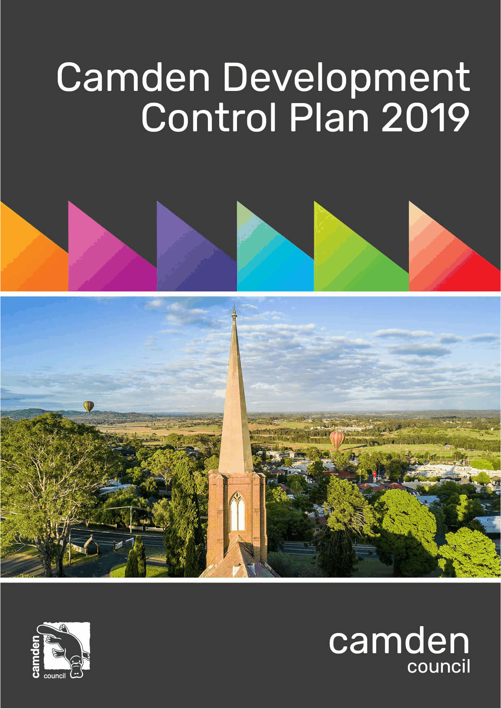

# Camden Development Control Plan 2019 - Appendix A and B

> This chapter is split into 2 section file(s), one per main heading, in the order they appear in the PDF.

Source PDF: [DCP-2019-Final-Appendix-A-B.pdf](DCP-2019-Final-Appendix-A-B.pdf)

> [Picture on page 1: a picture (the whole page), saved as a picture (images/appendix-a-and-b-page-1.gif, 150 dpi).]
> Words on this picture, read by OCR (may contain errors): Camden Development Control Plan 2019 Camden council

### Contents

Appendix A – Glossary

292

Appendix B – Landscape Design Principles and Submission Requirements

296

<!-- sections -->
## Sections

1. [Appendix A – Glossary](01-appendix-a-glossary.md)
2. [Appendix B – Landscape Design Principles and Submission Requirements](02-appendix-b-landscape-design-principles.md)
