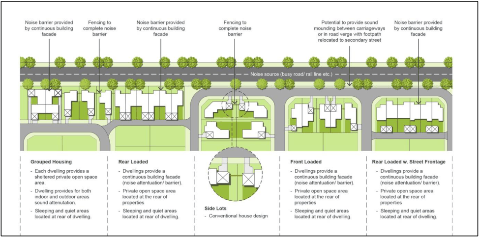
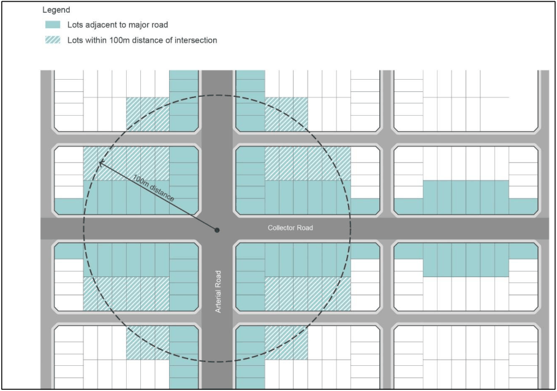

### 2.12 Acoustic Amenity

#### Background

Acoustic amenity in the community can be affected by a range of sources including, transportation (motor vehicles, aircraft, trains), industrial uses of all types and many commercial uses. This can not only be a potential annoyance, but at higher noise levels may also have health consequences.

A variety of mitigation strategies exist to reduce or manage sound levels and preserve the acoustic amenity of an area. This subsection seeks to establish criteria and detail acoustic design measures to minimise noise emissions that may arise from existing or proposed development.

#### Objectives

a. To minimise the impacts of noise from major transport infrastructure and commercial and industrial areas on residential amenity and other noise sensitive uses;

b. To achieve an acceptable noise environment whilst maintaining well designed and attractive streetscapes; and

c. To minimise the impacts of noise on sensitive receivers through subdivision layout and building design.

#### Controls

#### Acoustic Amenity (General)

1\. Acoustic reports (where required), must be prepared by a suitably qualified consultant. As a minimum an acoustic report must: identify receivers; determine background noise levels (where required); establish noise criteria; provide predicted noise levels (including relevant assumptions); assess potential impacts; and consider reasonable and feasible mitigation measures.

Council may consider a preliminary assessment from a suitably qualified acoustic consultant, justifying why an acoustic report is not required.

2\. Bedrooms, main living areas and principal private open spaces must be located away from noise sources (Refer to Figure 2-1).

3\. Noise attenuation measures must not adversely impact upon passive surveillance, active street frontages and energy efficiency.

4\. Residential plant and equipment must not generate a noise level greater than 5dBA above background noise level as measured at the boundary of a noise sensitive property during the hours of 7.00am to 10.00pm. Noise from plant and equipment must not be audible in habitable rooms of adjoining noise sensitive properties during the hours of 10.00pm to 7.00am.

5\. Physical noise barriers such as noise walls or solid fencing (other than earth mounds) are not generally supported along sub-arterial, transit boulevards or collector roads. Measures to attenuate noise through subdivision layout, building setbacks, building orientation, building design and materials selection should be implemented to achieve compliant noise levels.

6\. The use of physical noise barriers (i.e. noise walls or solid fencing) may be supported on arterial roads where it can be demonstrated that the following mitigation measures, in the listed order, are not able to adequately attenuate the noise source:

a. Locating less sensitive land uses between the noise source and the sensitive receivers;

b. Using the built form to act as noise barriers;

c. Optimising the subdivision layout to maximise shielding of principle private open space;

d. Incorporating noise mitigating building façade treatments and locating bedrooms, main living areas and principle private open space areas away from the noise source;

7\. Where noise barriers are required, they must be of a neutral recessive colour and design which blends in with the natural environment. In addition, barriers are to be screened from the road by a landscape strip of at least 1m.

> [Picture on page 28: a picture, saved as a picture (images/part-02-general-land-use-page-28-24.gif, 150 dpi).]

Figure 2-1: How to Mitigate Impacts from Road and Rail

#### Road and Rail Noise

i. Development applications for residential development and other noise sensitive uses such as places of public worship, hospitals, child care centres and educational establishments must be accompanied by an acoustic report where the development is:

j. adjacent to existing (or proposed) railway line, arterial, sub-arterial roads, transit boulevards; or

k. adjacent to a collector road that is within a 100m radius of the centre of the intersection the above roads (Refer to Figure 2-2).

Note: For all road developments the criteria should apply on the basis of the road traffic volumes projected for 10 years time.

> [Picture on page 29: a picture, saved as a picture (images/part-02-general-land-use-page-29-10.gif, 150 dpi).]

Figure 2-2: Noise from Road and Rail Noise

2\. Residential dwellings adjacent to an existing (or proposed) railway line, arterial road, sub-arterial road or transit boulevards, or collector roads that are within 100m of the centre of the intersection of those roads, are to be designed to minimise the impact of noise.

Non-residential buildings such as educational institutions, child care centres, places of worship, and hospitals are also required to be designed to minimise the impact of noise.

Both ‘residential dwellings’ and ‘non-residential buildings’ must comply with the internal noise criteria in ‘Table 3.1’ from the ‘Department of Planning: Interim Guideline – Development Near Rail Corridors and Busy Roads’.

Ventilation Requirements: If internal noise levels with windows or doors open exceed the criteria by more than 10dBA, the design of the ventilation for these rooms should be such that the occupants can leave windows closed whilst also meeting the ventilation requirements of the Building Code of Australia.

3\. The principle private open space or an equivalent area of useable open space of a dwelling within a new release area is not to exceed 57dBA LAeq (15hr) from 7am to 10pm.

Note: For clarification purposes, a new release area, includes land mapped as Urban Release Area within the CLEP 2010 and includes Growth Area Precincts that have been rezoned.

For dwellings in areas outside of the new release areas, the principle private open space area is to be attenuated to 55dBA LAeq (15hr) from 7am to 10pm.

Council may consider an increased decibel level where it can be demonstrated that the objectives of this policy are met and the above criteria is not able to be reasonably or feasibly achieved.

Note: The residential noise level criterion includes + 2.5 dBA allowance for noise reflected from the façade (‘facade correction’).

4\. Residential flat building developments are to meet the objectives of Part 4J of the NSW Department of Planning and Environment (or equivalent) - Apartment Design Guide to minimise potential impacts of road and rail noise through appropriate siting and layout of buildings, noise shielding and attenuation.

5\. Development applications for residential flat buildings are to document the noise mitigation measures that have been incorporated into the design.

6\. An area of communal open space is to be attenuated to 57dBA LAeq (15hr) from 7am to 10pm.

New and Upgraded Roads / Railway Lines and Traffic Generating Development near Residential and Other Sensitive Land Uses

1\. Where new and upgraded roads or traffic generating developments are proposed near residential and other noise sensitive land uses, acoustic assessments are to be undertaken in accordance with the NSW EPA Road Noise Policy.

2\. Where new and upgraded railway lines are proposed near residential and other noise sensitive land uses, acoustic assessments are to be undertaken in accordance with the NSW EPA Rail Infrastructure Noise Guideline (2013).

#### Aircraft Noise

1\. Any noise sensitive development, including but not limited to residential developments and schools, within the ANEF 20 contour (or higher) are considered to be potentially affected by aircraft noise and will require an acoustic assessment to be undertaken to demonstrate

compliance with Australian Standard 2021 – 2015 Acoustics – Aircraft Noise Intrusion – Building Siting and Construction.

Noise from Industrial Development or Commercial Development (including Community

#### Facilities and Religious developments)

1\. An acoustic assessment will be required for industrial and commercial development where the development:

a. Has the potential to impact on residences or noise sensitive receivers (defined as a LAeq, 15min level of more than background or more than the recommended amenity criteria within the NSW Environmental Protection Authority's Noise Policy for Industry (NPfI) minus 10 dB); or

b. Is located within a 100m radius from, or has a direct line of site of a distance of 150m to, residences or noise sensitive receivers; or

c. Proposes to operate anytime between 10pm and 6am.

2\. Noise emissions from industrial development must be assessed in accordance with the NSW EPA Noise Policy for Industry (NPfI).

3\. Noise emissions from commercial development must be assessed in accordance with the Noise Guide for Local Government and must be consistent with the methodology within the NSW EPA NPfI.

4\. Noise from the construction of industrial and commercial developments must be assessed and managed in accordance with the NSW Environmental Protection Authority’s Interim Construction Noise Guideline 2009.

Note: When commercial development is proposed on existing greenfield land and the surrounding land is expected to undergo significant land use change (described in section 2.4.3 of NPfI) the adoption of the ‘typical existing background noise levels’ applicable to ‘suburban residential’ from ‘Table 2.3’ of the NPfI  may be considered by Council for the assessment of the “Project Intrusive Noise Level.”

#### Noise from Child Care Centres and Educational Establishments

1\. Development applications for child care centres and educational establishments must be accompanied by an acoustic report.

2\. Child care centres and educational establishments are to be designed to not exceed the following noise levels:

a. LAeq (15 minutes) noise level from children in the outdoor areas of the site must not exceed the background LA90 sound level by more than 10dBA when measured at the boundary of the nearest or most affected residential premises (or if the boundary is more than 30 metres from a residential dwelling, at the most affected point within 30 metres of a residence).

b. LAeq(15 minutes) noise levels from all other operations (i.e. car park, plant) must not exceed the background LA90 sound level by more than 5dB(A) when measured at the boundary of the nearest or most affected residential premises.

Note: If there is an inconsistency between the SEPP (Transport and Infrastructure) 2021 (and Child Care Planning Guidelines) and the DCP, the SEPP will take precedence.

#### Noise from Licensed Premises

1\. Any music/entertainment and noise of patrons (whilst on-site) from a licensed premises, must be assessed in accordance with the noise emission criteria as follows:

a. The LA10,15min* noise level emitted from the licensed premises must not exceed the background noise level in any Octave Band Centre Frequency (31.5Hz – 8kHz inclusive) by more than 5dB between 7:00am and 12:00 midnight at the boundary of any affected residence.

b. The LA10,15min* noise level emitted from the licensed premises must not exceed the background noise level in any Octave Band Centre Frequency (31.5Hz – 8kHz inclusive) between 12:00 midnight and 7:00am at the boundary of any affected residence.

c. The LA10,15min* noise level emitted from the licensed premises when measured inside a habitable room of a residential premises between 12pm and 7am should not give rise to a measurable increase above the ambient level in any Octave Band Centre Frequency (31.5Hz

– 8kHz inclusive) in the absence of the music.

\* For the purposes of this condition, LA10 can be taken as the average maximum deflection of the noise emission from the licensed premises.

2\. A noise management plan must be submitted with the DA that addresses noise associated with patron departure in on site car parks or local streets, particularly after 10.00pm. Alternatively, noise reduction and mitigation measures (where required) must be addressed in a general plan of management for the premises.

#### Noise Attenuation of Public Open Space

1\. Public open space areas are to be designed to sensitively locate passive recreation areas away from noise sources without compromising the overall functionality of the area.

2\. Physical noise barriers (other than earth mounds) for public open space areas will not be supported.

#### Further Information

• Department of Planning and Environment - Apartment Design Guide

• NSW EPA Road Noise Policy

• Australian Standard 2021:2015 Acoustics – Aircraft Noise Intrusion – Building Siting and Construction

• NSW EPA Noise Policy for Industry (NPfI)

• Interim Construction Noise Guideline

• NSW EPA Noise Guide for Local Government

