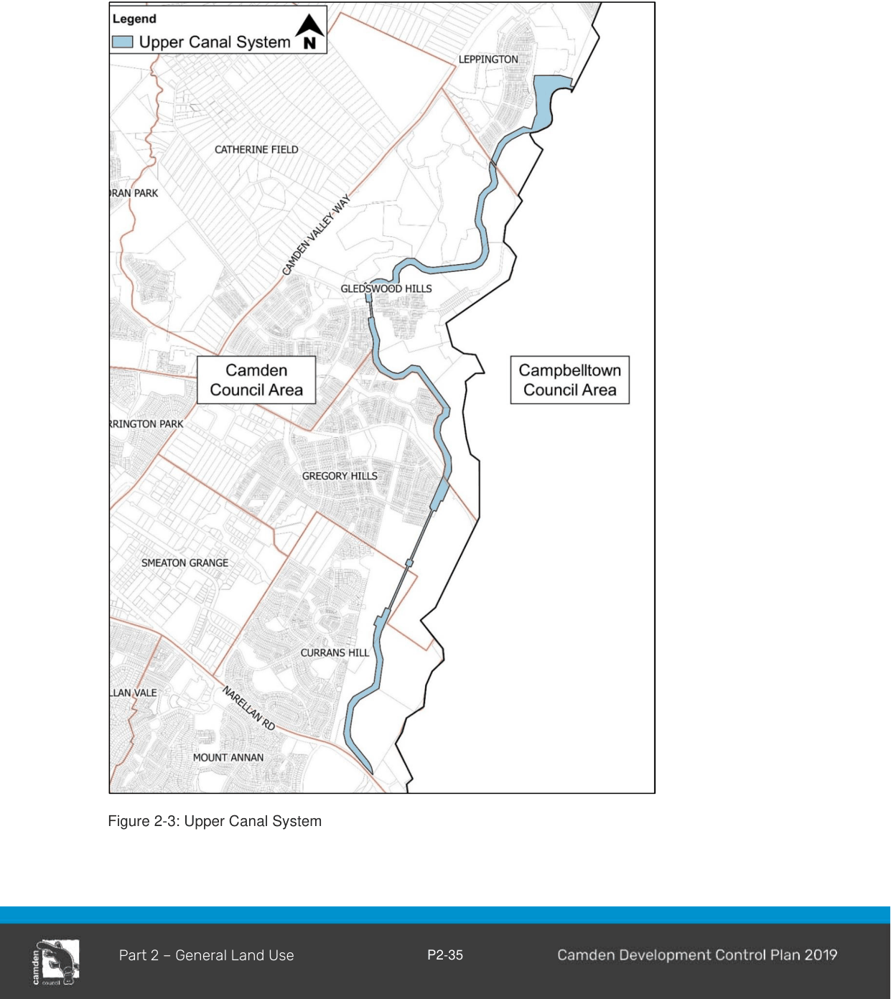

### 2.15 Development adjoining Upper Canal System

#### Background

The Upper Canal System (including its corridor) is listed on the State Heritage Register.  The Upper Canal extends generally through the Australian Botanic Garden Mount Annan, crossing under Narellan Road then passes north through Currans Hill and the Central Hills. The Upper Canal is critical water supply infrastructure that services Greater Sydney by transferring bulk raw water from the Upper Nepean Dams to the Prospect water filtration plant. The Upper Canal and corridor are classified as a controlled area under the provisions of the Water NSW Act 2014 This Act is administered by WaterNSW.

Development adjacent to the Upper Canal can potentially impact on the Canal corridor and the water within it.  These impacts include, but are not limited to, the following:

a. The potential impacts on the integrity of the infrastructure including changes to drainage such as increased risk of flooding and stormwater flows from the proposed development entering the corridor, resulting in erosion and slippage, and impacts during construction such as vibration and cut and fill.

b. The potential impacts of the development on the quality of water within the Upper Canal, include impacts on water quality from flooding and stormwater from adjacent development.  Any development should have a neutral or beneficial impact on water quality within the Upper Canal.

c. The potential impacts of the proposed development on the security of the infrastructure and associated corridor including fencing.

d. The potential impact of the proposed development on the ability of WaterNSW to manage and maintain the infrastructure, including maintenance of unrestricted access to the existing entry points to the Upper Canal corridor by WaterNSW staff, plant and vehicles.

#### Objectives

a. Ensure the Upper Canal and associated corridor is taken into account in siting, designing constructing and operating any proposed development adjoining or in the vicinity of the Upper Canal.

#### Controls

1\. Development proposals adjacent to or in the vicinity of the Upper Canal and associated corridor with the potential to impact on the Upper Canal, should be prepared in liaison with WaterNSW prior to lodging a development application.  Development Applications are to refer to WaterNSW’s Guidelines for Development Adjacent to the Upper Canal and Warragamba Pipelines.

The Upper Canal System is shown in Figure 2-3.

2\. All development must include the provision of appropriate security/delineation fencing and/or other mitigation strategies in consultation with WaterNSW.

Note:

Proposals to access or enter the Upper Canal corridor at any time will require authorisation in writing from WaterNSW.

Refer to the provisions within the Environmental Heritage Chapter within this DCP and the Heritage Act 1977 in relation to impact on the heritage significance of the Upper Canal.

> [Picture on page 39: a picture, saved as a picture (images/part-02-general-land-use-page-39-6.gif, 150 dpi).]

Figure 2-3: Upper Canal System

