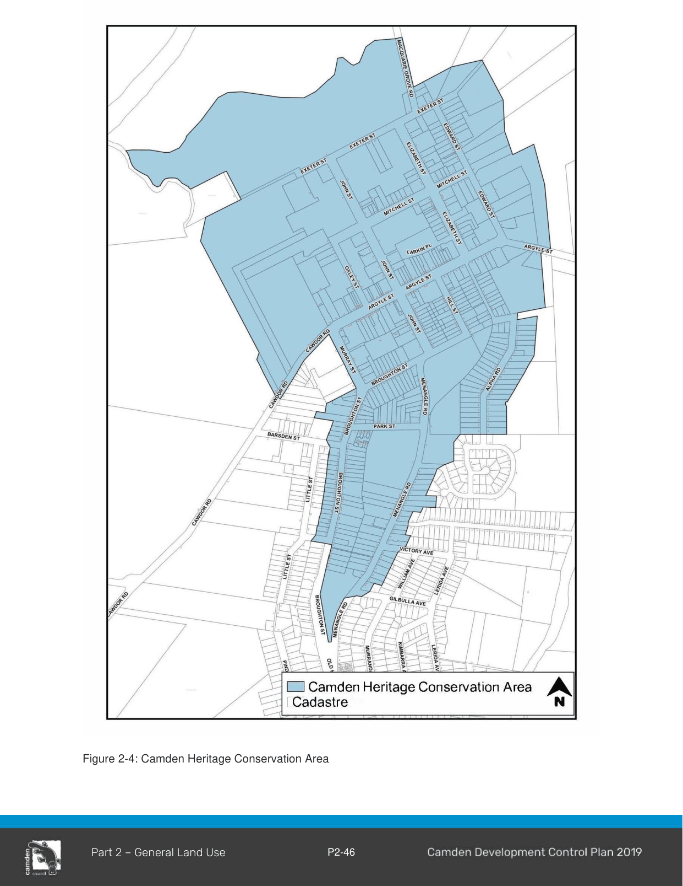

#### 2.16.4 Camden Heritage Conservation Area

#### Background

This subsection sets out the objectives and controls specific to development within the Camden Heritage Conservation Area, the area of which is shown in Figure 2-4. It must also be read in conjunction with the general heritage provisions and heritage controls in Part 5 within the Camden Town Centre.

> [Picture on page 50: a picture, saved as a picture (images/part-02-general-land-use-page-50-1.gif, 150 dpi).]

Figure 2-4: Camden Heritage Conservation Area

#### Character Elements

The distinguishing natural and built character elements of the Camden Heritage Conservation Area include:

1\. Distinct tree lined visual gateways as viewed from rural floodplain on the fringes of Camden town.

2\. A topographical form which rises from the floodplain.

3\. A town which is surrounded by rural hinterland containing transitional community uses.

4\. Prominent landmark buildings dominated by St John’s Church and in particular it’s spire.

5\. Cowpasture Bridge which opened land to the west of the Nepean River.

6\. A strong grid street network of Camden town.

7\. A pronounced “High Street” in Argyle Street, performing a traditional shopping and commerce role and thoroughfare function.

8\. A distinctive tree lined and landscaped medium strip with minimal landscaping fronting the shops along Argyle Street.

9\. Street lights delineating the carriageway and communicating “seasonal” festive and event information.

10\. Buildings covering a range in stylistic periods reflecting the evolution of the town centre and reflecting a diverse palette of building materials and finishes.

11\. Uniform single to two storey shop fronts along a wide main street.

12\. An important historical, visual and social axis is formed by John Street.

13\. A cluster of civic and community buildings in lower John Street.

14\. A range of residential premises, from the stately to workers cottages, largely converted to commercial functions; but still some with a residential use.

15\. A unique roofscape of smaller roof forms viewed throughout the town.

16\. Remnants of a rural service town, particularly in Edward Street.

17\. A modest workers cottage precinct in View Street, transitioning into large middle class housing in Alpha Road.

18\. Federation cottages and interwar bungalows radiating out from the town centre, with adaptive reuse of these in Broughton Street.

19\. A health precinct surrounding Camden Hospital.

20\. A series of informal pathways linking parking precincts.

21\. The grand Macarthur Park is on the fringe of the Town Centre.

#### Objectives

a. Retain the unique heritage significance of Camden town, recognising it as a rare and distinctive area;

b. Retain and promote evidence of the historical development of the town and enable interpretation of that historical development;

c. Retain the cohesive character particularly evident in the scale of development in each street;

d. Retain distinctive features which unite the place. Such as parapets, chimneys, veranda’s, the mixture of roofs, the road network, subdivision patterns, pathway connections, consistency of colours and the limited building material palette;

e. Seek to foster a balance between historic character and sensitive contemporary development;

f. Promote the concept of adaptive reuse as a major conservation tool;

g. Reflect an embellishment of public spaces and places in a manner which is sympathetic and does not compete with the period qualities of the township;

h. Retain the rural character of Camden town centre; and

i. The collection of distinctive worker’s cottages in View Street, will be conserved with sensitive and appropriate development encouraged.

#### Controls

1\. Views associated with the St John’s Church spire must not be compromised.

2\. The tree lined “gateway” entrances to the township must be retained and embellished.

3\. The rural-urban interface must be sensitively addressed in new development proposals.

4\. The strong street grid must be maintained and not compromised by closures and/or permanent malls.

5\. Opportunities for enhanced pedestrian linkages must be sensitively promoted

6\. Additional development on the fringe of the town should complement and not detract from the viability of the “main street”.

7\. Original uses of significant buildings should be encouraged and facilitated. Where this is no longer possible, appropriate adaptive re-use opportunities can be used to facilitate the conservation of these buildings.

8\. Existing cottage dominated streetscapes must be retained, new development such as extensions/additions should be compatible with the existing streetscape.

9\. A two storey height limit must prevail except for significant architectural features incorporated into the design of buildings in significant locations.

10\. Large built forms in cottage dominated precincts must be avoided through the use of various roof forms and pitches, wall openings and recesses, materials, recessive colours and landscaping

11\. Development of the flood affected fringes of the town must not compromise the prevailing character.

12\. In commercial areas where historical evidence exists, awnings and/or veranda’s must be provided on the front elevation and must complement existing awnings and verandahs on adjacent buildings.
