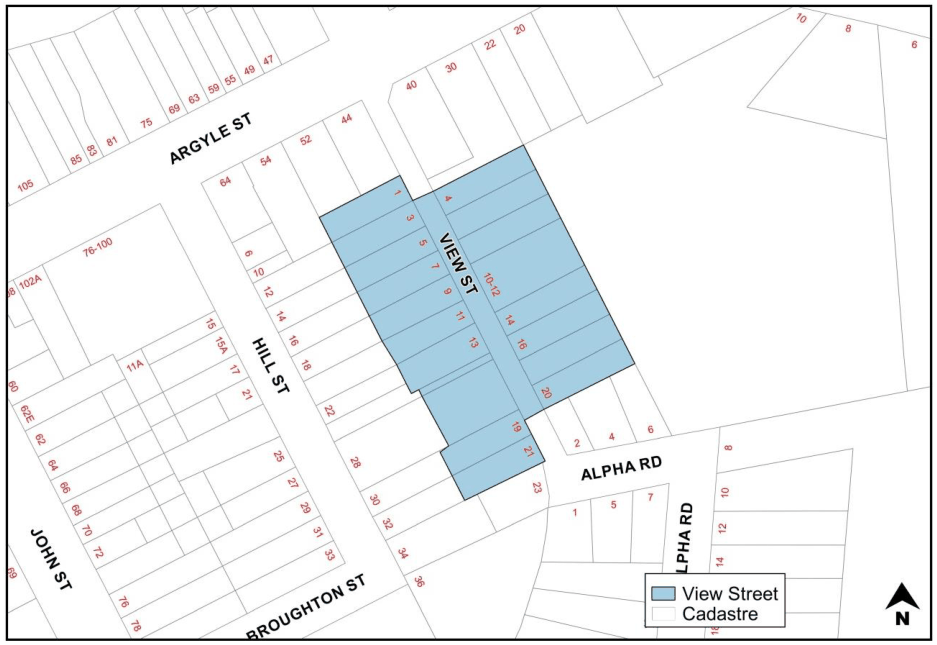

#### 2.16.5 View Street Workers Cottages

#### Background

On the entrance to the Camden town, View Street is an important street which demonstrates the early development of residential housing in Camden (Figure 2-5). This street forms part of the Camden Heritage Conservation Area. The original built forms are exhibited as smaller one storey, closely settled cottages, on narrow lots located close to the street, with front verandahs, small front garden areas and picket fences. A regular character is established in the street through consistent setbacks, lot sizes and spacing between cottages. The cottages present simple hipped roof forms, finished in either corrugated metal or tiles. Some buildings provide projecting gables to the front elevation.

> [Picture on page 53: a picture, saved as a picture (images/part-02-general-land-use-page-53-17.gif, 150 dpi).]

Figure 2-5: View Street, Camden

1\. Any additions or alterations to the original cottages must be of a minor nature and appear subservient to the original sections.

2\. Additions must only occur at the rear of the cottage and not be visible from the street.

3\. Additions must not extend further than half the width of the original cottage, nor include any roof openings.

4\. Open front verandahs must be retained or reinstated to their original form.

5\. New development on a site must be approved only where the faithful restoration and conservation of the existing cottage is assured and supported by appropriate heritage management documentation.

6\. New development will contribute to the streetscape by interpreting features of the prevailing character, including roof pitch and form, materials, bulk and scale, fencing styles, and front and side setbacks.

7\. Building height for front building must not exceed one storey, and rear building must not exceed two storeys.

8\. Fencing height for the front fence must not exceed 1.0m; rear fence must not exceed 1.8m and side fence must be 1.0m grading to 1.8m at the front building alignment.

9\. The area of private open space per residential unit (located behind the primary building line) must have a minimum area of 25m2 (with a minimum dimension of 5m).

10\. Car parking for residential development must be provided at a minimum rate of 1 space for each 1 bedroom unit and 2 spaces for all other units.

11\. Car parking for commercial development must be provided at a minimum rate of 2 spaces for each unit.

12\. All car parking is to be provided behind the front building line.

13\. Basement car parking is encouraged provided the visual impact of the entrance to the basement car park is minimised.

14\. Basement car parks on the high side of the street must drain by gravity to the street. For properties on the lower side of the street, drainage must be provided to an inter-allotment drainage easement.

15\. All other general heritage provisions must be complied with.
