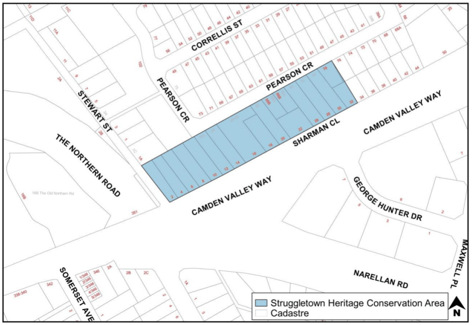

#### 2.16.6 Struggletown Heritage Conservation Area, Narellan

#### Background

This subsection sets out the objectives and controls specific to development within the Struggletown Heritage Conservation Area. It must be read in conjunction with the general heritage provisions.

The Struggletown Heritage Conservation Area consists of remnants of original cottages along Sharman Close (Figure 2-6). This street is prominently located at the junction of Camden Valley Way and The Northern Road.  It contains early examples of housing and is one of the last remaining intact groups within Narellan.

> [Picture on page 55: a picture, saved as a picture (images/part-02-general-land-use-page-55-5.gif, 150 dpi).]

Figure 2-6: Struggletown Heritage Conservation Area, Narellan

#### Objectives

a. Retain significant fabric and promote evidence of the historic development of the area and enable interpretation;

b. Promote tourist /commercial uses, especially small boutiques that generate limited parking requirements such as art galleries, cafes, boutique retail;

c. Retain the cohesive character particularly evident in the small scale of development;

d. Retain distinctive features which unite the place, such as parapets, chimneys, verandahs, the mixture of roofs, subdivision patterns, consistency of colours and limited building material palette;

e. Seek to foster a balance between historic character and sensitive contemporary infill development;

f. Promote the adaptive reuse as a major conservation tool; and

g. Conserve original significant fabric of early period housing and replace inappropriate additions/development with more sympathetic development and compatible uses.

#### Controls

1\. Original uses of significant buildings should be encouraged and facilitated. Where this is no longer possible, compatible adaptive re-use opportunities should be explored to facilitate the conservation of these buildings.

2\. Existing cottage dominated streetscapes must be retained and complemented with compatible extensions/additions and infill developments.

3\. Large built forms in cottage dominated precincts must be avoided. New built forms are to be sympathetic in terms of scale, form, fenestration and siting. Architectural detail materials, recessive colours and landscaping can be used to reduce impacts.

4\. All other general heritage provisions for design, siting, verandahs, colours, signs, demolition etc must be complied with.
