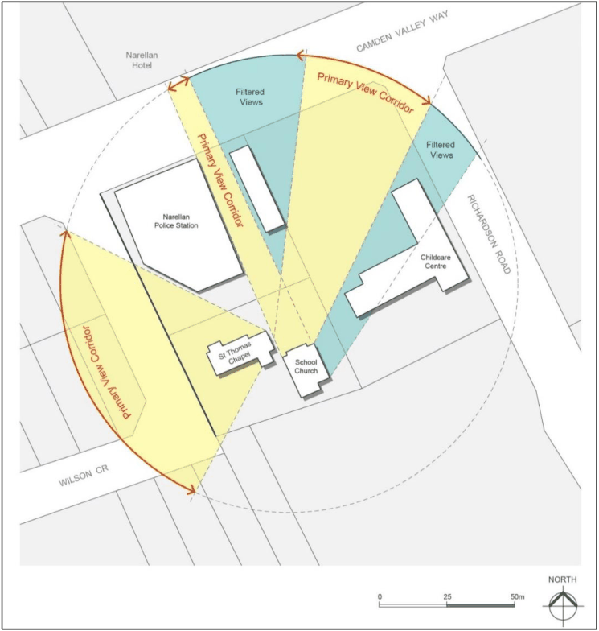

#### 2.16.7 St Thomas Chapel, Narellan – View Corridors

#### Background

This subsection sets out objectives and controls specific to development within and in the vicinity of St Thomas Chapel, the School Church, cemetery and Narellan Hotel. These are some of the historic buildings of the original Narellan Township. The School Church is a significant rare example of a rural colonial Church. The cemetery is one of the earliest in the district. The dominance of St Thomas Chapel and the School Church on a hill surrounded by open space is significant. The views between all buildings are important and are illustrated in Figure 2-7. This subsection must also be read in conjunction with the general heritage provisions.

> [Picture on page 57: a picture, saved as a picture (images/part-02-general-land-use-page-57-1.gif, 150 dpi).]

Figure 2-7: St Thomas Chapel, Narellan – View Corridors

#### Objective

a. The buildings, surrounding open space and the significant view corridors between St Thomas Chapel, the School Church, Narellan Hotel, cemetery and Camden Valley Way, must be retained.

#### Controls

1\. St Thomas Chapel, the School Church, Narellan Hotel, the cemetery and associated significant elements, including the open space and the semi-rural setting must be retained and conserved as outlined in ‘St Thomas’ Anglican Church and School Church, Narellan – Conservation Plan by Paul Davies Pty Ltd (CMP).

2\. No building, structures, signage, trees or shrubs are permitted within the primary view corridors identified in Figure 2-7.

3\. No development of the ovals/open space fronting Camden Valley Way is permitted. These ovals/open space are located north of the child care centre and school and are within the Narellan Public School (on the east and western corner Richardson Road). These areas should be retained as open space and a view corridor.

4\. New development within the filtered view corridors or within the vicinity of the site (as identified on Figure 2-7); must be in accordance with the relevant provisions of the “Macarthur Anglican School Site – Site Analysis (Heritage) and Proposed Development Guidelines” by Design 5 Architects Pty Ltd, draft, dated 2 April 2003 and the CMP.

5\. New development must be lower than and/or not dominate St Thomas Chapel, the School Church or the cemetery.

6\. The cemetery must continue to be used as a cemetery and must retain its semi-rural character and heritage significance in accordance with the CMP.

7\. Any development of the Hope School site must ensure the physical reconnection of the cemetery with the Church buildings via the Hope School site. This may be achieved by way of pathways, roads or open parklands.

8\. All other relevant general heritage provisions must be complied with.
