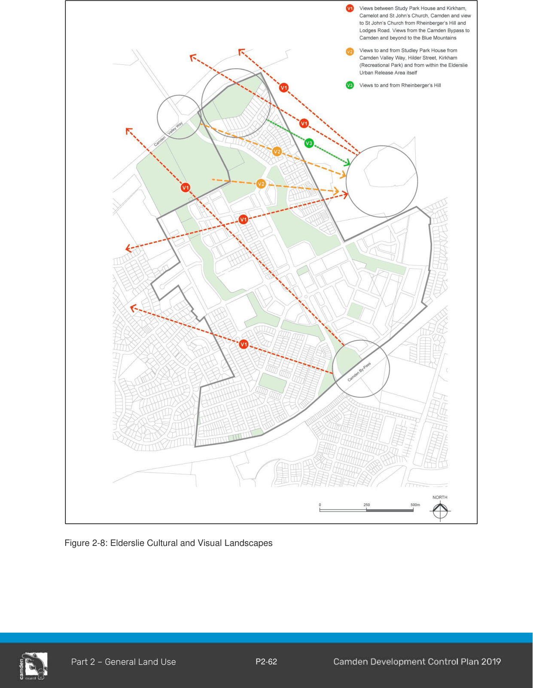
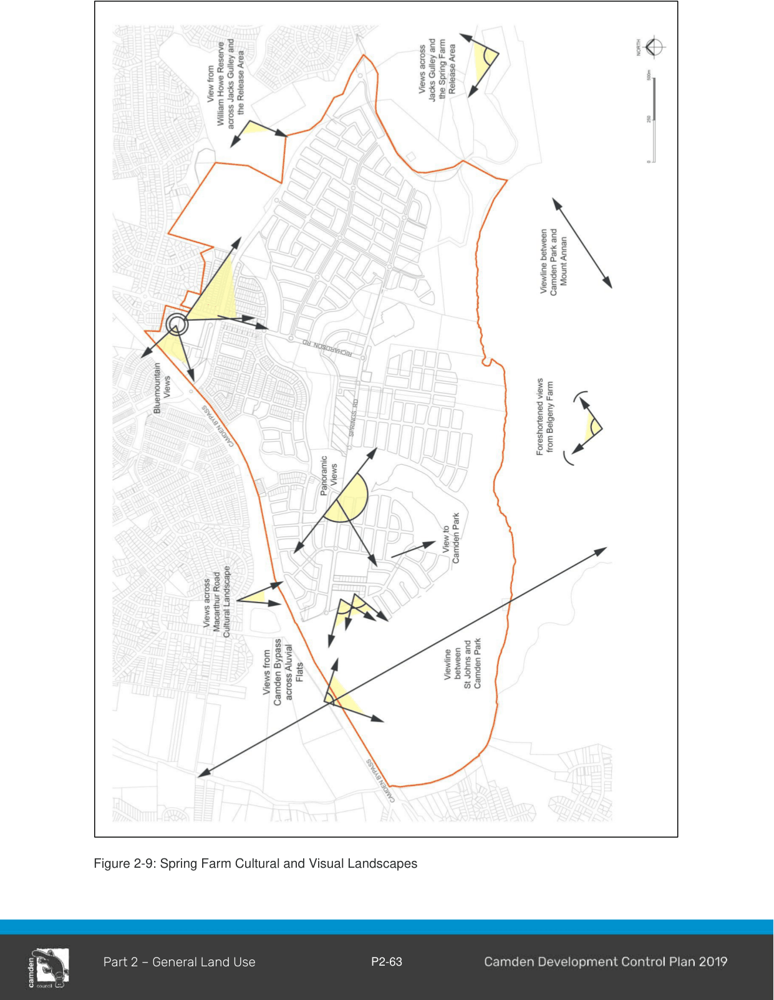

#### 2.16.9 Culturally Significant Places

#### Background

This section is applicable to all Culturally Significant Places listed in Table 2-2, 2-3, 2-4 Figures 2-8 and 2-9 or in the vicinity of these places as described in Table 2-1. In addition, where applicable to the site, all other sections must be considered.

#### Objectives

a. Conserve, protect, enhance and interpret Camden’s unique Cultural Landscapes;

b. Promote the importance of broader Cultural landscapes and an awareness of the impact that individual developments can have on these; and

c. Promote view sharing of the Cultural Landscapes where appropriate.

#### Controls

1\. A Heritage Impact Statement is required for any development identified as a Culturally Significant Place; Built Environment, Cultural Landscape or Archaeological Sites, as identified in Table 2-2, 2-3 and 2-4 and / or shown in Figures 2-8 and 2-9.

2\. Development should optimise the preservation and interpretation of the identified Culturally Significant Places as listed in Table 2-2, 2-3 and 2-4 and shown in Figures 2-8 and 2-9.

3\. Curtilages for heritage items established in Conservation Management Plans must be preserved.

4\. Avenue plantings and building alignments must reinforce view corridors where appropriate.

Note: The item name is not an indication of what is significant on the site. This will be determined by further heritage investigation.

Table 2-2: Culturally Significant Place – Built Environment

| Suburb | Item Name (see note above) | Address | Property Description |
|---|---|---|---|
| Bickley Vale | House “Boorabee” | 35 Burragorang Road | Lot 391 DP 136254 |
| Camden | House | 13 Alpha Road | Lot 5 DP 6261 |
| Camden | House | 41 Alpha Road | Lot 19 DP 6261 |
| Camden | House | 14 Barsden Street | Lot 14 SP 42398 |

| Suburb | Item Name (see note above) | Address | Property Description |
|---|---|---|---|
| Camden | Houses | 18 Broughton Street | Lot 13 DP 343009 |
| Camden | House | 6-10 Elizabeth Street | Lot 100 DP 1007469 |
| Camden | Former Picture Theatre | 39-41 Elizabeth Street | Lots 8 & 9 DP 13105 |
| Camden | House | 42 Elizabeth Street | Lot B DP 378788 |
| Camden | House | 44 Elizabeth Street | Lot 1 DP 707531 |
| Camden | House “Chellaston” | 38 Menangle Road | Lot 1 DP 202352 |
| Camden | House “Craig-y-nos” | 45 Menangle Road | Lot B DP 319830 |
| Camden | House “Coonac” | 47 Menangle Road | Lot 1 DP 946375 |
| Camden | House “Weetalabah” | 57 Menangle Road | Lot 1 DP 970145 |
| Camden | House | 59 Menangle Road | Lot 1 DP 530480 |
| Camden | Swimming Pool | 43 Mitchell Street | Lot 1 DP 231794 |
| Camden | House | 24, 26 & 28 Murray Street | Lot 6 DP 37602 Lot B DP 152812 |

| Suburb | Item Name (see note above) | Address | Property Description Lot A DP 152812 |
|---|---|---|---|
| Camden | House “Mount Mellick” | 1 Park Street | Lot 2 DP 1122806 |
| Camden | House “Cooinda” | 3 Park Street | Lot 1 DP 1122806 |
| Camden | House “Karoola” | 18 Park Street | Lot 1 DP 928268 |
| Camden | Camden Bowling and Recreation Club | 10, 10A and 10B Cawdor Road | Lot 1 DP 1170259 Lot 1 DP 1112588 and Lot 1 DP 668712 |
| Cobbitty | House | 95 Coates Park Road | Lot 22 DP 730360 |
| Elderslie | House | 64 Harrington Street | Lot 8 DP 1105408 |
| Elderslie | Residence | 175A Lodges Road | Lot 10 DP 1008863 |
| Elderslie | Residence and associated structures | 175B Lodges Road | Lot 100 DP 1018456 |
| Elderslie | House | 46 Macarthur Road | Lot 1 DP 112789 |
| Elderslie | House | 34 River Road | Lot B DP 360735 |
| Elderslie | House | 71 Springs Road | Lot 1 DP 1043066 |

| Suburb | Item Name (see note above) | Address | Property Description |
|---|---|---|---|
| Elderslie | House and associated structures “Camden Acres House” | 6 McLeod Place (formerly 13 Whyte Place) | Lot 161 DP 1087243 |
| Ellis Lane | House | 83 Ellis Lane | Lot 12 DP 260656 |
| Grasmere | House “Fairview” | 95 The Old Oaks Road | Lot 162 DP 819731 |
| Spring Farm | House | 2 Ettlesdale Road | Lot 10 DP 38392 |
| Spring Farm | House, garden and curtilage | 170 Macarthur Road | Lot 31 DP 635271 |
| Spring Farm | Outbuildings and curtilage associated with 170 Macarthur Road | 172 Macarthur Road | Lot 32 DP 635271 |
| Spring Farm | House | 214 Macarthur Road | Lot 1 DP 587631 |

#### Further Information

The following culturally significant landscapes were identified in the Camden Scenic and Cultural Landscapes Study February 1998 (Lambcon Associates).

Table 2-3: Culturally Significant Place– Cultural Landscape

| Suburb | Item Name | Address | View Description |
|---|---|---|---|
| Bickley Vale, Cawdor | Cultural Landscape | Westbrook Road | Westbrook Road corridor pastoral landscapes and sequential vistas and view corridors |
| Bringelly and Greendale | Cultural Landscape | Bringelly Road / Greendale Road | Rural Cultural Landscape |
| Camden | Cultural Landscape | Camden Valley Way (Approaches to Camden) | Includes sections of Camden Valley Way & Argyle Street, the Cowpasture Bridge & avenue of memorial trees along Camden Valley Way |
| Camden to Leppington | Cultural Landscape | Camden Valley Way | The former “Cowpastures Road” road corridor including trees and sequential vistas and view corridors to historical properties and pastoral landscapes |
| Camden, Cobbitty and Harrington Grove | Cultural Landscape | Macquarie Grove Road | Macquarie Grove Road corridor pastoral landscapes and sequential vistas and view corridors |
| Camden South | Cultural Landscape | Remembrance Drive | Remembrance Drive road corridor including trees |
| Cobbitty | Cultural Landscape | Cobbitty Road | Cobbitty Road cultural landscape |
| Cobbitty | Cultural Landscape | Cut Hill Road and Coates Park Road | Pastoral landscapes perceived from both roads and sequential vistas and view corridors |
| Elderslie | Rheinberger’s Hill reserve | 30 Rheinberger’s Circuit | Lot 162 DP 1087243 |
| Elderslie | Cultural Landscape (V1 on Figure 2-8) |  | Views between: • Studley Park House and Kirkham, Camelot and St John’s Church, Camden • views to St John’s Church from Rheinburger’s Hill and Lodges Road. |

| Suburb | Item Name | Address | View Description • Views from the Camden By-pass to Camden and beyond to the Blue Mountains |
|---|---|---|---|
| Elderslie | Cultural Landscape (V2 on Figure 2- 8) |  | Views to and from Studley Park House from Camden Valley Way, Hilder Street, Kirkham Recreational Park and from within the Elderslie Release Area. |
| Elderslie | Cultural Landscape (V3 on Figure 2-8) |  | Views to and from Rheinburger’s Hill |
| Kirkham | Cultural Landscape | Kirkham Lane | Kirkham Lane road corridor, pastoral landscapes and sequential vistas and view corridors |
| Narellan, Harrington Park, Oran Park | Cultural Landscape | The Northern Road | The Northern Road corridor pastoral landscapes and sequential vistas and view corridors. |
| Narellan Vale | Cultural Landscape | William Howe Regional Park | Turkey Nest Dam |
| Spring Farm, Camden, Camden South, and Ellis Lane, Cobbitty | Cultural Landscape | Flood Plains along Nepean River | Camden flood plain pastoral landscape |
| Spring Farm | Cultural Landscape |  | • Views from Belgenny Farm to the Spring Farm release area, between St Johns Church and Camden Park Estate and Mount Annan • Views from Macarthur Road to Galvin Cottage, its immediate garden setting, alluvial flats and eastern ridgeline. |

| Suburb | Item Name | Address | View Description |
|---|---|---|---|
| Spring Farm | Cultural Landscape |  | • Views from within the Spring Farm Release area to the Blue Mountains and Razorback Range. • Views from William Howe Reserve, across Jacks Gully and the Spring Farm release area. • Views from Camden By-pass across the alluvial flats. |
| Spring Farm | Cultural Landscape | Vicinity of Macarthur Road | Macarthur Road cultural landscape |
| Spring Farm | Cultural Landscapes | Vicinity of Nepean River and Camden By-pass | Vineyard and turf farming areas |

> [Picture on page 66: a picture, saved as a picture (images/part-02-general-land-use-page-66-1.gif, 150 dpi).]

Figure 2-8: Elderslie Cultural and Visual Landscapes

> [Picture on page 67: a picture, saved as a picture (images/part-02-general-land-use-page-67-1.gif, 150 dpi).]

Figure 2-9: Spring Farm Cultural and Visual Landscapes

Table 2-4: Culturally Significant Place - Archaeological Sites

| Suburb | Item Name | Address | View Description |
|---|---|---|---|
| Currans Hill, Narellan, Elderslie, Camden | Archaeological sites | Narellan Road and Camden Valley Way | Remnants of the Tramway Stations |
| Grasmere | Archaeological sites | 5 Smalls Road | Underground cistern and archaeological remains of cottage |
| Kirkham | Archaeological Sites | Kirkham Lane | Former Camden Tramway |
| Kirkham | Archaeological Site | Kirkham Lane | Former Camelot underground brick water tanks |

