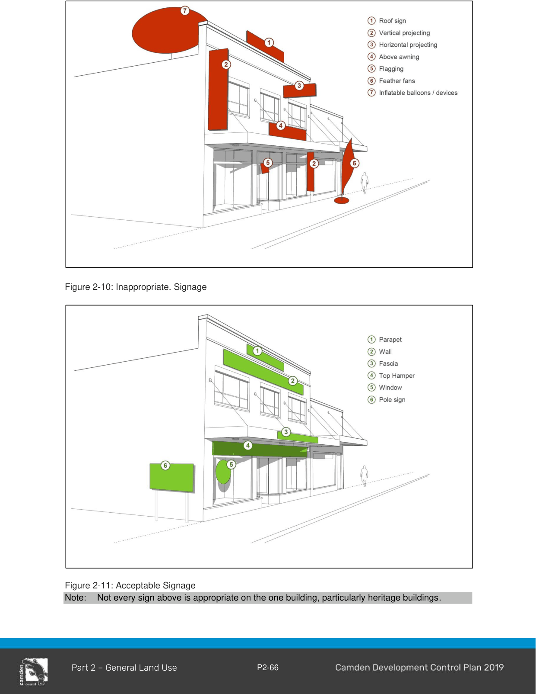

### 2.17 Signage

#### Background

The purpose of this section is to establish Council’s specific objectives and development controls for the provisions of signage in the Camden LGA. This section should be read in conjunction with State Environmental Planning Policy (Industry and Employment) 2021.  For the purposes of this section, signage has the same meaning as defined in  State Environmental Planning Policy (Industry and Employment) 2021,

• Advertisement;

• Business identification sign; and

• Building identification sign.

#### Inappropriate signage

Consent will not be granted to the following advertisements:

a. Above awning signs;

b. Roof or sky signs;

c. Vertical or horizontal projection signs;

d. Flashing, electronic, running or moving signs – for example a variable message board sign (other than those signs authorised for traffic management, road traffic and road safety purposes);

e. Illuminated advertising street name signs;

f. Inflatable balloons or other inflatable devices;

g. Banners, bunting, flagging and bill/fly posters (other than those erected by Council);

h. Advertising on shipping containers, parked cars and / or trailers (registered or not registered);

i. Temporary signage erected in or on a public place (other than temporary non-commercial signs); and

j. Feather fan banners (where erected on public property).

> [Picture on page 70: a picture, saved as a picture (images/part-02-general-land-use-page-70-1.gif, 150 dpi).]

Figure 2-10: Inappropriate. Signage

Figure 2-11: Acceptable Signage Note: Not every sign above is appropriate on the one building, particularly heritage buildings.

