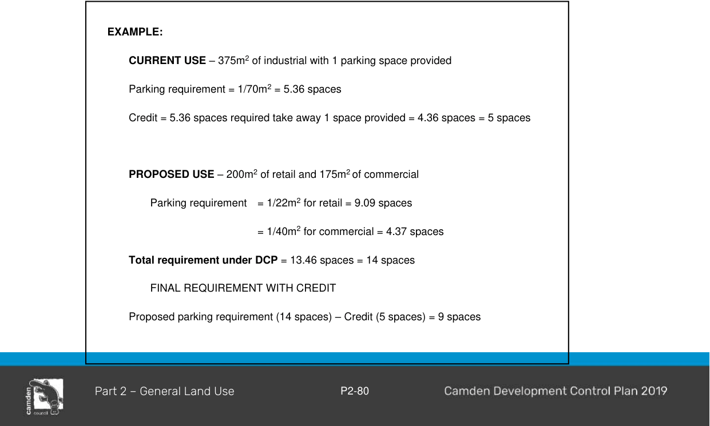

#### 2.18.2 Off Street Car parking rates/requirements

#### Calculation of Spaces

Parking is to be provided for a development in accordance with Table 2-5– Schedule of Car, Bicycle, and Motorcycle Parking Requirements and Table 2-6 Schedule showing Service Vehicle

#### Requirements.

1\. Calculations for the number of parking spaces will primarily be based on the gross floor area of the development, unless otherwise specified.

Council may consider variations to parking rates in certain circumstances that do not warrant demand and may be supported by a car parking and traffic impact assessment study submitted with a development application. Council will give consideration to other features of the development, such as proposed maximum staffing levels, expected customer levels etc. where warranted.

Note: In the circumstances where the car parking and/or other requirements are not defined by this chapter for a particular land use in the CLEP 2010, a detailed Car Parking and Traffic Impact Assessment Study may be required to be prepared for the proposed development.

2\. Where the calculation in respect of the level of parking required results in a fraction of a space, the requirement will be taken to the next highest whole number, unless otherwise specified. The number of off-street car parking spaces required for a development must be calculated in accordance with the methodology demonstrated in the following hypothetical development example:

#### EXAMPLE:

A combined industrial/warehouse development contains:

Industrial gross floor area = 1,500m² / 70 = 21.43

Warehouse gross floor area = 1,050m² / 300 = 3.5

TOTAL = 24.93

Therefore, this development would require 25 off-street car parking spaces3.  Where relevant, applicants should comply with the suggested bicycle parking provision rates for different land use types in the document “Planning Guidelines for Walking and Cycling” (NSW Government 2004).

#### Parking Credits for Existing Development

1\. Council recognises that, in certain cases, land uses may have been lawfully established without any off-street parking or with only a proportion of the parking that would now be required for those uses under this DCP.

2\. An estimate of this “historic deficiency” may be obtained by calculating the relevant car parking requirements under this DCP for the existing lawful development on a site and subtracting any existing off-street parking spaces.  The resultant figure will then be treated as a “credit” in any parking calculations which may be required for new development on the site (including changes of use).

> [Picture on page 84: a picture, saved as a picture (images/part-02-general-land-use-page-84-18.gif, 150 dpi).]
> Words printed on the picture (copied from the PDF):
> EXAMPLE:
> CURRENT USE – 375m2 of industrial with 1 parking space provided
> Parking requirement = 1/70m2 = 5.36 spaces
> Credit = 5.36 spaces required take away 1 space provided = 4.36 spaces = 5 spaces
> PROPOSED USE – 200m2 of retail and 175m2 of commercial
> Parking requirement = 1/22m2 for retail = 9.09 spaces
> = 1/40m2 for commercial = 4.37 spaces
> Total requirement under DCP = 13.46 spaces = 14 spaces
> FINAL REQUIREMENT WITH CREDIT
> Proposed parking requirement (14 spaces) – Credit (5 spaces) = 9 spaces

Final Requirement = 9 spaces

3\. Credits are not possible where a site is being fully redeveloped.  That is the existing building is being removed and another rebuilt, or extensively changed.  Gutting of a building with retention of the facade would be assessed as a redevelopment not eligible for parking credits.

4\. Credits will not be allowed when there is a significant differing pattern of parking demand between the existing and proposed use.

5\. Credits may be disallowed or only partially granted in situations where the local area is particularly sensitive to increases in parking demand on-street or in circumstances where the rates in this chapter of the DCP may be inappropriate;

6\. Credits may not be allowed if the building has been vacant for any substantial length of time.  When this is the case it effectively removes the justification that the parking demand is currently being catered for on-street.

In circumstances where it is considered that credits may not be strictly appropriate, the logistics and significance of the building or site may be taken into account and a concession for reduced parking granted.  In these circumstances, the applicant will need to demonstrate that there is insufficient room in the building to accommodate parking on-site without compromising its heritage or architectural worth, or that the streetscape and overall amenity will be unreasonably damaged.

#### Monetary Contributions In Lieu Of Off-Street Parking

1\. In certain circumstances Council may accept a monetary contribution pursuant to Section 7.11 of the EP&A Act, in lieu of off-street parking being provided as part of the development.  Details are set out in the relevant Contributions Plan.  The acceptance of a monetary contribution in lieu of off-street parking is not guaranteed and will be at Council’s discretion.

2\. The amount of contribution will be in accordance to the rate fixed from time to time in the Contributions Plan.

#### Schedule of Parking Requirements

The parking rates specified in Table 2-5 - Schedule of Car, Bicycle and Motorcycle Parking Requirements are based on a consideration of rates published in the RTA Guide to Traffic Generating Developments version 2.2, October 2002 (or as updated) and local requirements particular to Camden.

Table 2-5: Schedule of Car, Bicycle, and Motorcycle Parking Requirements

| LAND USE | MINIMUM CAR PARKING REQUIREMENT |
|---|---|
| Residential |  |

| LAND USE | MINIMUM CAR PARKING REQUIREMENT |
|---|---|
| Dwelling House | 1 car parking space for dwellings with 1 to 2 bedrooms. 2 car parking spaces for dwellings with more than 2 bedrooms. In both instances, at least one car parking space behind the building line. |
| Dual Occupancy and Semi-Detached Dwellings | 1 car parking space for each dwelling with 1 to 2 bedrooms. 2 car parking spaces for each dwelling with more than 2 bedrooms. |
| Multi Dwelling Housing and Attached Dwellings | 1 car parking space per dwelling, plus 0.2 car parking spaces per 2 bedroom dwelling, plus 0.5 car parking spaces per 3 or more bedroom dwelling. 1 visitor car parking space per 5 dwellings. |
| Residential Flat Buildings | 1 car parking space per unit, plus 0.2 car parking spaces per 2 bedroom unit, plus 0.5 car parking spaces per 3 or more bedroom unit. 1 visitor car parking space per 5 units. 1 bicycle space per 3 units. |
| Hostels, Permanent Group Homes and Transitional Group Homes (excluding Seniors Housing) | 1 car parking space per full time equivalent staff member. Parking rate for residents to be assessed on the merits of the application. |
| Boarding House | As per the State Environmental Planning Policy (Housing) 2021 |
| Home Business, Home Industry, Home Occupation, and Home Occupation (Sex Services) | As per Dwelling House, plus 1 car parking space per staff member other than permanent residents. Note: Additional car parking spaces may be required for visitors depending on the nature of the business. |
| Affordable Housing | Refer to State Environmental Planning Policy (Housing) 2021 |
| Seniors Housing |  |

| LAND USE | MINIMUM CAR PARKING REQUIREMENT |
|---|---|
| Residential Care Facility, Hostel, Self-Contained Dwelling | Refer to State Environmental Planning Policy (Housing) 2021 |
| Non-Residential Housing |  |
| Exhibition Home / Village | 2 visitor car parking spaces per exhibition home to be provided in a separate car park. Where it can be demonstrated that the use of on-street parking within the village for visitors will not adversely affect traffic flows and the operation of the display village, then the on-street parking may be treated as a credit against the overall requirement for a separate car park. A detailed assessment identifying all on street parking spaces proposed to allocate to visitors will be required to obtain this concession. Exhibition homes are to be designed to ensure they will provide the required amount of off-street car parking for when they are converted into dwelling houses. |
| Health Consulting Rooms | 3 car parking spaces per consulting room, and 1 car parking space per 2 employees. A reduction in the parking requirement will be considered if it can be shown that not all consulting rooms will be in concurrent operation and/or if convenient on-street parking is available, providing that the use of such parking does not adversely affect the amenity of the immediate area. |
| Casual Accommodation |  |
| Hotel or Motel Accommodation / Tourist and Visitor Accommodation / Serviced Apartment | 1 car parking space for each unit, and 1 car parking space per 2 employees, and • 15 car parking spaces per 100m2 GFA of restaurant / public entertainment / function / reception room / bar, or • 1 car parking space per 3 seats (whichever is the greater) 1 bicycle space per 25 car parking spaces in excess of the first 25 car parking spaces; and |

| LAND USE | MINIMUM CAR PARKING REQUIREMENT 1 motorcycle space per 50 car parking spaces in excess of the first 50 car parking spaces. Provision for coaches to pick up and set down may be required. |
|---|---|
| Backpackers’ Accommodation | 1 car parking space per 10 beds or 1 car parking space per 5 bedrooms (whichever is the greater), and 1 car parking space per 2 employees. 1 bicycle space per 10 beds. 1 bicycle space per 25 car parking spaces in excess of the first 25 car parking spaces; and 1 motorcycle space per 50 car parking spaces in excess of the first 50 car parking spaces. |
| Bed & Breakfast Accommodation | 1 car parking space for each bedroom, and 1 car parking space for the permanent residents of the dwelling. |
| Farm Stay Accommodation | 1 car parking space for each dwelling. |
| Tourist |  |
| Caravan Park | 1 car parking space per van/mobile home/campsite, and 1 car parking space per 2 employees, and 1 visitor car parking space per 10 sites. |
| Office and Commercial |  |
| Office Premises and Business Premises | 1 car parking space per 40m2 of GFA. 1 bicycle space per 25 car parking spaces in excess of the first 25 car parking spaces; and 1 motorcycle space per 50 car parking spaces in excess of the first 50 car parking spaces. |
| Public Administration Buildings and Community Facilities | Assessment to be based on merit taking into consideration the proposed uses and equivalent rates for similar uses as prescribed in this DCP. 1 bicycle space per 25 car parking spaces in excess of the first 25 car parking spaces; and |

| LAND USE | MINIMUM CAR PARKING REQUIREMENT 1 motorcycle space per 50 car parking spaces in excess of the first 50 car parking spaces. |
|---|---|
| Mortuary/Funeral chapels / Funeral homes | 1 car parking space per 4 seats and 1 car parking space per funeral service area |
| Emergency Services Organisation / Emergency Services facility | Assessment to be based on merit taking into consideration the proposed uses and equivalent rates for similar uses as prescribed in this DCP. |
| Place of Assembly / Place of Public Worship | 1 car parking space per 6 seats. 1 bicycle space per 25 car parking spaces in excess of the first 25 car parking spaces; and 1 motorcycle space per 50 car parking spaces in excess of the first 50 car parking spaces. A detailed parking assessment may be required identifying impacts of overflow parking on surrounding land uses and the road system. |
| Industry |  |
| Service Station | 4 car parking spaces per service work bay for up to 2 bays and 6 car parking spaces per service bay for each additional bay and 1 car parking space per 22 m2 GFA of Convenience Store; Plus, if a restaurant is present, the following rates apply for this component in addition: • 7 car parking spaces per 100m 2 GFA ,or • 1 car parking space per 3 seats (whichever is the greater). |
| Vehicle Body Repair Workshop | 4 car parking spaces per service work bay for up to 2 bays and 6 car parking spaces per service bay for each additional bay. |
| Vehicle Repair Station | 4 car parking spaces per service work bay for up to 2 bays and 6 car parking spaces per service bay for each additional bay. |
| Vehicle Sales or Hire Premises | 0.75 car parking spaces per 100m2 of display site areaand |

| LAND USE | MINIMUM CAR PARKING REQUIREMENT 6 car parking spaces per service work bay. |
|---|---|
| Boat Repair Facility | 1 car parking space per work bay and 1 car parking space per 2 employees. |
| Industry / Light industry | 1 car parking space per 70m2 of GFA. 1 bicycle space per 25 car parking spaces in excess of the first 25 car parking spaces; and 1 motorcycle space per 50 car parking spaces in excess of the first 50 car parking spaces. The parking provision rate is increased when: - Retailing is permitted on-site. The rate for Industrial retail outlets is applied for this component of the development. - The office space component is in excess of 20% of the floor area. The rate for Office Premises and Business Premises applies for the amount of this floor space in excess of 20% of GFA. |
| Industrial retail outlet | 1 car parking space per 30m2 GFA. 1 bicycle space per 25 car parking spaces in excess of the first 25 car parking spaces; and 1 motorcycle space per 50 car parking spaces in excess of the first 50 car parking spaces. |
| Warehouse or Distribution Centre / Storage Premises | 1 car parking space per 300m2 GFA. 1 bicycle space per 25 car parking spaces in excess of the first 25 car parking spaces; and 1 motorcycle space per 50 car parking spaces in excess of the first 50 car parking spaces. The parking provision rate is increased when the office space component is in excess of 20% of the floor area. The rate for Office Premises and Business Premises applies for the amount of this floor space in excess of 20% of GFA. |

| LAND USE | MINIMUM CAR PARKING REQUIREMENT |
|---|---|
| Retail |  |
| Shopping Centres | Assessment to be based on merit taking into consideration the proposed mix of uses within the shopping centre. The following formula determines the minimum rate to be provided: Peak Parking Demand (per 1,000m2) = 24 A(S) + 40 A(F) + 42 A(SM) + 45 A(SS) + 9 A(OM) where: • A(S): Slow Trade GLFA, includes major Department stores such as David Jones and Myer, furniture, electrical and utility goods stores. • A(F): Faster Trade GLFA, includes discount department stores such as K-Mart, Big W, and Target. • A(SM): Supermarket GLFA, includes stores such as Franklins and large fruit markets. • A(SS): Speciality Shops and Secondary retail GLFA, includes speciality shops and take-away stores such as McDonalds. These stores are grouped since they tend not be primary attractors to the centre. • A(OM): Offices, medical GLFA. It is recognised that a shopping centre may require more parking than the standard in certain circumstances and less in other circumstances. An application for a shopping centre should include a traffic and parking study identifying this parking requirement. Comparisons with similar sized shopping centre developments will be taken into consideration if the minimum requirement specified by Council is considered inappropriate. 1 bicycle space per 25 car parking spaces in excess of the first 25 car parking spaces; and 1 motorcycle space per 50 car parking spaces in excess of the first 50 car parking spaces. |

| LAND USE | MINIMUM CAR PARKING REQUIREMENT |
|---|---|
| Retail Premises / Shop / Kiosk | 200m2 or greater - 1 car parking space per 22m2 GFA. less than 200m2 – 1 car parking space per 30m2 GFA. 1 bicycle space per 25 car parking spaces in excess of the first 25 car parking spaces; and 1 motorcycle space per 50 car parking spaces in excess of the first 50 car parking spaces. |
| Neighbourhood Shop | 1 car parking space per 30m2 GFA. |
| Shop top housing | Shops 200m2 or greater – 1 car parking space per 22m2 GFA Shops less than 200m2 - 1 car parking space per 30m2 GFA. Residential rates apply to the housing component. |
| Specialised retail premises | 1 car parking space per 50m2 GFA. 1 bicycle space per 25 car parking spaces in excess of the first 25 car parking spaces; and 1 motorcycle space per 50 car parking spaces in excess of the first 50 car parking spaces. Comparisons with similar developments will be taken into consideration if this minimum requirement is considered inappropriate for a particular development. |
| Landscape and garden suppliers | 15 car parking spaces or, 0.5 car parking spaces per 100m2 of site area (whichever is the greater). 1 bicycle space per 25 car parking spaces in excess of the first 25 car parking spaces; and 1 motorcycle space per 50 car parking spaces in excess of the first 50 car parking spaces. |
| Market | 2.5 car parking spaces per stall for customers. 1 bicycle space per 25 car parking spaces in excess of the first 25 car parking spaces; and 1 motorcycle space per 50 car parking spaces in excess of the first 50 car parking spaces. |

| LAND USE | MINIMUM CAR PARKING REQUIREMENT Parking for stallholders is to be provided separately. The amount of stallholder parking required is to be assessed as part of the Development Application. |
|---|---|
| Take away food and drink premises | Developments with no on-site seating: 12 car parking spaces per 100m2 GFA. Developments with on-site seating: 12 car parking spaces per 100m2 GFA or greater of 1 car parking space per 5 seats (internal and external) or 1 car parking space per 2 seats (internal). Developments with on-site seating and drive through facilities: The greater of: 1 car parking space per 2 seats (internal), or 1 car parking space per 3 seats (internal and external) Plus queuing area for 5 to 12 cars. Developments must also accommodate: 1 bicycle space per 25 car parking spaces in excess of the first 25 car parking spaces; and 1 motorcycle space per 50 car parking spaces in excess of the first 50 car parking spaces |
| Restaurants and Cafés | Where located within a business or industrial zone: 1 car parking space per 30m2 of GFA All other zones: 15 spaces per 100m2 GFA; or 1 space per 3 seats (whichever is greater) |
| Roadside stall | Minimum of 4 car parking spaces. |

| LAND USE | MINIMUM CAR PARKING REQUIREMENT |
|---|---|
| Education |  |
| Educational Establishments | Schools: 1 car parking space per full time equivalent staff member, plus 1 car parking space per 100 students, plus 1 car parking space per 5 students in Year 12 where appropriate. On street car parking cannot be considered as a parking. Adequate space is also required for delivery vehicles, a drop off / pick up area and buses as appropriate. Tertiary Institutions: 1 car parking space per 5 seats or 1 space per 10m2 GFA, whichever is the greater. Developments must also accommodate: 1 bicycle space per 25 car parking spaces in excess of the first 25 car parking spaces; and 1 motorcycle space per 50 car parking spaces in excess of the first 50 car parking spaces |
| Information and Education Facility | Comparisons should be drawn with similar developments. |
| Child Care Centre | 1 car parking space per 4 children. 1 of the car parking spaces must be designed for people with a disability. |
| Home-Based Child Care | Residential rates apply plus adequate provision for parent pickup and drop off. |
| Recreation Facility |  |
| Cinemas | 1 car parking space per 5 seats |
| Entertainment Facility | Car parking will be determined on the characteristics of the facility. A submission based on parking arrangements for similar facilities may be required. |
| Function Centre | Single room function centre: |

| LAND USE | MINIMUM CAR PARKING REQUIREMENT 15 car parking spaces per 100m2 GFA room; or 1 car parking space per 3 seats (whichever is greater). Developments must also accommodate: 1 bicycle space per 25 car parking spaces in excess of the first 25 car parking spaces; and 1 motorcycle space per 50 car parking spaces in excess of the first 50 car parking spaces For larger function centres a separate parking study will be required. |
|---|---|
| Recreation facility (indoor or outdoor) | Squash / Tennis Courts: 3 car parking spaces per court Bowling Alley: 3 car parking spaces per alley Gymnasiums: 7.5 spaces per 100m2 GFA Local Soccer, Football and Similar Sporting Fields: 50 car parking spaces per field. Trampoline Centres: 0.37 car parking space per participant Other Recreation Uses Council may require a Car Parking and Traffic Impact Assessment Study for recreation uses other than those listed above. Developments must also accommodate: 1 bicycle space per 25 car parking spaces in excess of the first 25 car parking spaces; and 1 motorcycle space per 50 car parking spaces in excess of the first 50 car parking spaces. |

| LAND USE | MINIMUM CAR PARKING REQUIREMENT |
|---|---|
| Recreation facility (major) | Assessment to be based on merit taking into consideration the proposed uses and equivalent rates for similar uses as prescribed in this DCP. |
| Amusement Centre | 200m2 or greater - 1 car parking space per 22m2 GFA less than 200m2 – 1 car parking space per 30m2 GFA. One bicycle space/rail for every 5 machines. |
| Health Care |  |
| Health Service Facility / Medical Centre | 4 car parking spaces per 100m2 GFA. |
| Hospital / Veterinary hospital | Assessment to be based on merit taking into consideration the proposed uses and equivalent rates for similar uses as prescribed in this DCP. |
| Registered Premises |  |
| Pub / Registered club / Restricted Premises | A detailed car parking submission is required. Provision for coaches to pick up and set down may also be required for large establishments. 1 car parking space per 2m2 GFA of public bar area and 1 car parking space per 5m2 GFA of lounge, beer garden, auditorium, billiard room, restaurant and 25 car parking spaces per 100m2 of remaining public floor area. Developments must also accommodate: 1 bicycle space per 25 car parking spaces in excess of the first 25 car parking spaces; and 1 motorcycle space per 50 car parking spaces in excess of the first 50 car parking spaces. |
| Restricted Premises | 200m2 or greater - 1 car parking space per 22m2 GFA less than 200m2 – 1 car parking space per 30m2 GFA. |
| Sex service premises | 1 car parking space per room where sex services are provided and |

| LAND USE | MINIMUM CAR PARKING REQUIREMENT 1 car parking space per two employees working at any one time on the premises. At least 1 of the car parking spaces is to be suitable for a driver with a disability. |
|---|---|

Assessment of the following uses as defined in CLEP 2010 are to be assessed on merit taking into consideration the proposed uses, staffing, servicing requirements and local requirements:

• Agricultural Produce Industry

• Animal Boarding or Training Establishment

• Freight transport facility

• Hazardous storage establishment

• Liquid fuel depot

• Livestock processing industry

• Offensive storage establishment

• Research station

• Resource recovery facility

• Rural industry

• Stock and sale yard

• Transport depot

• Truck depot

• Turf farming

• Waste disposal facility

• Waste management facility

• Waste or resource management facility

• Waste or resource transfer station

• Water recycling facility

• Water treatment facility

#### Adoption of relevant standards and guidelines

For the purposes of this chapter of the DCP, the provision of the following standards and guidelines must be complied with:

• AS 2890.1 Part 1: Parking Facilities: Off-street Car Parking;

• AS 2890.2 Part 2: Parking Facilities: Off-street Commercial Vehicle Facilities;

• AS 2890.3 Part 3: Bicycle Parking Facilities;

• AS 2890.5 Part 5: On-street parking; and

• AS 2890.6 Part 6: Disabled parking.

• AUSTROADS Guide to Traffic Management.

• Building Code of Australia (BCA)

The following documents may also be used as best practice guidelines where specific

development controls are not contained in this DCP.

• RTA “Guide to Traffic Generating Developments version 2.2, October 2002”.

• AUSTROADS “Guide to Road Design”.

• Planning Guideline for Walking and Cycling. 2004. NSW Government.

• Cycling Aspects of Austroads Guides. June 2017.

Note: Where the above mentioned standards and guidelines are superseded by updated versions, the version current at the date of lodgement of the Development Application must apply to the development.

#### Traffic Impact Assessment

A Car Parking / Traffic Impact Assessment Study must be prepared by a suitably qualified and experienced traffic engineering consultant. The Car Parking / Traffic Impact Study must be submitted in support of the following Development Applications:

a. All Development Applications required to be referred to the Department of Transport (or equivalent) under Schedule 3 of State Environmental Planning Policy (Transport and Infrastructure) 2021; and

b. Other Development Applications where, in the opinion of Council, the development may cause a potential significant adverse traffic impact upon the surrounding road network.

The Car Parking / Traffic Impact Assessment Study must address (but is not necessarily limited to) the following matters / aspects:

a. Assessment of the proposed location and number of car parking spaces within the proposed development, including a breakdown of car parking numbers;

b. Full details of the proposed location of any loading dock / servicing areas and waste storage and collection areas;

c. Assessment of the performance of the existing road network / traffic environment, including the existing level of service of key intersections in the locality;

d. Assessment of the anticipated traffic generation from the development;

e. Cumulative impact assessment upon traffic flow movements and traffic safety in the locality, taking into account the traffic generation rates of the development;

f. Assessment of the predicted performance of the surrounding road network and predicted level of service for each key intersection in the locality;

g. Whether road upgrading and/or traffic improvement works are necessary in the locality as a result of the proposed development;

h. Whether public transport (i.e. either on-site and / or in the immediate locality) is necessary to satisfactory cater for public transport demands in relation to the proposed development;

i. Whether the proposed ingress/egress access arrangements of the development are satisfactory taking into account the proposed car parking and loading / servicing facilities within the development and the location of the proposed access points within the surrounding road network and proximity to key intersections in the locality;

j. Whether sight line distance and other safety issues are satisfactory;

k. Whether the construction of new pedestrian facilities or the upgrading of pedestrian areas / footpaths is required as a result of the proposed development; and

l. Other relevant matters based on the locality or the nature of the proposed development.

#### State Environmental Planning Policy (Transport and Infrastructure) 2021

Under State Environmental Planning Policy (Transport and Infrastructure) 2021, Council is required to formally forward a Development Application to the Department of Transport (or equivalent) for certain developments listed in Columns 2 & 3 of Schedule 3 of the policy and to consider any representations made by the Department of Transport.

#### Service vehicle provisions

o. Council will assess the extent and size of service vehicle parking area to be provided having regard to the nature of a particular development and its likely servicing requirements.

In cases where provision of separate off-street loading/unloading areas may prove difficult Council may consider requests from applicants to allow:

• shared parking and loading areas, with limitations on the hours during which vehicular loading/unloading may take place; or

• creation of kerbside loading zones.

p. Access by a garbage collection vehicle, where necessary, must be provided to development.

| LAND USE | MINIMUM SERVICE VEHICLE REQUIREMENT |
|---|---|
| Commercial Premises (Offices and Showrooms) | 1 car parking space per 4,000m2 GFA or part thereof for areas up to 2,000m2; thereafter 1 car parking space per 8,000m2 GFA or part thereof (50% of spaces adequate for trucks) |
| Department Stores | 1 car parking space per 1,500m2 GFA or part thereof for the first 6,000m2 and 1 car parking space per 3,000m2 GFA or part thereof thereafter (all spaces adequate for trucks) |
| Hotels and Motels | 1 car parking space per 50 bedrooms or bedroom suites or part thereof for the first 300 bedrooms or bedroom suites or part thereof; and 1 car parking space per 100 bedrooms or bedroom suites thereafter; plus 1 car parking space per 1,000m2 GFA or part thereof of public area set aside for bar, tavern, lounge and restaurant (50% of spaces adequate for trucks or coaches) |
| Residential Flat Buildings | Multiple unit developments with long access driveways to provide for access by furniture removal van, garbage collection and emergency vehicles |
| Road Transport Terminals, Bus Stations and Liquid Fuel Depots and the Like | 1 car parking space per car/truck/van/bus at the time of estimated peak parking accumulation |
| Supermarkets, Shops and Restaurants | 1 car parking space per 400m2 GFA or part thereof for the first 2,000m2 GFA; and 1 car parking space per 800m2 GFA or part thereof thereafter (50% of spaces adequate for trucks) |

| Warehouses, Industrial Including Automotive Industries, Bulky Goods Retail Outlets | 1 car parking space for the first 800m2 GFA or part thereof and thereafter developments will be assessed on merit |
|---|---|
| Other Uses | At Council’s discretion |

Table 2-6: Schedule showing Service Vehicle Requirements

#### Disabled Parking Requirements

Design of off-street parking for people with a disability must comply with AS 2890.6 and the Commonwealth Disability Discrimination Act (1992).  The car parking rates for accessible car parking spaces are to comply with the Building Code of Australia except where the requirements are specifically referred to in Table 2-5.

A continuous accessible path of travel must be provided between designated car parking spaces for people with a disability and lift lobby or access points servicing the development.

The designated car parking spaces for people with a disability must be appropriately signposted and line marked.

#### Parking for Motorcycles and Bicycles

The design of the bicycle spaces should be in accordance with AS2890.3.  Alternative designs for bicycle racks will be considered.

The design of motorcycle spaces (on and off street) must be in accordance with the on-street design requirements specified in AS2890.5.

#### Arcades - Consideration in Parking Calculations

This subclause applies to arcades being pedestrian corridors traversing a building, which provide a link between two public places within a development, where their floor space should be incorporated within the overall gross floor space of the development and generate additional car parking requirements at the applicable rates.

Arcades may qualify to be exempt from the car parking calculations where the developer can establish the following:

a. the arcade will provide a practical pedestrian link to parking facilities used by the public.

b. that the arcade will remain open to the general public for an appropriate period daily to serve as an unrestricted functional pedestrian link.

c. the arcade will provide an attractive public area, with seating and landscaped features which do not impede pedestrian flow.

d. the arcade floor space will not be utilised for retail, commercial, or like purpose by tenants of the complex or others.

e. where the developer provides a legally binding undertaking to maintain the arcade and to open the arcade at specified times as agreed upon by the developer/owner and Council or as required in development consent.
