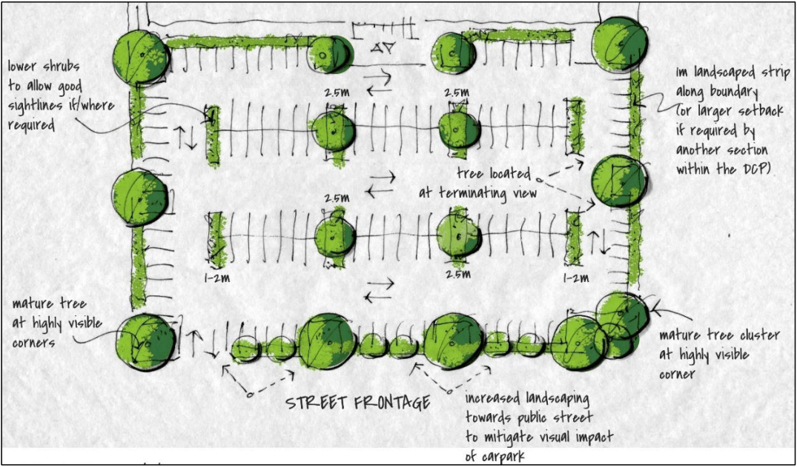

#### 2.18.3 Car parking design criteria

#### Parking for Visitors

1.Visitor parking spaces should be clearly marked and conveniently located to encourage their use by their intended users. Spaces should be freely accessible, preferably in front of the building.

#### Coaches and Car/Taxi Set-down

1\. Taxi, private vehicle and coach drop-off/set-down areas should be provided for larger developments in a convenient off-street location close to pedestrian entrances, with consideration given to the design of the front of the building, safely and interruption to traffic.

2\. The use of on-street space for set-down areas may be possible if off-street provision is impractical or detrimental to pedestrian amenity. However, this would be subject to negotiation with Council.

#### Public Transport

1\. Access to public transport services from developments should be maximised.

#### Garbage Vehicles

1\. Garbage storage and collection areas should be conveniently located and designed so as not to cause unacceptable on-street conflicts. Information should be gained from Council regarding specific garbage collection requirements for the site. Refer to Council’s Waste Management Guideline.

#### Landscaping and Aesthetics

#### General Appearance and Design Considerations

1\. The design of parking areas should take into account the likely visual impact of these areas in the context of the surrounding development and streetscape.  Landscaping is the most effective means of “softening” the appearance of large paved surfaces and multiple rows of vehicles, as well as providing shade for users and assisting with surface water run-off.  A landscape plan is required to be prepared by a suitably qualified person and submitted with the development application, showing the proposed layout of each design.

#### Planting Principles

1\. The planting of trees and shrubs can improve the appearance of car parks considerably and enhance user amenity through sun control. Species should be selected and located to avoid maintenance problems such as interference with overhead wires, underground conduits, damage to paved areas by root systems, and leaf and branch litter.

2\. Trees to avoid for parking areas are those with large surface roots, excessive girth, brittle limbs, fruits which drop and trees which attract large numbers of birds.  In most cases landscaping can be integrated into parking layouts without the need for additional area or loss of spaces.

3\. Car parks that are highly visible from the public domain must comply with the following requirements:

• provide a 2.5m wide landscape bay between every 6-8 car parking spaces,

• provide a minimum 1m landscaping strip at the end of parking aisles, and

• be landscaped generally in accordance with the Figure 2-12.

Figure 2-12 Design features of car park

> [Picture on page 104: a picture, saved as a picture (images/part-02-general-land-use-page-104-15.gif, 150 dpi).]

4\. A minimum 1 metre landscaping strip is to be providing along the boundary (the 1 metre landscaping strip can be included in any front or secondary landscaping requirement e.g. Smeaton Grange).

#### Planting Preparation

1\. Planting areas should be prepared with quality growing media to a minimum depth of 1 metre and have appropriate sub surface drainage. The planted area should be covered with weed free organic mulch to a depth of 100mm.

#### Landscaping Provision

1\. Landscaped areas for car parks must be provided in the form of tree planting, garden beds, mounding, shrubberies, lawns and the like.

2\. In multi-storey parking facilities, the use of planter boxes on the external face of the parking structure is encouraged.  Likewise, exposed retaining walls may be planted with suitable trailing or climbing species.

3\. Planting is also encouraged between parking spaces to maximise shaded areas and to further enhance the appearance of the car park.  Trees should, where possible, be planted every four car parking spaces. To ensure greater sight distances, tree species should have thin trunks with high canopies and garden beds should include low shrubs.

#### Basement Car parking

1\. Where basement car parking extends beyond the building envelope, a minimum soil depth of 1.0m is to be provided, measured from the top of the slab and will not be calculated as part of the deep soil zone.

