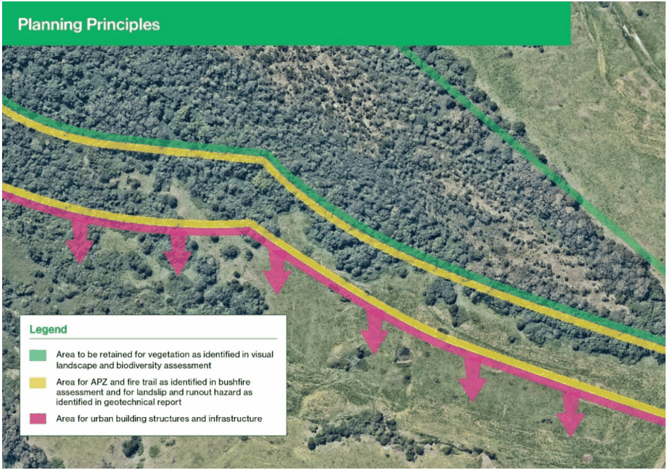

### 2.20 Ridgelines and Steep Land

#### Background

Ridgeline lands are recognised in NSW Government regional and district strategic plans and in Camden Council’s planning strategies and studies as having environmental value in terms of scenic amenity, cultural heritage, and biodiversity values that need protecting. Ridgelines and steep land also present environmental hazards such as land instability and bushfire hazard.  This section of the DCP aims to protect and enhance the environmental values and manage the environmental hazards associated with ridgelines and steep land in development applications.

This section of the DCP applies to development applications for land subdivision, civil works and new buildings on or adjoining ridgeline land and/or land that has a gradient of 15% or greater. This section of the DCP is separated into two parts - Ridgeline Land controls and Steep Land controls. As part of a DA, ridgeline land is to address both the Ridgeline Land and Steep Land controls. However, where land is not considered a ridgeline, the Steep Land controls are to be addressed.

This section of the DCP does not apply to the following development:

• alterations or minor additions to an existing building;

• development on land that is included in a precinct specific plan for ridgeline land or steep land in a DCP schedule which the consent authority is satisfied has been prepared in a manner consistent with the objectives and controls in this section; or

• development which, in the opinion of the consent authority, is consistent with a previous development on the land (such as a masterplanned subdivision) that has been approved or carried out in a manner consistent with the objectives and controls in this section.

The general controls in this section operate in conjunction with the precinct specific controls in the DCP schedules. In the event of an inconsistency between this section and a precinct specific schedule, the precinct specific schedule is to apply. Where site-specific DCP controls address the above criteria, the site-specific DCP controls will prevail.

#### Definitions

Ridgeline Land - is defined as elevated lands characterised by its separation from surrounding terrain by steep slide slopes and includes the high points along ridgelines and hilltops and the steeper upper and lower side slopes.

#### Steep Land – is defined as land which has a gradient of 15% or greater.

#### Objectives

The objectives of this section of the DCP on planning for ridgelines and steep land are to:

a. Maintain, protect and enhance the environmental values of ridgeline land including:

• landscape scenic/visual amenity value;

• biodiversity value of vegetation and habitat including as a biodiversity corridor connection;

• heritage and cultural values and connection with country value;

• stability of the ridgeline and side slopes.

b. Maintain the social and economic values of ridgeline land including:

• social values that encompass the land’s contribution to sense of place and identity, orientation and legibility in the landscape, and amenity and liveability in the locality;

• values of a scenic landscape that encourages business and resident investment and attracts tourism;

c. Manage and mitigate the natural / environmental hazards on ridgelines and steep land including:

• land instability hazards;

• stormwater runoff and subsurface water implications for erosion and instability hazards;

• bushfire hazards;

d. Ensure urban development on ridgeline land responds to the natural environment and its visual amenity and is undertaken in a manner that avoids or mitigates environmental hazards;

e. Ensure the scale, location and height of buildings recedes into the landscape; and

f. Ensure the design of buildings follows the slope of the land to minimise cut and fill.

#### Controls Ridgeline Land Environmental Assessments

1\. A Development Application on land to which this section applies is to be accompanied and informed by the following environmental assessment reports:

Table 2-7: Ridgeline land environmental assessments

| Assessment | Output |
|---|---|
| Visual Landscape Assessment (for land that includes the top of a ridgeline) | • Assessment of visual / scenic landscape significance and whether the ridgeline should be retained as scenic landscape. • Identification of areas which are to be retained as vegetated or revegetated. • Identification of areas to be retained free of visible urban building structures. |

| Assessment | Output • Recommendations for orientation / layout of road and subdivision pattern, building design, and extent of earthworks in urban development area adjacent to ridgeline. |
|---|---|
| Heritage and Connection with Country Assessment | • Identification of any Aboriginal heritage, cultural and/or connections with country value, and likelihood of the presence of any Aboriginal artefacts. • Identification of any non-Aboriginal heritage values items. |
| Geotechnical Assessment | • Geotechnical and land stability conditions. • Land instability risk profile. • Hazardous area of land slip and run out risk in which urban building structures and infrastructure are to be excluded (taking into account any engineering stabilisation measures to be implemented). • Engineering and other measures for land stability such as vegetation retention/rehabilitation, surface and subsurface drainage, landforming, landscape surface treatments, and erosion control in construction and operational stages. |
| Vegetation Management Plan (see below for requirements) Biodiversity Assessment (cont.) | • Context of strategic plans in the locality such as Biodiversity Values Land, Cumberland Plain Conservation Plain Strategic Conservation Area. • Description and biodiversity value of any existing vegetation, habitat and fauna on the subject land and adjacent land. • Identification of areas which are to be retained as vegetated or revegetated. • Potential for the subject land to form a part of a vegetation corridor with adjoining land. • Rehabilitation and ongoing management of existing vegetation. • Restoration of vegetation on areas cleared or occupied by undesirable plant species. |
| Bushfire Hazard Assessment (for bushfire prone land) | • Bushfire risk of existing and/or restored vegetation. • Bushfire protection measures needed for urban development adjacent to ridgelines including asset protection zone, perimeter road/fire trail, and water supply. |

2\. A Vegetation Management Plan is to be undertaken for ridgeline land on which there is existing native vegetation, and/or which is connected to an area of native vegetation, and/or which is intended to be revegetated for either scenic landscape or biodiversity purposes.

3\. An environmental assessment in clause 1 above may be waived if it was prepared previously to inform an approved planning proposal, master plan or subdivision plan applying to the land which is the subject of the Development Application, and if the consent authority is satisfied it is adequate for the Development Application.

#### Development Controls

1\. The planning and design of development on or adjoining ridgeline land is to be consistent with and informed by the abovementioned environmental assessments.

2\. All Development Applications for ridgeline land are to identify the following, where relevant:

• Vegetated Area/s to be retained and rehabilitated for native trees and vegetation under a Vegetation Management Plan in which clearing, urban buildings, infrastructure and engineering works that would adversely affect tree survival are to be excluded (which is to be based on a visual landscape assessment and/or biodiversity assessment);

• Bushfire Protection measures on any bushfire prone land including asset protection zone/s, perimeter fire trail/s and water supply (which is to be based on a bushfire hazard assessment);

• Hazardous area/s that are subject to a high risk of land instability and associated runout in which urban development, buildings and infrastructure are excluded (which is to be based on a geotechnical assessment); and

• Engineering measures to manage hazardous areas of land instability including landforming, surface drainage and subsurface drainage (which are to be based on a geotechnical assessment).

3\. Development Applications that include planting of vegetation on ridgeline land are to include a geotechnical assessment, and arborist assessment or landscape architect statement, demonstrating the soil type and depth are adequate for the vegetation survival.

4\. Development Applications that include retention of vegetation on ridgeline land and engineering works that disturb the ground or earthworks in close proximity to the vegetation are to include an arborist assessment demonstrating the life expectancy of the vegetation will not be undermined by the works.

5\. Development Applications for the subdivision of ridgeline land are to include the following items (in addition to the items in clause 5 above) which are to be based on the abovementioned environmental assessments where relevant to protect and manage ridgeline and steep land:

• Subdivision and road layout;

• Building envelopes on each lot;

• Location of driveway on each lot;

• Interallotment drainage;

• S.88B covenants on title for the following where relevant:

o Building envelope;

o Drainage easements;

o Vegetation management / maintenance;

o Bushfire protection measures (eg. APZ and perimeter fire trail) maintenance;

o Land stability measures including restrictions on carrying out earthworks, and subsurface and surface drainage engineering works maintenance.

6\. Development Applications for ridgeline land are to be generally consistent with the schematic drawing of general planning principles for development on ridgeline land in Figure 2.13 below where relevant.

7\. In subdivision, the size and arrangement of allotments is to be sufficient to accommodate the outcomes of environmental assessments mentioned above and be consistent with the general planning principles in Figure 2.13 below. Development Applications for subdivision plans must demonstrate consistency with the objectives and controls in this section of the DCP for ridgelines and steep lands, notwithstanding any minimum lot size standard applying to the land.

> [Picture on page 112: a picture, saved as a picture (images/part-02-general-land-use-page-112-16.gif, 150 dpi).]

Figure 2-13 Schematic drawing of general planning principles for development of ridgeline land

#### Steep Land Environmental Assessments

1\. A Development Application on land to which this section applies is to be accompanied and informed by the following environmental assessment reports:

Table 2-8: Steep land environmental assessments

| Assessment | Output |
|---|---|
| Geotechnical Assessment (for land which has a gradient of 15% or greater, and/or which has erodible soils or instability. | • Geotechnical and land stability conditions. • Land instability risk profile. • Hazardous area of land slip and run out risk in which urban building structures and infrastructure are to be excluded (taking into account any engineering stabilisation measures to be implemented). • Engineering and other measures for land stability such as vegetation retention/rehabilitation, surface and subsurface drainage, landforming, landscape surface treatments, and erosion control in construction and operational stages. |
| Vegetation Management Plan (see below for requirements) Biodiversity Assessment (cont.) | • Context of strategic plans in the locality such as Biodiversity Values Land, Cumberland Plain Conservation Plain Strategic Conservation Area. • Description and biodiversity value of any existing vegetation, habitat and fauna on the subject land and adjacent land. • Identification of areas which are to be retained as vegetated or revegetated. • Potential for the subject land to form a part of a vegetation corridor with adjoining land. • Rehabilitation and ongoing management of existing vegetation. • Restoration of vegetation on areas cleared or occupied by undesirable plant species. |
| Bushfire Hazard Assessment (for bushfire prone land) | • Bushfire risk of existing and/or restored vegetation. • Bushfire protection measures needed for urban development adjacent to ridgelines including asset protection zone, perimeter road/fire trail, and water supply. |

2\. A Vegetation Management Plan is to be undertaken for steep land on which there is existing native vegetation, and/or which is connected to an area of native vegetation, and/or which is intended to be revegetated for either scenic landscape or biodiversity purposes.

3\. An environmental assessment in clause 11 above may be waived if it was prepared previously to inform an approved planning proposal, master plan or subdivision plan applying to the land which is the subject of the Development Application, and if the consent authority is satisfied it is adequate for the Development Application.

#### Development Controls

1\. Development on land having a natural gradient of 15% (1:6.7) or greater must not be approved unless a geotechnical study, including guidelines for structural and engineering works on the land, has been considered by Council.

In subdivision, the size and arrangement of allotments is to be sufficient to accommodate the outcomes of environmental assessments mentioned above and be consistent with the general planning principles in Figure 2.13 above. Development Applications for subdivision plans must demonstrate consistency with the objectives and controls in this section of the DCP for ridgelines and steep lands, notwithstanding any minimum lot size standard applying to the land.

Additional Controls for residential buildings including outbuildings for both Ridgeline Land and

#### Steep Land

1\. Dwellings and ancillary structures must have a roof line that is lower than the ground surface on the top of ridgelines or hilltops.

2\. Dwellings and ancillary structures are to be sited so as to appear to be below the height of any ridgeline and its vegetation when viewed from public vantage areas such as major transport corridors, parks, lookout vantage point and public heritage items.

3\. Dwellings and ancillary structures must be designed to follow the slope of the land to minimise cut & fill. (Refer also to Section 2.1 for objectives and controls for earthworks.) Split level home and building design is to be used on land which has a gradient of 15% or greater.

4\. Roof design of any dwelling and ancillary structure must complement the slope and visual qualities of the land and have an earthy mid-tone and colour that is recessive in the landscape and has low reflectivity.

5\. Any roof element including solar panels must be constructed of material with low reflectivity.

6\. Driveway design and colour must be visually recessive with the surface constructed of non-reflective materials.

#### -End of Part-

