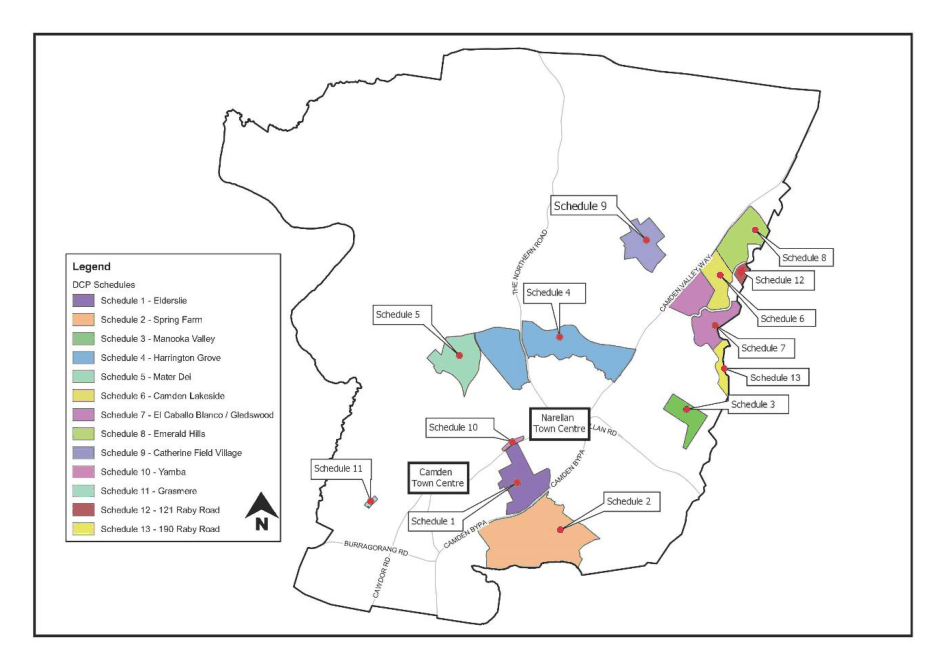

### 3.1 Introduction

#### Background

This part applies to land zoned R1 General Residential, R2 Low Density Residential, R3 Medium Density Residential and Zone R5   Large Lot Residential. This part focuses on the broad issues associated with the subdivision of land which need to be addressed including lot dimensions, street block and lot configuration, street network and public transport.

In addition to these subdivision controls, further controls are provided within the following Schedules of this DCP that apply to site specific localities. Refer to Figure 3-1 which shows the location of the schedules;

Schedule 1 – Elderslie

Schedule 2 – Spring Farm

Schedule 3 – Manooka Valley

Schedule 4 – Harrington Grove

Schedule 5 – Mater Dei

Schedule 6 – Camden Lakeside

Schedule 7 – El Caballo Blanco and Gledswood

Schedule 8 – Emerald Hills

If subdividing in R5 zone refer to the following schedules;

Schedule 9 – Catherine Field Village

Schedule 10 – Yamba

Schedule 11 – Grasmere

Schedule 12 – 121 Raby Road

Schedule 13 – 190 Raby Road

> [Picture on page 5: a picture, saved as a picture (images/part-03-residential-subdivision-page-5-1.gif, 150 dpi).]

Figure 3-1: Map of Schedules

In the event of an inconsistency between a Schedule and the main body of this DCP, the Schedule prevails.

This Part must be read in conjunction with the requirements set out in Part 2 and Part 4 of this DCP, where relevant.

The flow chart below (Figure 3-2) explains how to work your way through Part 3 – Residential Subdivision, depending on the type of subdivision development application and the subdivision category.

