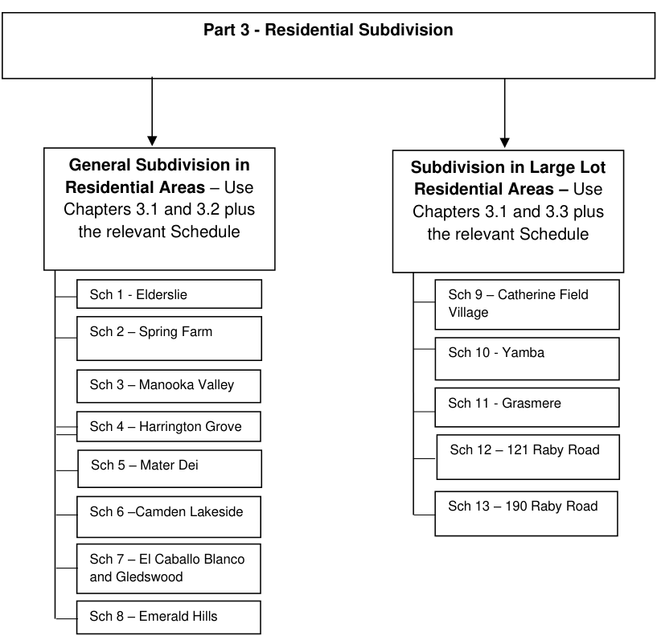

## Part 3 - Residential Subdivision

> [Picture on page 6: a picture, saved as a picture (images/part-03-residential-subdivision-page-6-2.gif, 150 dpi).]
> Words printed on the picture (copied from the PDF):
> the relevant Schedule
> the relevant Schedule
> Sch 1 - Elderslie
> Sch 9 – Catherine Field
> Village
> Sch 2 – Spring Farm
> Sch 10 - Yamba
> Sch 3 – Manooka Valley
> Sch 11 - Grasmere
> Sch 4 – Harrington Grove
> Sch 12 – 121 Raby Road
> Sch 5 – Mater Dei
> Sch 13 – 190 Raby Road
> Sch 6 –Camden Lakeside
> Sch 7 – El Caballo Blanco
> and Gledswood
> Sch 8 – Emerald Hills

#### Subdivision in Large Lot

General Subdivision in Residential Areas – Use Chapters 3.1 and 3.2 plus

Residential Areas – Use Chapters 3.1 and 3.3 plus

Figure 3-2: Residential Subdivision Flow Chart

#### Integrated Development (Small Lot) Application Subdivision Approval Process

#### Background

Integrated Development involves the subdivision and construction of dwellings on small lots (less than 300m2).

An Integrated Development Application can be either categorised as Pathway 1 or Pathway 2 depending on the development type as shown in Table 3-1.

#### Objectives

a. To facilitate a diversity of housing sizes and products;

b. To ensure that subdivision & development on smaller lots is undertaken in a coordinated manner; and

c. To ensure that small residential lots achieve an appropriate level of amenity.

#### Controls

1\. The subdivision of land must comply with CLEP 2010 which prescribes minimum lot size requirements for land in the Camden Local Government Area.

2\. The subdivision approval process for small lot development is to be consistent with the requirements outlined in Table 3-1 below.

Table 3-1: Subdivision Approval Pathway for Integrated Development

|  | Pathway 1 | Pathway 2 |
|---|---|---|
|  | DA for Subdivision with Detached Dwellings or Abutting Dwellings | DA for Subdivision with Attached Dwellings or Semi-Detached Dwellings |
| Application | Lots less than 300m2 | Lots less than 300m2 |
| Dwelling Design s88B restriction required | Yes, only the approved dwellings should be built as shown on the s88B instrument) | No (as the dwellings must be constructed with the subdivision as integrated housing) |
| Timing of subdivision (release of subdivision plan) | At any time with a s88B instrument, or No earlier than post a satisfactory frame inspection from a principal certifying authority (PCA) | No earlier than post a satisfactory frame inspection from a principal certifying authority (PCA) |

