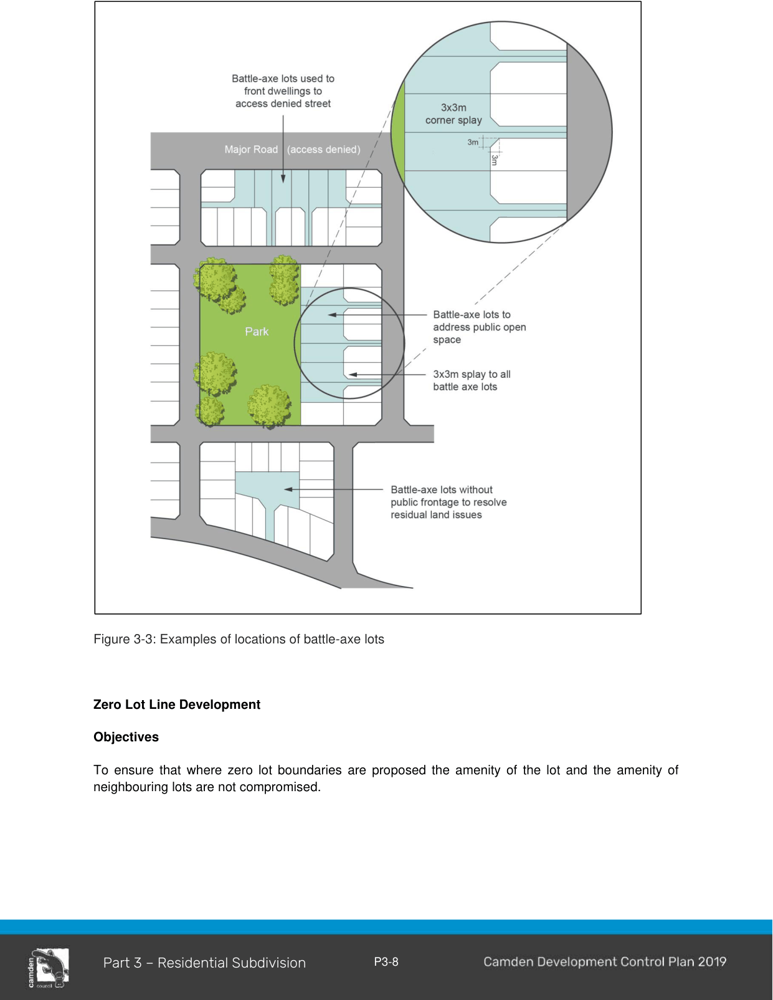

#### 3.2.2 Lot Dimensions

#### Objectives

a. To establish minimum lot dimensions for different residential dwelling types;

b. To encourage a variety of lot sizes, type and design to promote housing choice and create attractive streetscapes with distinctive characters;

c. To ensure sense of place is maintained by ensuring that density and scale is in harmony with the existing or planned character of places; and

d. To ensure that subdivision reflects and reinforces the predominant subdivision pattern of the area.

#### Controls

1\. Final residential lots must comply with the below table.

Table 3-2: Minimum Lot Dimensions

| Minimum Lot size as stated in CLEP 2010 | Minimum Lot Width | Minimum Lot Depth |
|---|---|---|
| 450m2 or greater | 15m | 25m |
| 300m2 and less than 450m2 | 9m | 25m |

Note: Notwithstanding the minimum dimensions specified in Table 3-2, the minimum lot size in CLEP 2010 must be achieved.

2\. Where permitted with consent under CLEP 2010, lots between 225m2 and 300m2 or less than 9m in width, may be considered, where the plan of subdivision includes a building envelope plan which demonstrates compliance with the requirements of this DCP. If approved, Council may require the building envelope plan to be included as part of a s88B Instrument attached to the lot (to only permit the approved dwelling to be constructed).

3\. Where permitted with consent under CLEP 2010, lots less than 225m2, may be considered, where a development application for both the subdivision of land and the construction of a dwelling on the lot is proposed. If approved, Council may require the building envelope plan to be included as part of a s88B Instrument attached to the lot (to only permit the approved dwelling to be constructed).

4\. Lots should generally be rectangular in shape.

Note: Some Schedules contain additional lot dimension controls (including locational requirements) that should also be complied with.

#### Battle-axe Lots

#### Objectives

a. To limit the number of battle-axe lots;

b. To provide battle-axe lots that can accommodate residential development; and

c. To ensure that where a battle-axe lot is proposed the amenity of the lot and the amenity of neighbouring lots or public domain is not compromised.

#### Controls

1\. A battle-axe lot should be considered only where:

a. it has a minimum lot area of 600m2 (excluding the access handle);

b. a building envelope is provided which demonstrates compliance with the provisions for solar access, private open space, setbacks and site coverage of this DCP;

c. a satisfactory building envelope is provided with adequate distance from existing or proposed dwellings, to ensure privacy.

2\. The lot is designed so that the future dwelling house will be orientated to face the park, access denied road or resolve residual land issues (see Figure 3-3).

Where lots are addressing open space or access denied roads, fencing is to be provided on the shared boundary, to a maximum height of 1.5m and is to be open style incorporating pickets, slats, palings or the like or lattice style panels with a minimum aperture of 25mm. The only exception is if the boundary is a noise attenuation barrier which should be suitably designed (e.g. incorporating colour variation or textured panels) to maintain visual amenity.

3\. Dual Occupancy development must not be located on a battle-axe lot.

4\. Battle-axe access handles must:

- be at least 3.5 metres wide, if servicing one additional lot;

- be at least 5 metres wide if servicing two lots;

- not service more than 2 lots;

- have a maximum length of 50m and have reciprocal rights of way;

- have a 3m x 3m splay in accordance with Figure 3-3

> [Picture on page 11: a picture, saved as a picture (images/part-03-residential-subdivision-page-11-1.gif, 150 dpi).]

Figure 3-3: Examples of locations of battle-axe lots

#### Zero Lot Line Development

#### Objectives

To ensure that where zero lot boundaries are proposed the amenity of the lot and the amenity of neighbouring lots are not compromised.

1\. Zero lot line development is only permitted on lots less than 400m2.

2\. An easement is required on the neighbouring lot where a zero lot line is nominated on an allotment on the subdivision plan, the adjoining (burdened) allotment is to include a 900mm easement for single storey zero lot walls and 1200mm easement for two storey zero lot walls to enable servicing, construction and maintenance of the adjoining dwelling.

3\. The location of a zero lot line is to be determined primarily by topography and should be on the low side of the lot to minimise water penetration and termite issues.  Other factors to consider include dwelling design, adjoining dwellings, landscape features, street trees, vehicle crossovers and the lot orientation.

4\. The S88B instrument for the subject (benefited) lot and the adjoining (burdened) lot must include a note identifying the potential for a building to have a zero lot line. The S88B instrument supporting the easement is to be worded so that Council is removed from any dispute resolution process between adjoining allotments.

Note: Part 4 provides additional built controls for development on the zero lot.
