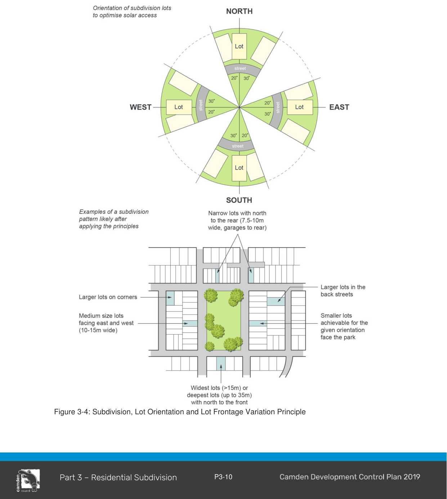

#### 3.2.3 Street Block and Lot Configuration

#### Objectives

a. To respect the natural attributes of the site; and

b. To optimise outlook, solar access and proximity to public and community facilities, parks and public transport with increased residential density in proximity to those areas.

#### Controls

1\. Street blocks are to be a maximum of 250m long x 70m deep where the layout is grid formation. Longer block lengths and depths may be considered by Council where it can be demonstrated that pedestrian connectivity, stormwater management and traffic calming objectives are achieved.

2\. Lot orientation and configuration is to be generally consistent with the subdivision principles shown at Figure 3-4. The preferred lot orientation is either on a north-south or east-west orientation. In locations which have views and vistas which may offer future residents a high level of visual amenity (e.g. views to bushland, open space, valleys or distant hills) an alternative lot orientation may be considered.

3\. Residential lots must generally be rectangular and the use of battle-axe lots is to be minimised.

4\. Where smaller lots are permitted they must be located close to neighbourhood centres, public transport or adjacent to high amenity areas such as parks.

5\. Where possible, plans of subdivision are to identify the location of utility infrastructure and / or existing or proposed substations, kiosks, sewer man holes and/or vents affecting corner lots.

> [Picture on page 13: a picture, saved as a picture (images/part-03-residential-subdivision-page-13-6.gif, 150 dpi).]

Figure 3-4: Subdivision, Lot Orientation and Lot Frontage Variation Principle

