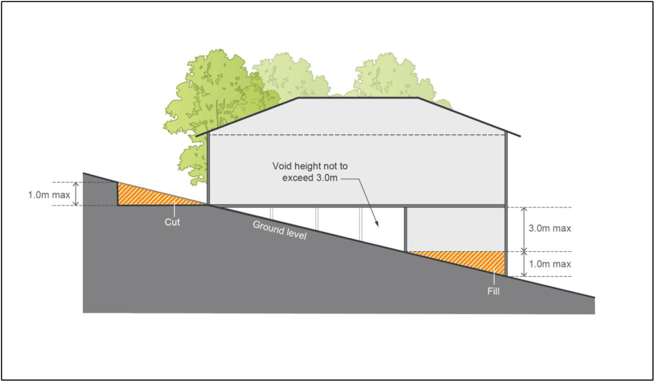

#### 4.2.2 Cut and Fill

#### Objectives

a. To minimise the extent of cut and fill within residential allotments;

b. To protect and enhance the aesthetic quality of the area by controlling the form, bulk and scale of land forming operations; and

c. To ensure that the amenity of adjoining residents is not adversely affected by any land forming operation.

#### Controls

1\. Development Applications (DA’s) are to illustrate where it is necessary to cut and/or fill land and provide justification for the proposed changes to the land levels.

2\. The maximum amount of cut must not exceed 1m.

3\. The maximum amount of fill must not exceed 1m.

4\. Fill greater than 300mm within 1m of a property boundary must be fully contained by the use of deepened (drop) edge beam construction with no fill permitted outside of this building footprint.

5\. The use of a deepened edge beam must not exceed 1m above natural ground level.

On steeply sloping sites, Council may consider deepened edge beams greater than 1 metre where it can be demonstrated that there will be no detrimental impacts on neighbouring properties, and can meet the objectives.

6\. Council will consider permitting greater cut for basement garages, split level designed development and steeply sloping sites. Basement garages will be considered on steeply sloping sites where it can be demonstrated that:

a. a finished ground level slope equal to or more than 15% will be achieved; and

b. there will be no adverse impacts on the existing and future amenity of any adjoining land on which residential development is permitted.

7\. Where excavation or filling is required alongside a driveway, it must be retained by a retaining wall.

8\. Where the same builder or developer is developing adjoining sites, Council may vary Controls No. 2, 3 or 4 subject to a merit based assessment of the impacts upon each affected property.

9\. All retaining walls (including associated footings and drainage etc.) are to be contained wholly within subject property boundaries. Excavations affecting adjoining properties are to be retained or shored immediately. All other approved retaining walls are to be in place prior to the issue of an occupation certificate.

10\. Where retaining walls are proposed to be built on the boundary (on side and / or rear boundaries), an s88B Instrument stipulating a positive covenant is required on the lots affected by the retaining wall.

11\. The maximum height of voids within individual allotments is 3m, as illustrated in Figure 4-1.

> [Picture on page 8: a picture, saved as a picture (images/part-04-residential-dwelling-controls-page-8-1.gif, 150 dpi).]

Figure 4-1: Maximum height of voids within residential lots
