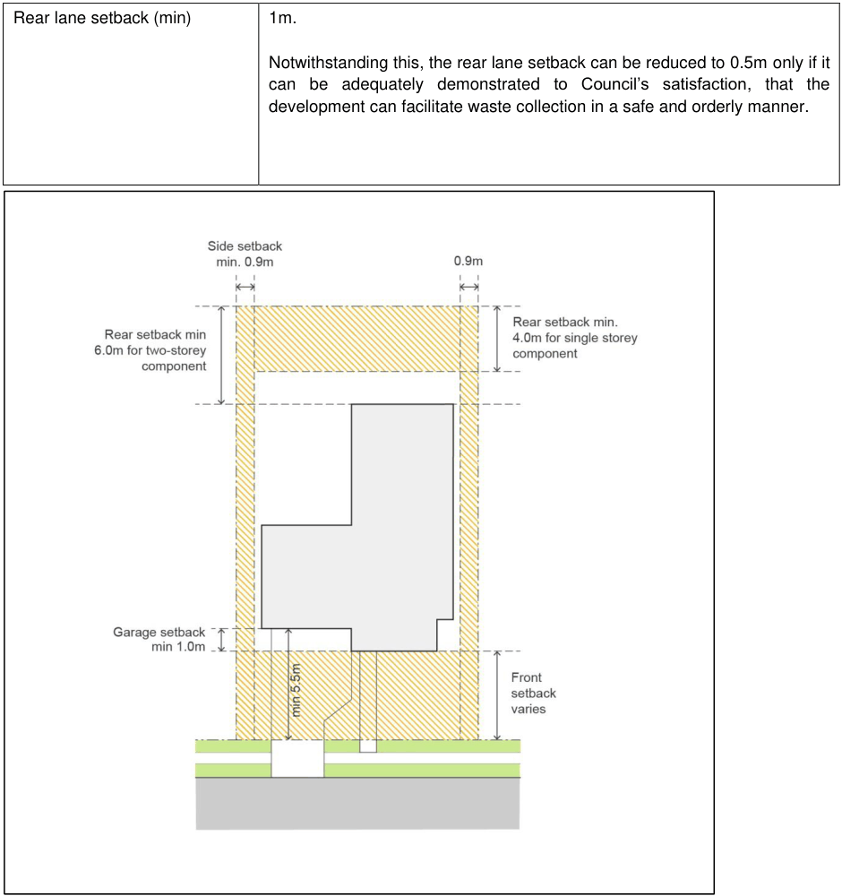
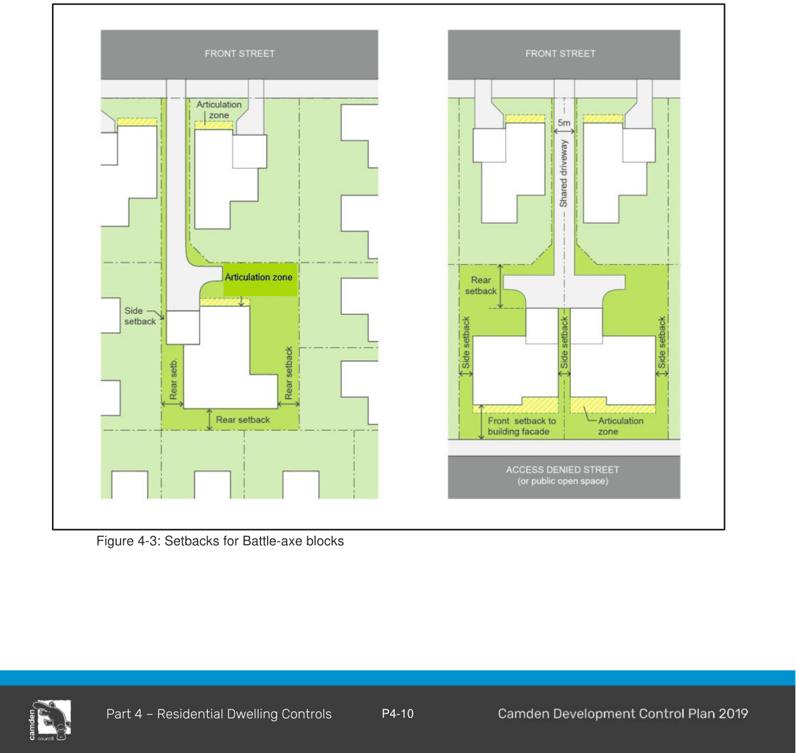
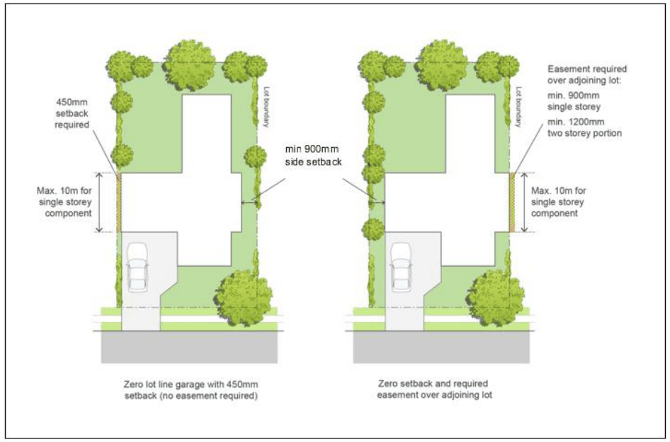

#### 4.2.4 Setbacks

#### Objective

a. To minimise the impacts of development on neighbouring properties with regards to view, privacy and overshadowing;

b. To ensure garages do not dominate the streetscape; and

c. To ensure buildings on corner sites provide an appropriate secondary street setback and maintain sight lines for the safety of pedestrians and vehicles.

#### Controls

1\. The general numerical setback requirements for residential accommodation are listed in Table 4-2 below.

Note: These apply to all areas except where a specific setback control is provided for that area elsewhere in this DCP, or where a registered building envelope applies to the lot.

2\. Setbacks must be measured between the principal wall closest to the boundary and the boundary line, excluding any architectural building design element encroachments as permitted by this DCP

3\. Front setbacks on irregularly-shaped lots (e.g. those which are not perpendicular to the street) must be calculated in accordance with control 2 above.

4\. Architectural building design elements on the front façade may encroach 1.5m into the prescribed front setback area where it can be demonstrated that such elements have a positive effect on the streetscape. For further information regarding architectural building elements refer to subsection

2.3 – Control 1.

5\. Building elements such as eaves, fascias, gutters, down pipes, flues, light fittings, electricity or gas meters, rainwater tanks and hot water units may encroach upon the prescribed side boundary setbacks, provided they do not impact upon adjoining properties and achieve compliance with the National Construction Code (NCC).

6\. 900mm side setbacks for awnings may be measured to the awning post, with awning overhangs beyond the post of up to 450mm permitted, consistent with the allowable overhangs for dwelling eaves, fascias, sun hoods, gutters, downpipes, flues, light fittings, electricity or gas meters, rainwater tanks and hot water units.

7\. Walls along the side boundary setbacks must be articulated to avoid the appearance of excessively long walls. Articulation may be provided in the form of a window, wall return or architectural feature.

8\. Where there is a large or potentially large tree in the road reserve or public open space adjacent to the site, a setback will be required that is sufficient to avoid damage to the tree or future problems with the development.

9\. For steeply sloping sites the front setbacks specified in this clause may be inappropriate and may need to be varied. The siting of buildings on such sites must take into consideration the grade of the resultant access driveway and allow for the need to provide batters and/or retaining walls for any areas of cut and filling. Generally front boundary setbacks need to be increased for steeply sloping sites.

10\. In exceptional circumstances, Council may consider a reduced rear setback on corner allotments where it can be demonstrated that there is no adverse impact on the adjacent properties, streetscape in general and lot coverage. The following factors will be taken into consideration, but are not limited to:

- Bulk, mass and scale of the structure;

- Privacy impact;

- Overshadowing;

- Streetscape and architectural treatment; and

- Provision of Private Open Space and landscaping requirements

Note: In the case of corner allotments, the primary street frontage is taken to be the boundary which is the shorter of both frontages. The rear setback is taken to be the opposite boundary to the primary frontage.

Table 4-2: Setbacks

| Element | Control |
|---|---|
| Front setback (min) | The setback of a dwelling house and any attached development from a primary road must not be less than the average setback from the primary road of the 2 nearest dwelling houses on the same side of the primary road. If there are not 2 dwelling houses within 40m of the lot on the same side of the primary road, the dwelling house and any attached development must have a minimum setback from the primary road as shown in the following: Lot size Minimum setback from primary road < or equal to 900m2 4.5m A reduced front setback of 3.5m where the development is fronting open space. >900m2–1,500m2 6.5m >1,500m2 10m |
| Front setback for Battle-axe block (min) | 3.5m applies only if the lot fronts an access denied street or open space as per Figure 4-3 |
| Secondary Setback | 2m A greater secondary setback may be required if the proposed development does not positively address the secondary street and/or demonstrate a good level of amenity. |
| Garages and carports (including garages on secondary setback) | Minimum 1m behind the building line of the dwelling and at least 5.5m from the road in accordance with Figure 4-2. |
| Articulation • Primary street frontage | 1.5m (max) |
| Side setback • Secondary frontage | 0.9m • 0.5m (max) |
| Rear setback – single storey dwelling or single storey portion of a two storey dwelling (min) | 4m |
| Rear setback – two storey portion of a two storey dwelling (min) | 6m |

Rear lane setback (min) 1m.

Notwithstanding this, the rear lane setback can be reduced to 0.5m only if it can be adequately demonstrated to Council’s satisfaction, that the development can facilitate waste collection in a safe and orderly manner.

> [Picture on page 12: a picture, saved as a picture (images/part-04-residential-dwelling-controls-page-12-5.gif, 150 dpi).]

Figure 4-2: Setbacks

#### Setbacks for Battle-axe Lots

#### Background

Due to an existing subdivision pattern, or a particular landform, there may be an opportunity to create an additional allotment known as a battle-axe lot. Dwelling houses on battle-axe lots have some different impacts from dwelling houses on lots that face the street. There is a need to be more sensitive to neighbouring properties in terms of privacy, overshadowing and built form.

#### Objectives

a. To ensure setbacks between neighbouring dwellings provide visual and acoustic privacy.

#### Controls

1\. Front setback of 3.5m only applies to battle axe blocks where the lot fronts an access denied street and/or open space in accordance with Figure 4-3.

2\. Side and rear setbacks for battle-axe blocks are to be measured in accordance with Figure 4-3 (below).

NOTE: The garage can utilise the side setback control, while the remainder of the house must be setback as per the rear setback control.

> [Picture on page 13: a picture, saved as a picture (images/part-04-residential-dwelling-controls-page-13-10.gif, 150 dpi).]

Figure 4-3: Setbacks for Battle-axe blocks

#### Zero Lot Line Development

#### Background

To facilitate the most efficient use of land on smaller lots, a dwelling may be designed so that a side wall of the dwelling is built on or close to the side boundary. This is referred to as ‘zero lot line’ development.

NOTE: Zero lot line development has a zero lot line on one side boundary only. This is distinct to semi-detached dwellings or attached dwellings which may also be attached to other dwelling/s.

#### Objectives

a. Maximise the efficient use of small allotments where no adverse impact is created for adjoining properties.

b. To ensure that the benefitted party can reasonably access and use the easement for its intended purpose.

#### Controls

1\. An easement for ‘support and maintenance’ (servicing, construction and maintenance) of the zero lot line wall (and any services along the side of the dwelling) is to be provided on the adjoining property, except where a 450mm side boundary setback is provided. Refer to Figure 4-4.

2\. Projections will be permitted to encroach into zero lot line easements where:

a. the encroachment will not impede the benefited party from reasonably using easement for its intended purpose;

b. the encroachment will not have adverse amenity impacts on the adjoining lot;

c. there is an unobstructed vertical clearance of 5m from the underside of any eave, to the finished ground level of the adjacent benefited lot, whichever is higher; and

d. services will not impede the ability to undertake maintenance.

3\. For single storey development, walls must not exceed 50% of the length of the boundary that the zero lot applies to.

4\. For two storey development, walls must not exceed 30% of the length of the boundary that the zero lot applies to.

5\. No section of a wall built on a side boundary (including walls setback 450mm) should be longer than 10 metres (i.e. an internal courtyard or light well will be required to achieve this standard).

6\. Excavation is not permitted within an easement for ‘support and maintenance’ (servicing, construction and maintenance). All filling adjacent to an easement for ‘support and maintenance’ must be contained within the building footprint i.e. drop edge beams.

7\. Access to the rear yard of zero lot line development must be provided via a minimum 0.9m metre side setback on the opposite side of the dwelling, or via a rear garage door provided as a ‘drive through garage’.

> [Picture on page 15: a picture, saved as a picture (images/part-04-residential-dwelling-controls-page-15-9.gif, 150 dpi).]

Figure 4-4: Zero Lot Line Development
