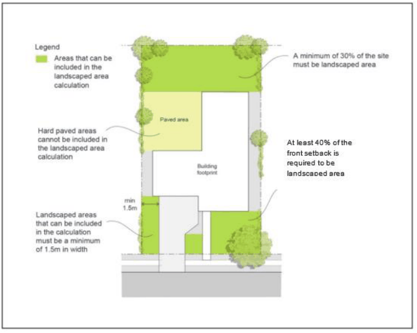

#### 4.2.6 Landscaped Area

#### Objective

a. To ensure that each site has sufficient area for landscaping, including deep soil planting areas, to facilitate the establishment of attractive and functional streetscapes;

b. To enhance the quality of the built environment by providing opportunities for landscaping; and

c. To create the desired street character.

Landscaped area means a part of a site used for growing plants, grasses and trees, but does not include any building, structure or hard paved area.

#### Controls

1\. A minimum of 30% of the site must consist of landscaped area (Figure 4-5).

2\. Areas less than 1.5 metres in width are not to be included in the calculation of landscaped area.

3\. A minimum of 40% of the front setback (as measured from the building line) must be landscaped area.

4\. Plans submitted with the development application must include a landscape plan.

Note: Synthetic or artificial grass is not to be included in landscaped area calculations. It is also noted that Council does not permit the use of artificial turf within public land adjacent to the road verge. Artificial turf can have detrimental impacts with regard to maintenance, access to utilities, natural drainage and offers no ecological or long term amenity benefits. It is an offence to install artificial turf on public land without the prior approval of Council. Council may pursue regulatory action in these instances, including requiring removal of any such installation.

> [Picture on page 18: a picture, saved as a picture (images/part-04-residential-dwelling-controls-page-18-1.gif, 150 dpi).]

Figure 4-5: Landscaped Area
