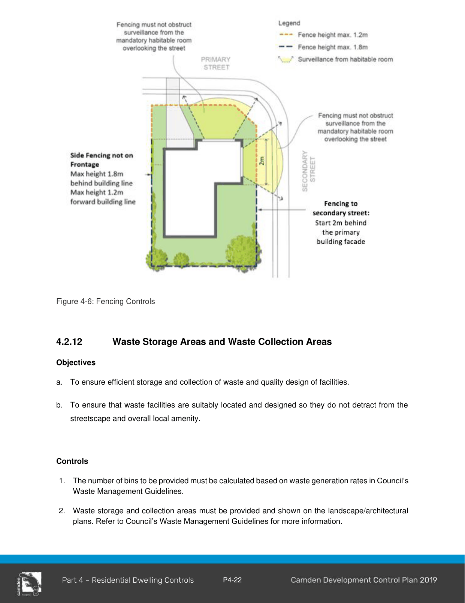

#### 4.2.11 Fencing

#### Objectives

a. To ensure boundary fencing is of a high quality and does not detract from the streetscape.

b. To encourage the active use of front gardens through provision of secure areas.

c. To ensure that rear and side fencing will assist in providing privacy to private open space areas.

d. To ensure that fence height, location and design will not affect traffic and pedestrian visibility at intersections.

#### Controls

1\. Front fencing must have a maximum height of 1.2m above ground level (existing) and must be open style incorporating pickets, slats, palings or the like or lattice style panels with a minimum aperture of 25mm (refer to Figure 4-6).

2\. Front fences and walls are not to impede safe sight lines for traffic.

3\. Fences on corner lots facing the secondary street frontage, must have a maximum height of 1.8m to a point which is a minimum of 2m behind the primary building line (refer to Figure 4-6) . Any fencing forward of this point must comply with control 1, having a maximum height of 1.2m and incorporating an open style design (refer to Figure 4-6). The location of corner lot fencing must be shown in the submitted site plan or landscape plan.

4\. All other fencing must comply with State Environmental Planning Policy (Exempt and Complying Development Codes) 2008. Details of any fencing which does not meet this criteria must be provided and assessed as part of a development application.

> [Picture on page 25: a picture, saved as a picture (images/part-04-residential-dwelling-controls-page-25-1.gif, 150 dpi).]

Figure 4-6: Fencing Controls
