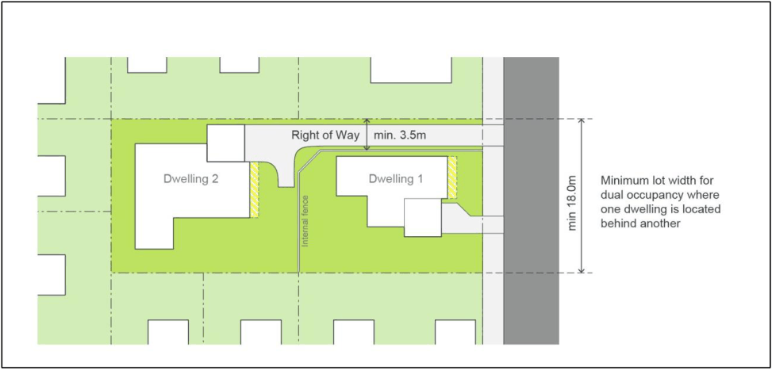

### 4.4 Dual Occupancies and Semi Detached Dwellings

#### Objectives

a. Ensure dual occupancies and semi-detached dwellings are compatible with existing housing and do not adversely affect the local environment or the amenity of adjacent residents.

b. Provide housing choice for the residents of the Camden LGA.

#### Controls

1\. Dual Occupancy and semi-detached dwelling development must comply with the controls in Sections 4.2.1- 4.2.12 (General Residential Development Controls), except where the controls in this section differ, in which case the controls in this chapter and Table 4.5 take precedence.

2\. Dual occupancy and semi-detached development on corner lots must be designed to address both street frontages.

3\. Each dwelling must provide a minimum storage area of 8m3. This space is to be provided exclusively for storage purposes and must be provided in addition to any garage space.

4\. Mirror-reversed or replicated built form is not permitted. Forms of differentiation and interest must be provided to all dwellings.

5\. The architectural treatment and building materials of both dwellings should be compatible.

6\. Each dwelling should have a separate driveway.

7\. Dual Occupancy development is not permitted on battle-axe lots.

Note:  Dual occupancies and semi-detached dwellings are types of residential accommodation that are very similar in terms of built form (both consist of two dwellings). The distinction between the two is that dual occupancies are located on one lot of land and may only be strata subdivided, whereas semi-detached dwellings are located on their own lot of land (Torrens title). Accordingly, semi-detached dwellings are generally suitable for locations which have a smaller minimum lot size, and development consent must be sought for both semi-detached dwellings and Torrens title subdivision concurrently when lodging a development application in order to satisfy the CLEP definition.

Table 4-5: Controls for Dual Occupancies and Semi-Detached Dwellings

| SITE REQUIREMENTS |  |
|---|---|
| Lot size (min) | ≥600m2 For corner lots ≥800m2 |
| Lot width primary frontage (min) • For development where the dwellings are side by side • For development where one dwelling is directly behind the other (battle axe formation) –Figure 4-7 | ≥22m (at the building line) ≥18m (at the building line) |
| SETBACKS |  |
| Dual Occupancies Setbacks for Dual Occupancies where one dwelling is directly behind the other (battle axe formation) | Consistent with 4.2.4 Setbacks The setbacks for the rear dwelling in accordance with Figure 4-7. |
| Secondary street setback (min) | ≥4.5m |
| SITE COVERAGE |  |
| Site coverage (max) | Single storey development - ≤60% Two storey development – ≤60% ground floor, ≤30% upper floor |
| GARAGE DESIGN |  |
| Car parking Requirements | 1 car parking space for each dwelling with ≤2 bedrooms 2 car parking spaces for each dwelling with ≥3 bedrooms |

> [Picture on page 30: a picture, saved as a picture (images/part-04-residential-dwelling-controls-page-30-1.gif, 150 dpi).]

Figure 4-7: Dual Occupancy with 18 metre frontage

