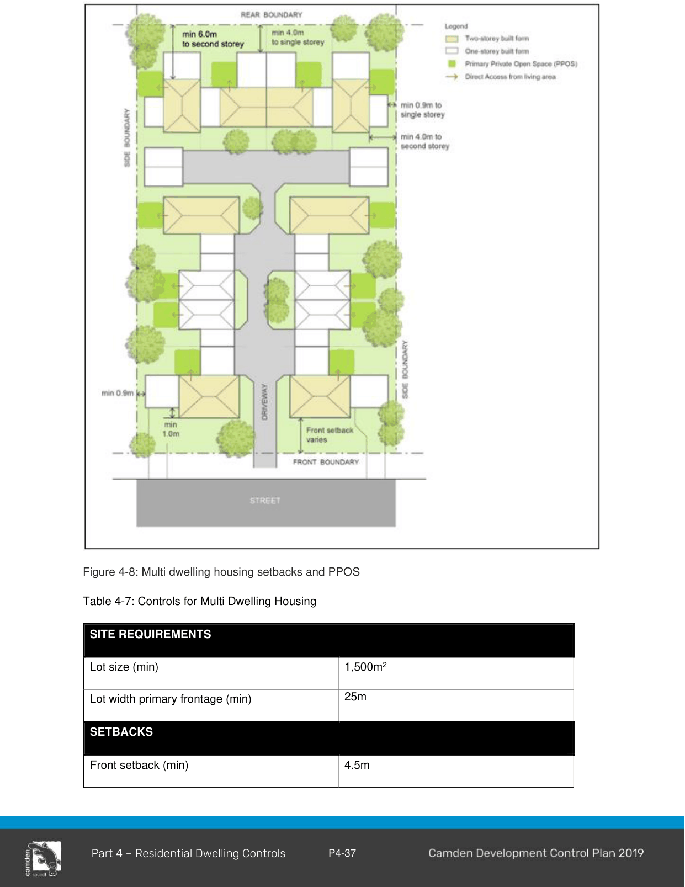

### 4.6 Multi Dwelling Housing

#### Objectives

a. Encourage high quality residential developments which feature a high standard of urban design and provide a high level of amenity for residents;

b. Ensure that development sites have sufficient site area to accommodate appropriate setbacks and open space areas, including areas for deep soil planting and natural site drainage;

c. To ensure that each new dwelling provides a sufficient amount of storage for elements such as garden equipment and bicycles; and

d. To ensure waste storage areas and waste collection areas are suitably located and designed to be compatible with the streetscape, accessible, clean and safe for all users and collectors.

#### Controls

1\. Multi dwelling housing must comply with the controls in Sections 4.2.1- 4.2.12 (General Residential Development Controls), except where the controls in this chapter differ, in which case the controls in this Chapter and Table 4-7 take precedence.

2\. Multi-dwelling housing sites are to have direct frontage to a public road (i.e. not on battle-axe lots).

3\. Multi dwelling housing should have a unified design for the whole development, a coordinated style and base colour palette. Individuality can be added as small details or accent colours, rather than strikingly different forms.

4\. At least one habitable room is to be located at the front of each dwelling addressing the street and/ or internal driveway.

5\. PPOS must be directly accessible from the main living area (Figure 4-8).

6\. PPOS is permitted within the front setback provided that:

a. the dwelling is of a two-storey construction which provides casual surveillance to the street from a first-floor balcony; and

b. the location of PPOS in the front setback is required to achieve compliant solar access.

7\. Multi dwelling housing should provide a clear differentiation between private areas (open space, private front and side yard areas, private car parking spaces) and communal open space and car parking.

8\. Controls for adaptable dwellings (requirement triggered by minimum number of dwellings in development located in 4.7 Residential flat buildings and shop top housing) also apply to multi-dwelling housing. Adaptable dwellings are preferably to be single level accommodation at ground level and be located on the street frontage.

9\. Communal visitor and/or resident’s parking areas should be located within view of residents to facilitate passive surveillance of these areas.

10\. Traffic calming measures should be provided to ensure a safer vehicle and pedestrian environment.

11\. Driveways, manoeuvring areas, parking areas and garages are to be located away from bedrooms.

12\. Internal driveways must be the smallest configuration possible while allowing for vehicle manoeuvrability and landscaping.

13\. Internal driveways should avoid long gun barrel appearance. The alignment of driveways should:

a. be varied to avoid a straight gun barrel appearance, particularly when parking is at grade; and

b. be flanked by landscaped verges to soften development on either side.

14\. Each dwelling must provide a minimum storage area of 8m3. This space is to be provided exclusively for storage purposes and must be provided in addition to any garage space.

#### Image and legibility

1\. The proposed development should:

a. blend in with its surroundings and/or be in keeping with the character of the area.

b. be designed to be compatible with the streetscape and be attractive when viewed within the site.

c. create an appearance of a single or grouped dwellings that are separated by gardens and ancillary structures, with facades designed to incorporate a variety of materials and shading structures.

d. avoid repeating designs used in other developments, particularly those located in close proximity to the proposal. It is, however, recognised that there may be instances in a planned development where repetition of a design element is used to create a theme development. These proposals will be considered on the merit of the design. Forms of differentiation and interest are encouraged in all dwellings.

e. provide a clear differentiation between private areas (open space, private front and side yard areas, private car parking spaces) and communal open space and car parking.

f. provide a minimum of 12m between front facades within the development so that the layout does not create gun-barrel vistas.

g. clearly identify each unit, its entrance, visitor carparking to enable a visitor to easily understand the development’s layout.

#### Access and entries

1\. The proposed development should:

a. minimise vehicular and pedestrian entry and exit points to the site.

b. provide a defined and well-lit pedestrian ‘safe route’ which can be clearly viewed by residents for passive surveillance.

c. consider site accessibility to people in wheelchairs and with lesser mobility.

d. The proposed development should be designed to comply with ‘Safer By Design’ Guidelines.

#### Communal open space and landscaping

1\. A landscape plan is to be submitted with every application for multi dwelling housing.

2\. Landscaping must take into account probable day and night use by residents, seating and the provision of shade.It should allow surveillance by residents i.e. the plants are either high (canopy trees) or low (ground covers).

3\. Landscaping is to be provided to the side and rear boundary setback areas and along driveways to improve visual amenity.

4\. If the area is fenced, the fence must be dark in colour and permeable to maximise passive surveillance of the area.

5\. Communal open space landscaping must be designed to minimise water usage and maintenance requirements.

6\. Communal open space should be provided in locations which help to retain existing trees wherever possible.

#### Waste Storage Areas and Collection

1\. A detailed Waste Management Plan (WMP) must be submitted for the ongoing use of the site. A WMP must outline the waste that will be generated from the site, how the development proposes to manage the waste on site and collection.

2\. Bins must be presented kerbside for collection. The total number of bins awaiting collection must not exceed 50% of street frontage (driveways not included in street frontage). Variations to this control will be considered only if it can be demonstrated to Council’s satisfaction that there are suitable arrangements for waste collection and no adverse impacts on neighbouring properties, streetscape and local amenity.

3\. In exceptional circumstances where suitable arrangements for kerbside presentation cannot be practically achieved, Council may consider a collect and return service from an alternate collection point (may be either the communal waste storage area or a temporary bin holding area). The alternate collection point must:

a. be provided within 10m of the kerb;

b. be setback at least 3 metres from the front boundary;

c. be suitably screened or otherwise not visible from the street;

d. be a hardstand which is graded and drained appropriately to prevent pollution;

e. be designed as per Council’s Waste Management Guideline;

f. enable a collect and return service to be provided conveniently and safely, via a concrete , unobstructed pathway with a minimum width of 1.6m between the temporary bin holding area and waste collection area;

g. allow for each bin to be readily accessed and manoeuvred in and out of the area (stacked bin arrangements are not acceptable);

h. where the alternate collection point is a temporary bin holding area bins may be placed in this area no more than 24 hours prior to collection; and

i. have a floor area at least 20% larger than the size of the bins and/or equipment required.

4\. Waste collection areas must not obstruct traffic flows on the road, vehicle entry to the property or pedestrian traffic in front of the property.

5\. Where alternative collection arrangements are considered (i.e. collect and return service and alternate collection points), a communal waste storage area must be provided. Communal waste storage area must:

a. be suitably screened from the street frontage or otherwise not be visible from the street;

b. be well lit, built in accordance with the Building Code of Australia and well ventilated in accordance with AS 1668.4 (AS 1668.2 for buildings requiring mechanical ventilation)

c. have a smooth graded ground surface;

d. have a minimum ceiling height of 2.4m;

e. be protected from inclement weather conditions via a roof;

f. provide an external water tap adjacent to the storage area;

g. provide a drain in the bin storage area discharging to a sewer connection;

h. have doorways with a minimum width of 1.8m and unobstructed pathway with a minimum width of 1.6m between waste storage area and waste collection area;

i. allow for each bin to be readily accessed and manoeuvred in and out of the area (stacked bin arrangements are not acceptable);

j. have a floor area at least 50% larger than the size of the bins and/or equipment required; and

k. provide a minimum of 6m2 additional floor space for bulky waste in the communal waste storage area.

6\. Where a development is under a strata or community title the owners’ corporation must take responsibility for the management of waste and recyclable materials generated upon the site as well as cleaning and maintenance of associated facilities. An ongoing waste management plan must be submitted to demonstrate that there are suitable arrangements in regards to the management, maintenance and cleaning of all waste/recycling management facilities.

> [Picture on page 40: a picture, saved as a picture (images/part-04-residential-dwelling-controls-page-40-1.gif, 150 dpi).]

Figure 4-8: Multi dwelling housing setbacks and PPOS

Table 4-7: Controls for Multi Dwelling Housing

> Words printed on the picture (copied from the PDF):
> Lot size (min)
> 1,500m2
> 25m
> Front setback (min)
> 4.5m

#### SITE REQUIREMENTS

Lot width primary frontage (min)

#### SETBACKS

|  | or |
|---|---|
|  | In established areas, the front setback must |
|  | be consistent with the prevailing setback |
|  | established by adjacent development. The |
|  | prevailing setback is calculated as being the |
|  | average distance of the setbacks of the |
|  | nearest two dwelling houses having a |
|  | boundary with the same primary road. |
| Secondary street setback (min) | 2m |
| Side setback (min) | Ground floor: 0.9m Upper floor: 4m |
| Rear setback (min) | Ground floor: 4m Upper floor: 6m |

#### SITE COVERAGE, LANDSCAPING AND PRINCIPAL PRIVATE OPEN SPACE

| Site coverage (max) | 50% |
|---|---|
| Landscaped Area (min) | Refer to 4.2.6 Landscaped Area |
| Principal private open space (PPOS) (min) | 16m2 with a minimum dimension of 4m at ground level or 10m2 with a minimum dimension of 2.5m as balconies. |

#### GARAGE DESIGN

| Garage door width (max) | Multi Dwelling Housing - 50% of front elevation of the width multi dwelling housing unit. |
|---|---|
| Car parking Requirements | 1 car parking space per dwelling, plus 0.2 car parking spaces per 2-bedroom dwelling, plus 0.5 car parking spaces per 3 or more- bedroom dwelling. 1 visitor car parking space per 5 dwellings |

