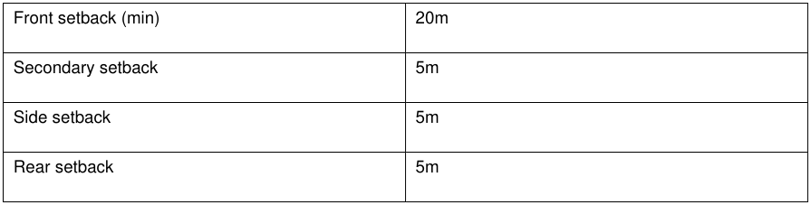

### 4.7 Large Lot Residential Areas (R5 Zones)

#### Background

The Camden LGA features an R5 Large Lot Development residential zone which permits a specific type and density within the area. Dwelling houses within R5 zones must comply with the controls in Sections 2.1- 2.12, except where the controls in this chapter differ, in which case the controls in this chapter takes precedence.

#### Objectives

a. To provide controls for dwellings in R5 zones to ensure that it achieves a high standard of urban design and that it is compatible with the amenity and character of the R5 zone; and

b. To provide a variety of attractive and cohesive streetscapes within the R5 zone.

Note: Additional objectives are listed in the detailed controls below.

#### Unsewered Sites

#### Objective

a. To ensure that unsewered sites are provided with appropriate effluent management.

#### Control

1\. On unsewered sites, effluent and household waste water is to be disposed in accordance with Council’s Sewage Management Strategy.

#### Setbacks

#### Controls

1\. The general numerical setback requirements for dwellings in R5 development are listed in Table 4- 8 below. These apply to all areas except where a specific setback control is provided for that area elsewhere in this DCP, or where a registered building envelope applies to the lot.

2\. Notwithstanding the numerical setback requirements in Table 4-8, all setbacks must be consistent with the prevailing setback established by existing adjacent development to maintain the streetscape. The prevailing setback is calculated as being the average distance of the setbacks of the nearest two dwelling houses having a boundary with the same primary road.

3\. Setbacks must be measured between the principal wall closest to the boundary and the boundary line, excluding any architectural building design element encroachments as permitted by this DCP.

Table 4-8: Dwelling Setback Controls for Large Lot Residential Lots

> [Picture on page 43: a picture, saved as a picture (images/part-04-residential-dwelling-controls-page-43-4.gif, 150 dpi).]

| Front setback (min) | 20m |
|---|---|
| Secondary setback | 5m |
| Side setback | 5m |
| Rear setback | 5m |

#### Colours and Materials

#### Objective

a. To protect the rural setting by minimising impacts on environmentally sensitive locations and scenic quality.

#### Control

1\. Materials and colours for buildings (including ancillary structures) must adopt neutral / earthen colours such as tones or greys, grey-greens, blue-greys, browns or fawns. Bright colours, stark whites and blacks must be avoided.

2\. Non-reflective materials for external use must be utilised.

#### Fencing

#### Objectives

a. Ensure boundary fencing is of a high quality and constructed using materials and finishes which are consistent with the character of the locality and do not detract from the streetscape; and

b. Permit appropriate fencing for the screening of courtyards and private open space areas.

#### Controls

#### Front fences and dividing fences

1\. Front fences must have a maximum height of 1.5m and be of traditional picket, open post and wire, post and rail, or masonry utilising only brick or stone construction.

2\. Dividing fences and returns to dividing fences must be a maximum of 1.5m in height and be open post and wire or post and rail in construction.

3\. Front fences and dividing fences must be erected on the alignment of the common boundary of the land.

4\. Front fences on corner lots must be designed to maintain adequate sight line distances for motorists.

5\. Special feature entrances and special feature front fencing which does not comply with the above may be considered on a case-by-case basis and will be assessed on merit.

6\. Continuous front and dividing fencing of masonry, paling, painted or unpainted or metal sheet, fibrous cement or the like in either part or full must not be used in the construction of a front fence or dividing fence.

7\. Fences constructed over or adjacent to easements must include appropriate means of access (e.g. gates) to enable the servicing of the easements.

8\. Fences constructed on land affected by drainage easements, watercourses or drainage waterways must be designed and constructed so as not to obstruct the free flow of stormwater.

#### Courtyard and screen fences

1\. Courtyard and screen fences must not be erected forward of the front building line.

2\. On lots 4000m2 or greater, courtyard and screen fences must not be erected within 3m of any side or rear boundary.

3\. Courtyard and screen fences must have a maximum height of 2m.

4\. Where courtyard and screen fences are constructed using painted, unpainted or metal sheet, the materials used must be a recognised fencing-grade product with a profile, design and colour which integrates with the surrounding development.

5\. Courtyard fences which enclose a part or portion of the allotment of land must have a maximum internal area of 50m2.

6\. The maximum length of any side of a court yard fence or screen fence must be 40 metres.

7\. The exterior of all courtyard fences and screen fences must be provided with appropriate landscaping to minimise the impact on the adjoining premises and the area generally.

#### Feature entrances and special feature front fencing

1\. Feature entrances and feature front fences are to be constructed of materials, and be a size, style and design to complement and be consistent with, the existing development on the site, are to impact minimally on the area generally.

2\. Continuous brickwork incorporated in feature front fencing must be a maximum of 500mm above the natural ground surface beneath the fence.

3\. Posts and/or columns incorporated in feature front fences must be maximum of 1.5 metres in height.

4\. Fencing panels between the posts or columns in feature front fencing must be of the open, decorative type with the structure of the panel covering a maximum of 30% of the area of the panel.

