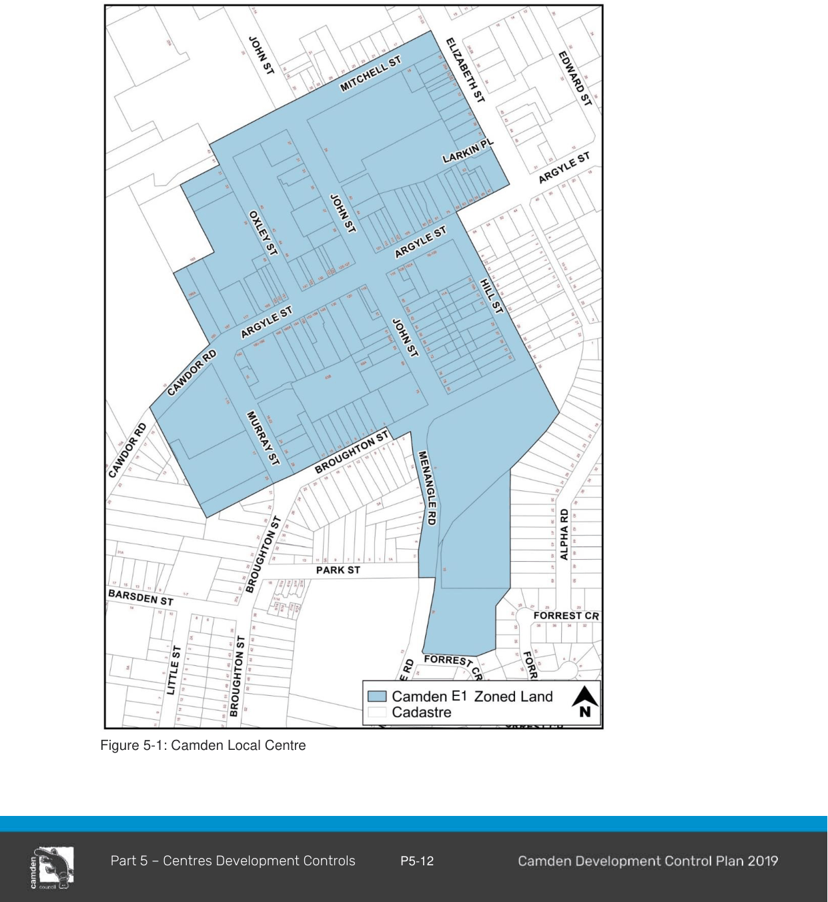

### 5.3 Camden Town Centre Development Controls

#### 5.3.1 Camden – E1 Local Centre

#### Background

This section applies to the E1 zoned land which forms the core of the Camden town centre (Figure 5- 1).

> [Picture on page 16: a picture, saved as a picture (images/part-05-employment-zones-page-16-6.gif, 150 dpi).]
> Words printed on the picture (copied from the PDF):
> E1

Figure 5-1: Camden Local Centre

#### Controls

#### Layout/Design

1\. New development should complement or reinforce the retail functions of the centre, particularly along Argyle Street frontages and associated pedestrian accessways.

2\. Buildings should maintain and enhance the historic character of Argyle, Hill and John Streets in the town centre.

3\. Buildings fronting Argyle Street should incorporate awning structures into their front facades in a manner consistent with the prevailing character of existing buildings. These awnings will offer convenient and sheltered access for pedestrians at the frontage of the premises.

#### Heritage and Character

4\. The Camden township is located within the Camden Heritage Conservation Area. Reference must be made to Part 2 of this plan, with specific regard to Chapter 16.

5\. Development within the E1 Local Centre zone at Camden must be consistent with the Camden Town Centre Urban Design Framework.
