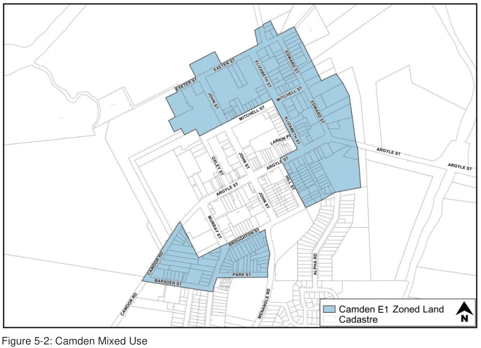

#### 5.3.3 Camden – MU1 Mixed Use

#### Background

This section applies to the MU1 zoned land which fringes the E1 zoned land at Camden (Figure 5-2).

> [Picture on page 18: a picture, saved as a picture (images/part-05-employment-zones-page-18-1.gif, 150 dpi).]
> Words printed on the picture (copied from the PDF):
> E1

Figure 5-2: Camden Mixed Use

#### Controls

#### Layout/Design

1\. Development in the MU1 Mixed Use zone should be complementary to the existing land uses in the E1 Local Centre zone which forms the core business and retail precinct of the Camden township.

#### Built Form and Appearance

2\. Buildings must contribute to the local distinctiveness of the Camden township by using a varied palette of colours, materials and finishes.

3\. Buildings in full corporate colours will not be permitted. Corporate colours can, however, be sensitively integrated as part of an overall design and signage strategy.

#### Light Industrial Development

4\. Light industrial development must be consistent with the objectives and controls contained in Part 5.5 of this DCP.

#### Heritage and Character

5\. The Camden township is located within the Camden Heritage Conservation Area. Reference must be made to Part 2 of this DCP.

6\. Development within the MU1 Mixed Use zone at Camden must be consistent with the Camden Town Centre Urban Design Framework.

