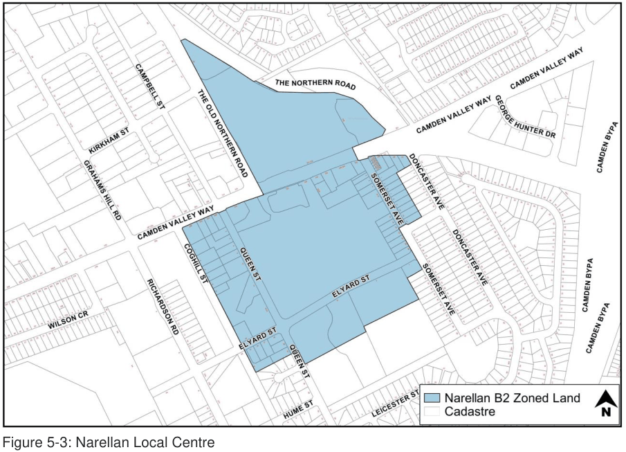
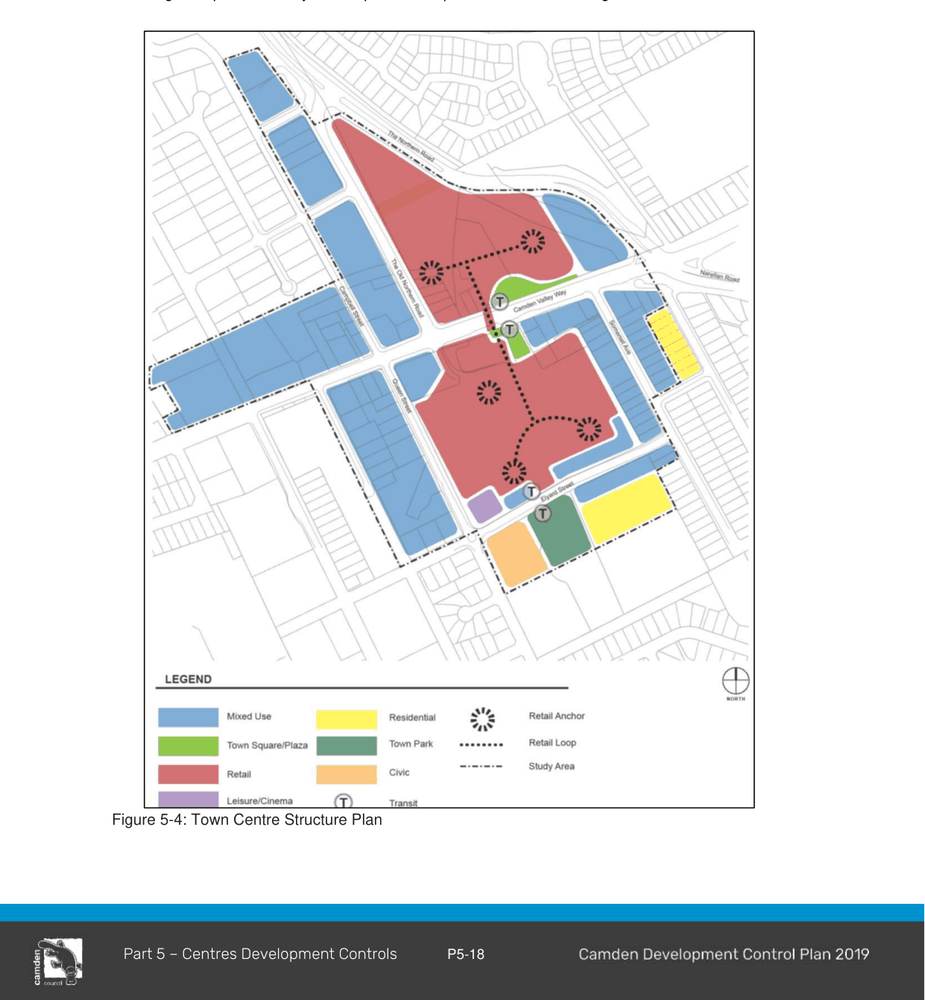
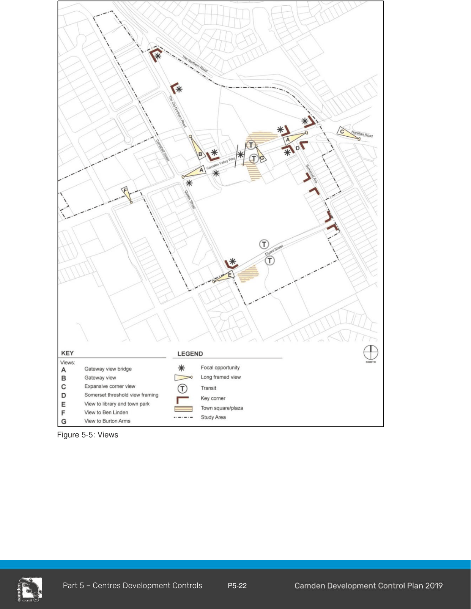
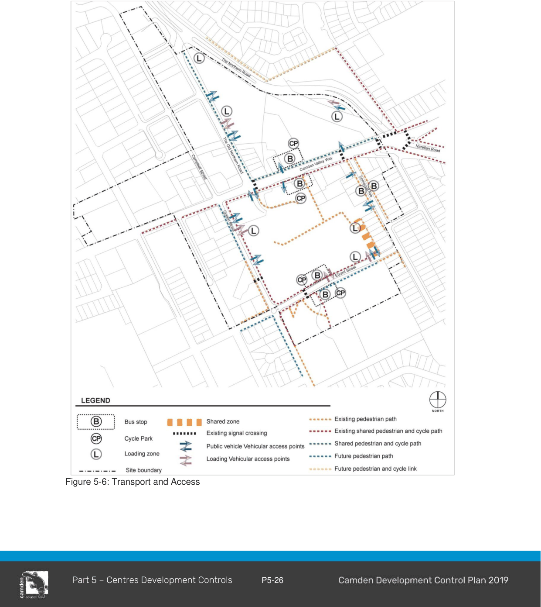
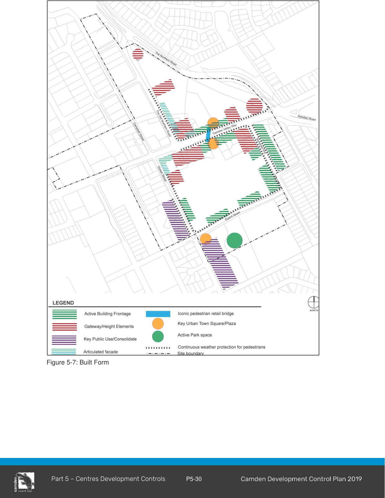

#### 5.4.1 Narellan E1 Local Centre

This section applies to land known as the Narellan Town Centre and surrounding land within the E1 - Local Centre zone (Figure 5-3).

> [Picture on page 20: a picture, saved as a picture (images/part-05-employment-zones-page-20-8.gif, 150 dpi).]

Figure 5-3: Narellan Local Centre

#### Desired future character for Narellan Town Centre

a. Narellan is a town centre anchored by a large shopping centre and supported by a range of other uses.

b. There is opportunity to demonstrate leading edge urban design principles in an integrated way which balances the challenge of achieving a sense of place and attractive streetscape within the constraints imposed by a traffic dominated environment.

c. Build on the existing character and history of Narellan in a contemporary manner.

d. Camden Valley Way to become a community heart with strong emphasis on integrated design and linkages at multiple levels.

e. A variety of uses brings the community together in a central destination.

f. Highly accessible place for all modes of transport.

g. A place of high amenity and quality - a genuine Town Centre.

h. A successful commercial hub that encourages ongoing growth.

i. A place that reflects the history and promotes heritage items as an asset of Narellan while charting a new course to meet the aspirations of the growing community.

j. The vision for Narellan Town Centre is to create a people orientated and pedestrian friendly environment, where the built form has a human scale at street level, with cultural and civic expression.

k. Narellan Town Centre forms the heart of the existing region and community. Providing employment opportunities in a range of industries and professions is a critical element to ensure success of the Town Centre.

l. Narellan Town Centre is prosperous and vibrant during the day and at night and all people feel safe and comfortable moving through the Narellan Town Centre at any time.

m. Narellan Town Centre is not only a shopping centre; it is a true community hub providing all the services and facilities that a community needs.

n. The design of the public and private realms is integrated to provide a sense of openness and space.

o. Narellan Town Centre is designed to be used during a twenty-four hour cycle. A variety of spaces are located and designed for community interaction in large and small groups. Places are provided for recreation and entertainment, including community activities and cultural events

#### Town Centre Structure Plan Layout

1\. The Narellan Town Centre Structure Plan (refer to Figure 5-4 Town Centre Structure Plan) has been prepared to guide the future development of Narellan Town Centre. The Structure Plan describes the layout and land uses proposed for Narellan Town Centre.

2\. The Structure Plan demonstrates an integration of land uses, with active street frontages to promote a vibrant Town Centre, maximise employment generation, promote economic development together with social and cultural interaction and provide a wide range of public and private services.

3\. The Narellan Town Centre Structure Plan promotes a pedestrian friendly environment with integration of surrounding buildings at street level via two public plazas addressing Camden Valley Way and elevated walkway over Camden Valley Way.  The structure plan incorporates an integrated pedestrian, cycle and public transport network, with linkages to the broader network.

> [Picture on page 22: a picture, saved as a picture (images/part-05-employment-zones-page-22-8.gif, 150 dpi).]

Figure 5-4: Town Centre Structure Plan

#### Objectives

The Narellan Town Centre layout is to be consistent with the following principles:

a. Incorporate a pedestrian focused central heart consisting of two large public open spaces located on Camden Valley Way that act as the focal point for the retail precinct;

b. Establish a clearly defined Town Centre core and frame differentiated through varying uses and intensity of development;

c. Consider potential future noise and amenity conflicts in the layout and location of Town Centre uses;

d. Provide legibility by emphasising sight lines to gateways, places of key cultural significance, civic buildings and public open space; and

e. Locate bus stops within easy walking distance of the central heart of Narellan Town Centre.

#### Controls

1\. Development should be generally in accordance with the principles set out in Figure 5-4 - Town Centre Structure Plan.

#### Land Uses

#### Objectives

a. Narellan Town Centre is to incorporate a variety of integrated land uses to meet the needs of the existing region future residents;

b. Two large Urban Squares are proposed as the heart of the future Narellan Town Centre, providing a key focal point for surrounding land uses and future visitors to the Town Centre; and

c. Land uses within Narellan Town Centre will incorporate a range of retail, civic, community, recreational, commercial, residential and mixed-use types.

#### Retail Precinct

#### Objectives

a. The Retail Precinct constitutes modern centre-based retailing. The Retail Precinct seeks to create a vibrant entry to Narellan Town Centre, which maximises employment generation and economic prosperity.

#### Controls

1\. Narellan Town Centre is to be consistent with the following controls as demonstrated in Figure 5-4 Town Centre Structure Plan, although it is acknowledged that land uses within Narellan Town Centre will change over time. Figure 5-4 illustrates land uses which demonstrate consistency with the following controls:

2\. Achieve a large scale focus of retail premises within the E1 Local Centre Zone, limited by a maximum floor space ratio (FSR) of 1:1. Additional retail premise floor space and uses are also acceptable, as appropriate, within the ‘Mixed Use Area’ identified on the Structure Plan.

3\. Incorporate a variety of retail, commercial, entertainment, recreation, accommodation, and community uses to serve the needs of the wider community and promote an active and vibrant town centre.

4\. Maximise employment opportunities within Narellan Town Centre.

5\. Focus a mix of active retail, restaurants, commercial and banking uses at ground level along, and fronting the town squares/plaza, Camden Valley Way, Somerset Avenue, Queen and Elyard Street, with large-scale retail developments located within the retail precinct.

6\. Co-locate uses and facilities where possible to maximise the efficient use of space.

7\. Incorporate the needs of health and aged care providers, facilities for young people, civic and emergency services within the Town Centre.

#### The Town Squares

#### Objectives

a. The Town Squares should be located at the centre of Camden Valley Way, at the heart of the Narellan Town Centre;

b. The Town Square should be provided as early as possible in the delivery of the Town Centre development to provide a place for people to meet, recreate and dine;

c. The Town Squares should function as a traditional ‘European’ style town square or ’Piazza‘, with coffee shops, restaurants and shop fronts spilling onto the plaza areas, with no clear delineation of public and private property boundaries;

d. The town square will incorporate appropriate levels of retail, commercial development and landscaping elements, enhancing the feeling of enclosure intimacy, activity and sense of place;

e. The Squares should have places for people to sit and could include kiosk outlets and/or shade elements;

f. The town Square should be designed to incorporate water elements that contribute to the activation of the town square and modify the microclimate; and

g. domain should be provided to create a unique sense of place.  Public art elements should reflect the history of Narellan.

> [Picture on page 26: a picture, saved as a picture (images/part-05-employment-zones-page-26-1.gif, 150 dpi).]

Figure 5-5: Views

#### Controls

8\. Development must include the provision of two Town Squares generally in accordance with the principles for Special Places – Town Squares.

9\. The two Town Squares should not be over scaled but should have a minimum useable area in the order of 2,000sqm (Northern Square) and 1,000sqm (Southern Square) clear of covered circulation areas or colonnades.

10\. The Town Squares must contain appropriate public art elements.

#### Views, Vistas and Gateways

#### Objectives

a. The Narellan Town Centre Structure Plan has been designed to emphasise sight lines and define key gateways with key built form articulation.

#### Controls

11\. Development should protect key sight lines. Refer to Figure 5-5.

#### Interaction with Surrounding Land Uses

#### Objectives

a. The Narellan Town Centre Structure plan has been designed to respond to existing key land uses including residential, educational, open space and commercial development outcomes.

#### Controls

12\. Detailed design of Narellan Town Centre should take into consideration proposed adjoining land uses and ensure provision for a high level of pedestrian connectivity between Narellan Town Centre and the surrounding development. With particular reference being made to the Elyard Street proposed residential / commercial future developments and the existing civic uses including the Urban Forest Park, The Library and Council annex.

#### Access and Movement

#### Vehicle Movement Network

#### Objectives

a. To provide an integrated hierarchy of roads, cycle ways and pedestrian pathways that provides safe, convenient and legible access within and around Narellan Town Centre;

b. To ensure that the hierarchy of the streets is clearly discernible through variations in carriageway, pavement surfaces, on-street parking and street tree planting; and

c. To ensure a high quality, functional, safe, legible and visually attractive public domain.

d. To allow ease of vehicular access to Narellan Town Centre.

#### Controls

13\. Traffic management measures are to be utilised within and surrounding Narellan Town Centre to produce a low speed pedestrian friendly traffic environment particularly on Somerset Avenue, Queen and Elyard Street. Such traffic management devices are to be identified at the time of lodgement of any Development Application directly affecting the local road network.

14\. Principles of CPTED (Crime Prevention through Environmental Design) to be incorporated in the design of the access and movement system.

#### Pedestrian and Cycle Movement

#### Objectives

a. To ensure that Narellan Town Centre is designed to promote high levels of accessibility for pedestrian and cyclists; and

b. To encourage pedestrian and cycle movements as a means of accessing services and facilities within and surrounding Narellan Town Centre.

#### Controls

15\. Narellan Town Centre is to be designed to provide clear and legible pedestrian and cycle connections as identified in Figure 5-6 Transport & Access.

16\. Streets and pathway networks should be designed to ensure that walking and cycling within Narellan Town Centre takes priority over traffic circulation.

17\. Continuous weather protection for pedestrians is to be provided in key locations by colonnades or awnings.

18\. Bike parking facilities should be provided at key locations on streets within Narellan Town Centre and within the two public plaza areas located on Camden Valley Way. Refer to Figure 5-6 Transport and Access.

#### Public Transport

#### Objectives

a. To encourage the provision and use of public transport as a preferred method of access to and from Narellan Town Centre;

b. To provide a high level of access to public transport services within and surrounding Narellan Town Centre;

c. To ensure that the Town Centre layout responds to the provision of a future public transport interchange to the Camden, Campbelltown and the future Leppington Regional Centre; and

d. Bus stops to be located on both sides of Camden Valley Way and will be subject to detailed design.

#### Controls

19\. The location of bus stops to Camden, Campbelltown and Leppington Centre is to achieve a high level of access to key places of interest such as residential and commercial development.

20\. Bus stops are to be located to allow for integration of local and regional transport services.

21\. Bus stops are to be located in areas of high pedestrian, active commercial / café’s and vehicle activity and designed to ensure a high level of passive surveillance.

22\. Bus stops are to be located to allow for integration of local and regional transport services.

23\. Bus stops are to be located in areas of high pedestrian, active commercial / café’s and vehicle activity and designed to ensure a high level of passive surveillance.

Note: Bus stops are to be provided generally in accordance with Figure 5-6 Transport and Access

> [Picture on page 30: a picture, saved as a picture (images/part-05-employment-zones-page-30-5.gif, 150 dpi).]

Figure 5-6: Transport and Access

#### Public Domain

#### Objectives

a. To provide a variety of high quality public domain areas which cater for a wide range of activities;

b. To ensure that public domain areas are designed in a manner which recognise Narellan Town Centre location and allow for a seamless transition between public and private spaces;

c. The public realm must be unambiguously public in its design and detailing; and

d. To ensure that the Town Squares respond to the character statements outlined in the desired future character for Narellan Town Centre.

#### Controls

24\. Town Square areas are to be designed by a Registered Landscape Architect and located generally in accordance with Figure 5-4 Town Centre Structure Plan.

25\. Two main Public Town Squares are to be designed to provide an urbanised, vibrant, interactive public space, which incorporates outdoor seating areas associated with retail tenancies, which will open onto the Town Squares and opportunities for informal seating and gathering places.

26\. External lighting is to be provided within the Town Square and must provide ample lighting for night use throughout the year. Lighting is to be provided in accordance with Australian Standards AS 4282 - Control of the Obtrusive Effects of Outdoor Lighting and AS 1158 - Lighting for Roads and Public Spaces.

27\. Any Development Application, which seeks approval for the design of a Town Square must include a statement outlining how the design addresses the objectives for Town Squares

28\. The Southern Square should include a means of vertical connection to achieve a seamless pedestrian link between the retail podium level and ground level on Camden Valley Way.

29\. All paving materials must conform to relevant standards for durability, non-slip textures, strength and surface treatment to withstand use by light automobiles, service vehicles, pedestrians and bicycles.

30\. Public art elements that reflect the history of Narellan are to be incorporated into the design of public spaces.

#### Street Trees

#### Objectives

a. To create a landscaped urban environment which helps to provide shade, comfort and amenity, particularly for pedestrians and provide distinctive streetscapes through the use of various tree types / species;

b. To create a strong visual order for the streetscape;

c. To use appropriately scaled species, which can grow within the constraints, imposed by an urban environment; and

d. To create a landscaped environment which responds to Environmentally Sensitive Design principles and can be reasonably maintained.

#### Controls

31\. Each Development Application must include a landscaping plan that demonstrates how they address Crime Prevention through Environmental Design (CPTED) principles.

32\. Plant and Tree selection must take into account the following:

a. Species that complement remnant native vegetation.

b. Level of on-going maintenance.

c. Potential impacts on road and footpath pavements.

d. Focus on hardy, drought tolerant, easily maintained species.

e. Scale in relation to the function of the area.

f. Contribution to the character of the Town Centre.

33\. Street trees and open space planting is to provide generous shade for pedestrians in summer and allow for sunlight penetration to street level in winter.

34\. The town square must incorporate a sufficient density of trees, incorporating placement of medium to large deciduous trees, in order to provide seasonal amenity for pedestrians in the public domain places. All landscaping throughout the town square must not obstruct the heritage significance of heritage items and view lines.

#### Land Use and Built Form

#### Built Form Articulation

#### Objectives

a. To promote articulated building forms, which contribute to creating an interesting streetscape character; and

b. To promote architectural articulation of building mass which responds to key design elements of the Narellan Town Centre buildings.

#### Controls

35\. Articulation zones should be provided to complement the building mass and emphasise key design elements such as vehicular and pedestrian entrance points and respond to environmental conditions including solar access, noise, privacy and views. (Refer to Figure 5-7 Built Form)

> [Picture on page 34: a picture, saved as a picture (images/part-05-employment-zones-page-34-1.gif, 150 dpi).]

Figure 5-7: Built Form

#### Architectural Character

#### Objectives

Architectural expression should be diverse across building groups/blocks and facades should be articulated to create visual interest and reflect the buildings adjacent uses and context.

a. Recognise Camden Valley Way and associated key corners as the main focus for articulated elements, visual indicators and ‘main street’ facade elements;

b. There should be consideration of a contemporary architectural style based on simple primary building forms and a fine-grained assemblage of elements (which may incorporate the diversity of character of streetscapes in historic towns such as Camden) where appropriate;

c. Architectural design should be sympathetic to the heritage context of the Burton Arms building and other heritage items in the vicinity and respect the building’s curtilage;

d. Façade design should create a series of vertical elements along a building length reflecting a traditional main street façade where appropriate;

e. Sleeve buildings or appropriate screening is to be provided to minimise the visual impact of large boxes, service areas and to define streets where viable and effective. Lifestyle environmental graphics alone are not considered as appropriate architectural screening and such graphics should be included in an integrated solution that offers a mix of techniques to improve visual presentation. Screening elements must be integrated within the Narellan Town Centre architectural character and language and

f. Roof forms and structures such as clock towers/spires are encouraged for key sites, corners and roofs should be designed to break up the overall mass of a roof on a large building. Roof elements should be used to screen mechanical plant.

#### Controls

36\. Articulation and Corners: Buildings within Narellan Town Centre are to generally align with street edges, be articulated in their façade treatments and express corners in design. (Refer Figure 5-7 Built Form).

37\. Corners are to be visually prominent and may be reinforced by one and two-story verandahs / balconies which turn the corner in a contemporary manner.

38\. Building Interface: The interface between the building and the public domain is to be designed to create active safer streets, to encourage flexibility in design for changing uses at ground level and provide weather protection for pedestrian amenity.

39\. Building facades are to be designed to accentuate key architectural features and clearly delineate points of interest such as building entries, vertical and horizontal elements.

40\. Building facades are to incorporate a variety of finishes and materials which provide visual relief to the built form and be of a robust construction to withstand constant use and interface with the public.

41\. A diverse palette of durable and cost efficient external materials exploring a contemporary urban character is to be used. A range of materials is to introduce a fine grain façade treatment along street edges.

#### Safety and Surveillance

#### Objectives

a. To ensure that the siting and design of buildings and spaces, through casual surveillance, decreases the opportunity for crime; and

b. To ensure that development encourages people to use streets, parks and other public places without fear of personal risk.

#### Controls

42\. Buildings should be designed to overlook streets, lanes and other public or communal areas to provide casual surveillance. In the case of corner lots tenancies windows are also to be oriented to overlook the side street.

43\. The design of all development, in particular, the public domain and community facilities is to enhance public surveillance of public streets and open space.

44\. Appropriate design of publicly accessible areas (e.g. footpaths, etc) encourages a sense of community ownership of open and public spaces.

45\. Developments are to avoid creating areas for concealment and blank walls facing the street.

46\. Pedestrian and communal areas are to have lighting (to Australian Standards) to ensure a high level of safety. These areas must be designed to minimise opportunities for concealment.

47\. All development should aim to provide casual surveillance of the street as a means of passive security. This should be achieved by maximising outlooks and views, but minimising the overlooking of neighbouring properties.

48\. All developments are to incorporate the principles of Crime Prevention Through Environmental Design (CPTED). Development Applications for subdivision, public open space and community facilities may require a formal crime risk (CPTED) assessment as part of the EP&A Act, development assessment and Camden Council’s Designing Safer Communities – Safer by Design Guidelines (October 2002).

#### Pedestrian Retail Bridge Articulation

#### Objectives

a. The detailed design of the pedestrian retail bridge must acknowledge its importance as a primary gateway / threshold into Narellan Town Centre as it will be highly visible to all modes of transport passing through the area;

b. The primary purpose of the pedestrian retail bridge is to ensure a successful commercial operation for the Shopping Centre, achieves a connected, vibrant link between the retail precincts on either side of Camden Valley Way; and

c. The pedestrian retail bridge must reflect the architectural character of both buildings either side of Camden Valley Way and form an integrated composition of architectural form, elements and materials.

#### Controls

49\. The pedestrian retail bridge should be single level only and may incorporate retail uses to activate the pedestrian connection across Camden Valley Way and achieve a connected, vibrant link between the retail precincts on either side of Camden Valley Way.

50\. The façade design of the pedestrian retail bridge must have a high level of architectural finishes and be consistent to the main building façade treatments along the Camden Valley Way frontages.

51\. The eastern facade of the pedestrian retail bridge must be fully integrated with the two vertical circulation (escalators) elements that link street level to the retail podium level in terms of material resolution and ease of pedestrian use.

52\. Both facades of the pedestrian retail bridge need to be treated in a similar manner in terms of materials and proportions selected.

53\. Equal consideration of materials and façade treatment need to be shown to the underside of the pedestrian retail bridge including the night time experience for pedestrians and vehicles.

54\. The vertical pedestrian circulation entries are to be provided at an appropriate scale to maximise the open-air transparency of the pedestrian retail bridge abutments and encourage visible connectivity between plazas and retail levels.

55\. The pedestrian retail bridge is comprised of the span and abutments to differentiate it from the remainder of the built form. Detailed consideration must be given to material selection of the pedestrian retail bridge with materials to reflect a lightweight feel to the pedestrian retail bridge structure. Solid, non-transparent or reflective materials are to be minimised and transparent/translucent glazing panels with detailed fenestration should be encouraged.

56\. No advertising on the pedestrian retail bridge will be permitted.

#### Building Envelopes / Bulk & Scale

#### Objectives

a. To ensure that the bulk and scale of future development responds to the desired vision, scale and character of Narellan Town Centre and existing surrounding development;

b. To encourage a variety of building heights within Narellan Town Centre, which respond to the site-specific, design considerations;

c. To encourage buildings with flexibility in their use over time;

d. Encourage redevelopment of neighbouring sites over time;

e. Hierarchy of height acknowledges the status of the centre;

f. Heights to acknowledge the heritage buildings (in particular ‘Burton Arms’ and ‘Ben Linden’) and should respect and respond to them with appropriate transitions; and

g. Building heights will transition to surrounding residential uses and school site.

#### Controls

57\. Prominent street corners should be reinforced in a visual context through concentrating building height and built form.

58\. Buildings are to be designed to ensure a human scale is maintained at street level.

59\. Minimum floor to finished ceiling heights are as follows:

a. 3.6m for the ground floor of all buildings (applies only to commercial and retail uses)

b. 3.3m for the first floor for retail and/or commercial uses.

c. 3.3m for all other retail and/or commercial floors.

d. 2.7m for all other residential floors.

#### Weather Protection

#### Objectives

a. Pedestrians should be provided with amenity and comfort throughout the public realm, and the commercial and retailer occupants provided with a commercially viable and sustainable environment. (Refer Figure 5-7 Built Form);

b. The public realm should offer a diversity of experience, including providing a choice of exposure to environmental conditions; and

c. A variety of types, materials and methods for weather protection must be adopted to promote a diverse experience across Narellan Town Centre.

#### Controls

60\. Weather protection must maintain a feeling of openness and enhance both the public function of the specific space and /or street. (Refer Figure 5-7 Built Form).

61\. Weather protection devices must take into account wind, sun, rain, night / day, seasons and shadowing effects of other built components.

62\. Weather protection devices must consider the scale of adjacent buildings and the width of the street / public space in order to ensure appropriate proportions and “feel”.

63\. Weather protection solutions should be predominantly naturally ventilated.

64\. Weather protection should be included as part of the design of the architecture / built form or landscape design.

65\. Pedestrian rights of way, squares and other public spaces should typically have a variety of weather protection devices, where provided, ranging from minimal protection, fixed or temporary devices (including an array of devices such as awnings, canopies, “floating” roofs or be incorporated into the architecture of the building), and landscaped solutions, thus providing a variety of experiences and conditions.

66\. Except where a colonnade is provided, active retail, restaurants, commercial, community and banking uses fronting the street or town square at ground level must provide weather protection along the majority of the facade, especially those areas facing north and west. This protection should typically take the form of a variety of eavetypes.

67\. Awnings increase the usability and amenity of public footpaths by protecting pedestrians from sun and rain. Awnings encourage pedestrian activity along streets and, in conjunction with active edges such as retail frontages, support and enhance the vitality of the Town Centre. Awnings can be used in conjunction with colonnades. There are to be no wing walls so colonnades are continuous and unimpeded.

68\. In particular, continuous awnings and colonnades are required to be provided along the ground floor street frontage on active street frontages in accordance with Figure 5-7 Built Form.

69\. The front fascia of the awning is to be set back a minimum of 500mm from the kerb of the street carriageway, including at street corners.

#### Setbacks

#### Objectives

a. To ensure that building setbacks reflect the desired future character of Narellan Town Centre and significance of heritage items in the vicinity;

b. To establish the desired vertical and horizontal spatial proportions of the streetscape;

c. To provide a defined street edge within a Town Centre context; and

d. To encourage passive surveillance of streetscape areas.

#### Controls

70\. The urban character is achieved by adopting zero setback conditions to create street walls and introduce different types of streets. The main building facades are to be built to the block edge with allowances for insets and projections and to create stronger corner edges.

#### Streetscape Activation

#### Objectives

a. To encourage active streets throughout Narellan Town Centre;

b. To promote safety and security within Narellan Town Centre by maximising activation of street frontages where appropriate;

c. To ensure outlook to and surveillance of the street; and

d. To acknowledge Camden Valley Way, Somerset Avenue, Queen and Elyard St as the key areas of importance in terms of street activation.

#### Controls

71\. Active frontage uses are defined as one of a combination of the following at street level:

- Entrance to retail premises.

- Shop fronts.

- Glazed entries to commercial lobbies occupying less than 50% of the street frontage, to a maximum of 12m frontage.

- Cafés or restaurants if accompanied by an entry from the street.

- Active office uses, such as reception areas, if visible from the street.

- Public buildings if accompanied by an entry.

72\. Buildings are to maximise areas of street activation through a mixture of ground floor retail/commercial suites.

73\. As far as practical, retail and commercial development is to be built to the street alignment to achieve active street frontages.

74\. Large format retail such as supermarkets and parking areas are to be sleeved or hidden by retail, commercial uses and detailed architectural features where appropriate.

75\. Restaurants, cafes and the like are to consider providing openable shop fronts.

76\. No external security shutters to be permitted.

77\. On corner sites, shop fronts are to wrap around the corner.

#### Solar Access

#### Objectives

a. To maintain appropriate levels of solar access to public and private spaces within Narellan Town Centre; and

b. To ensure that building mass does not impede solar access to public and private spaces within Narellan Town Centre and adjacent land uses without prior solar analysis.

#### Controls

78\. Any Development Application is required to submit detailed solar access diagrams for between 9am and 3pm mid-winter to demonstrate sufficient solar access is maintained to public and private spaces and streets.

79\. The Town Squares are to receive sunlight on a minimum of 50% of the combined site area between 11am and 2pm on June 21.

80\. Building envelopes are to allow for north-south streets to receive 2 hours of sunlight between 9am- 3pm on 21 June on a minimum of 50% of the eastern or western footpaths.

81\. Building envelopes are to allow for east-west streets to receive 1 hour of sunlight between 9am- 3pm on 21June on a minimum of 50% of the southern footpaths.

#### Site Access, Parking and Loading

#### Vehicle Parking and Storage

#### Objectives

a. To ensure an appropriate number of parking spaces are provided within Narellan Town Centre to service the needs of both residents and visitors;

b. To encourage an appropriate mix of on and off-street parking options within Narellan Town Centre; and

c. To provide integrated vehicle, bicycle and service access points without compromising the streetscape character or pedestrian amenity.

#### Controls

82\. Access, parking and loading areas must be provided in accordance with Part 2 of this DCP.

83\. Car parking dimensions are to be provided in accordance with relevant Australian Standards.

84\. On street parking is encouraged and is to be provided as far as practical throughout Narellan Town Centre to contribute to street life and surveillance.

85\. Above ground parking must incorporate appropriate design measures to mitigate adverse visual impact.

86\. Below ground car parking is encouraged for mixed-use blocks as well as Town Centre retail blocks.

87\. Where below ground parking is along a street edge and cross ventilation is desirable, any exposed section of car park wall is to be appropriately modelled and scaled.

88\. The majority of car parking is to be provided under the Narellan Town Centre buildings and on street level to limit visual impact and maintain pedestrian amenity.

89\. Natural ventilation of basement and sub-basement parking areas is encouraged to be provided wherever possible.

90\. Service vehicle access points should be consolidated where possible to limit the potential for conflict points.

Note: Bicycle racks/storage areas are to be provided in accordance with Part 2 of this DCP.

#### Loading Docks

#### Controls

91\. Loading docks are to be developed in accordance with Part 2 of this DCP.
