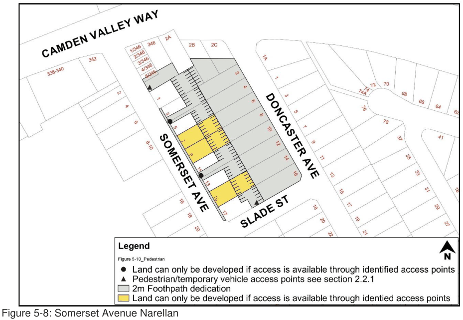

#### 5.4.2 Somerset Avenue, Narellan

The following controls apply to land fronting Somerset Avenue, Narellan known as Part Lots 32 and 34, and Lots 37 to 45 inclusive DP 25582 shown on Figure 5-8.

#### Controls

#### Urban Design

1\. Any building to be constructed adjoining a pedestrian walkway i.e. at Nos. 3 & 5 and 11 & 13 are to provide an active edge to the walkway in the form of windows and entrances.

2\. The rear wall of any development is to be constructed to accommodate a future decked parking structure.

Note: Additional foundations may be required to accommodate future excavation works associated with any deck-structured car park.

#### Building Footprint

3\. A 2 metre strip of land fronting Somerset Avenue, as shown on Figure 5-8, must be restricted from development, but should be available for external activities associated with businesses within the premises.

4\. This area may be used for some external activities associated with a shop front, subject to Council approval.

5\. Building setback from the rear boundary is to be 19 metres, comprising a 17.5 metre car park area and 1.5 metre wide footpath at the rear of the building.

#### Awnings Treatment

6\. Awnings are to extend 3.6 metres from the building alignment within Somerset Avenue.

#### Storm Water Quantity Management

7\. A strategy for managing storm water quantity must be prepared in a manner consistent with the Somerset Avenue Augmentation Design Plan prepared by Council. (Ref No 2001-045)

8\. Temporary on-site detention may be required as an interim measure in realising the overall Augmentation Design Plan.

9\. Any drainage strategy incorporating car park detention must have regard to any catchment influences.

NOTE:  Drainage design should be developed in consideration of the overall car park levels, which are available from Council.

#### Accessibility - Vehicles:

10\. Access to the car parking area is to be via access driveways at Slade Street and north of No 1 Somerset Ave as indicated in Figure 5-8.

11\. Short-term vehicle access may be achieved from Somerset Avenue, between Nos. 3 & 5, 11 & 13, where a 6 metre wide access is to be provided. Such access is to accommodate two-way vehicle movement and dedicated pedestrian access. Upon vehicle access becoming available from either Slade Street or North of No 1 Somerset Avenue then the temporary access is to revert to pedestrian access only. As an alternative should Nos. 3 & 5 or 11& 13 develop jointly then Council would accept an arcade style development, subject to the rear car park having access to Slade Street or north of No 1 Somerset Avenue.

12\. Council will require a right of way over the above-mentioned land to the rear car park for both vehicles and pedestrians until such time as the car park is linked to the adjoining car park and has access to either Slade Street or north of No 1 Somerset Avenue. Following the linking of the car park to adjoining car parks a pedestrian only right-of -way will be required.

#### Accessibility - Car Parking:

13\. All car parking areas and associated footpaths are to be dedicated to Council as part of the development process. These areas are shown shaded grey on Figure 5-8.

14\. Car parking is to be configured as shown on Figure 5-8.

15\. Car parks are to be constructed in accordance with specifications available from Council’s Works and Services Division.

16\. Part Lots 35 & 36 DP25582 – Rear land to be dedicated to Council for car park when development occurs.

Note: A public “at grade” car park is to be provided at the rear of the properties facing Somerset and Doncaster Avenues, with attractive pedestrian walkways linking the car park to Somerset Avenue. Vehicular access to this car park will be gained from Slade Street, Somerset Avenue and Doncaster Avenue.  At some time in the future and subject to demonstrated demand the car park will be redeveloped to a “decked” structure, which is to incorporate a commercial building fronting Doncaster Avenue.

#### Accessibility - Pedestrian:

17\. Access to the rear car parking area is to be via pedestrian walkways as indicated Figure 5-8. These walkways may function as alternative vehicle access points until access is made available elsewhere.

18\. The walkways are to be constructed without a defined level change; vehicle and pedestrian travel areas are to be identified within the paver/asphalt design.

> [Picture on page 46: a picture, saved as a picture (images/part-05-employment-zones-page-46-17.gif, 150 dpi).]

Figure 5-8: Somerset Avenue Narellan

