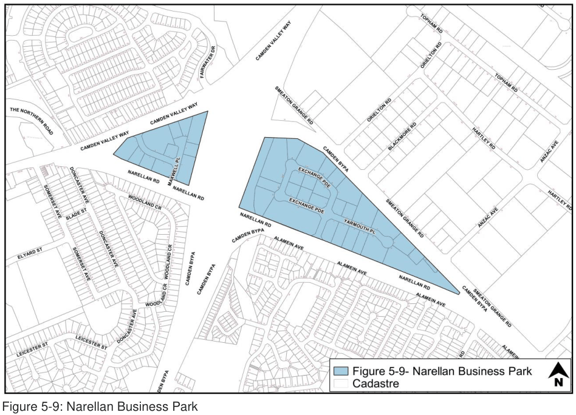

#### 5.4.3 Narellan Business Park – E3 Productivity Support

#### Background

The Narellan Business Park area is located in the vicinity of Camden Valley Way and Narellan Road, Narellan, and is bisected by the Camden Bypass. The location of the land is shown in Figure 5-9.

> [Picture on page 47: a picture, saved as a picture (images/part-05-employment-zones-page-47-5.gif, 150 dpi).]

Figure 5-9: Narellan Business Park

#### Controls

#### Function and Uses

1\. Development within the Narellan Business Park must be complementary to the function of the Narellan township as a local centre.

#### Layout/Design

2\. Given the high visibility of the Narellan Business Park, storage areas will be located within the building.

3\. A consistently high standard of landscaping must unify development within the area, particularly along major roads.  All front setback areas must be landscaped to soften the visual impact of development.

4\. A 3m landscaped area is to be provided along all road frontages

5\. The following setbacks apply to all development within the Narellan Business Park:

6\. front setback to Narellan Road, Camden By-Pass or Camden Valley Way – 10m

7\. front setback to all other road frontages – 7.5m

8\. side setback to secondary road frontages on corner lots – 3m

9\. side and rear boundary setbacks – in accordance with the Building Code of Australia.

#### Built Form and Appearance

10\. The area must have a low scale built form, softened by landscaping to the main roads.

11\. Landmark features including signature buildings must be used in the gateway or highly visible locations where development adjoins the Camden Bypass, Narellan Road and Camden Valley Way and other highly visible areas. Such development will be constructed from high quality materials and designed to incorporate articulated roof and wall forms, ornamentation and prominent feature entrances. This may include glazed facades and recessed colonnades.

12\. In order to avoid the proliferation of signage in the Narellan Business Park, signage will be integrated in a consistent theme as part of a building elevation, whether on a single occupancy building or multi unit development. Limited opportunities exist for individual free-standing signs and signage visible from arterial roads. No signage is to be directed towards the Camden By- Pass.

13\. The maximum height of fencing must not be more than  2.1 metres.

14\. The location of the front fencing will be dependent upon the type of fencing.

15\. Decorative metal or a combination of decorative metal and masonry fences may be erected not less than 1 metre from the property boundary to allow a landscaped area to be provided in front.

16\. A combination decorative metal and masonry fence must comply with the following:

a. The ratio of the masonry component to decorative metal component must fall within the range of between 1 part masonry to 6.5 – 7 parts metal panels.

b. The metal panels must not exceed 3 metres in length nor be less than 1.8 metres in length.

c. Any masonry plinth established along the bottom of the fence must be not more than 600 mm high.

d. Green or black plastic coated chain wire fencing may be erected behind the designated landscape area.

e. Galvanised chain wire, untreated metal, metal sheeting and wooden fencing will not be permitted in front of the building line.

f. All gates within the area covered by this DCP must be located behind the designated landscape area and must not swing towards the roadway.

