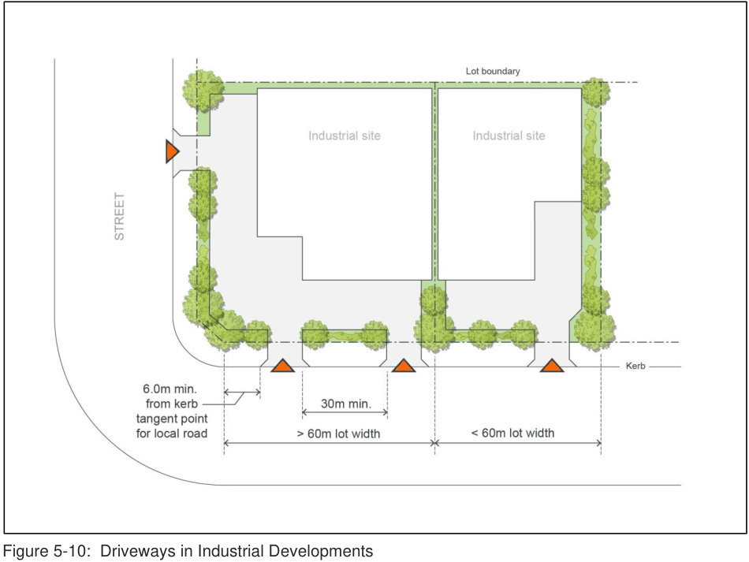

#### 5.5.11 Parking and Access

#### Controls

1\. The car parking requirements are to comply with the controls as set out in this DCP.

2\. All parking must be provided off-street and must be appropriately line marked.  The number of parking spaces must be in accordance with the car parking requirements referred to in this DCP.

Note: Designated car parking areas are not to be used for storing vehicles under repair, or for any other storage function

3\. A maximum of one access driveway is permitted per lot frontage where the frontage is less than 60m.

4\. Multiple access driveways servicing a single lot are limited to a maximum of two (2) driveways per lot frontage which must have a minimum separation distance of 30m, measured from the inside edge of each driveway crossover.

> [Picture on page 61: a picture, saved as a picture (images/part-05-employment-zones-page-61-13.gif, 150 dpi).]

Figure 5-10:  Driveways in Industrial Developments

5\. All loading and unloading must take place within the loading docks for each building. Where practical, loading facilities or vehicular entries to buildings must not be provided on any street elevation.  Where such facilities can only be provided to street frontages, they must be screened by suitable landscaping.

6\. Car parking on individual sites must be located to integrate with proposed landscaping.

7\. Access driveways must be constructed as a kerb return not as a splay and must otherwise be designed generally in accordance with Australian Standard 2890.2.

The following Table 5-4 gives Council’s requirements for the minimum size of service vehicle that must be provided for industrial/warehousing developments.

Table 5-4: Minimum Size of Service Vehicle

| Development GFA | Minimum Service Vehicle Size |
|---|---|
| < 300m² | Medium Rigid Vehicle |
| > 300m² | Large Rigid Vehicle |

8\. Consideration should also be given to providing parking, access and manoeuvring for B-double size service vehicles. Council encourages provision for these types of service vehicles, particularly on larger development sites.

