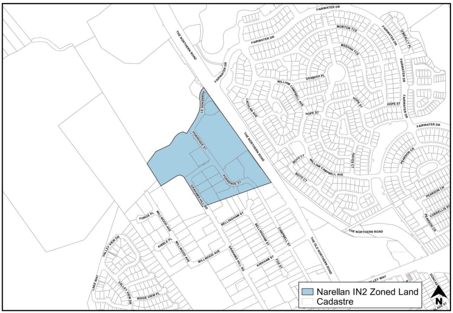

### 5.6 Site Specific Industrial Controls

#### 5.6.1 Narellan E3 Land

#### Background

The Narellan E3 land is located to the north-west of the established Narellan industrial precinct and is known as often referred to as the Narellan Industrial Extension. The land is shown in Figure 6-3.

> [Picture on page 65: a picture, saved as a picture (images/part-05-employment-zones-page-65-6.gif, 150 dpi).]

Figure 5-11: Narellan E3 Zoned Land

#### Controls

#### Landscaping

1\. A minimum 3 metre wide landscape buffer must be provided along all boundaries of the site that have an interface with any road or street and the proposed pedestrian/bike path.

#### Built Form and Appearance

2\. Regardless of the approved traffic servicing arrangements, a 10 metre landscape buffer is to be provided along the Northern Road between the Eastern boundary (Pioneer Homes) and the Western boundary (Bunnings Hardware Store) which denies access to vehicles and pedestrians, other that if provided at the nominated entry and exit locations.

3\. Individual advertising signs for each tenancy/land use within an industrial unit complex will not be permitted on the Northern Road frontage of any lots.  All advertising must be located on or behind the approved building line within this precinct except where an integrated advertising structure has been approved as part of the original development application for the complex.

4\. All service vehicles will be required to access the sites from the estates internal roads, i.e. Campbell Street extension.
