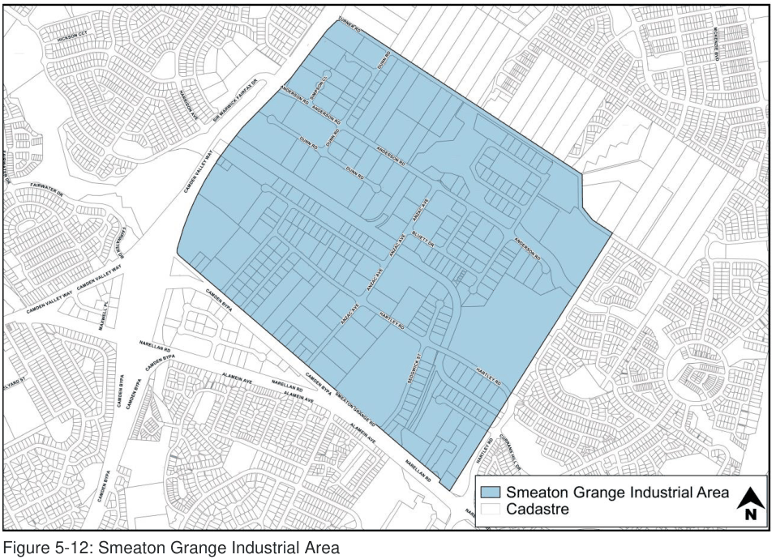
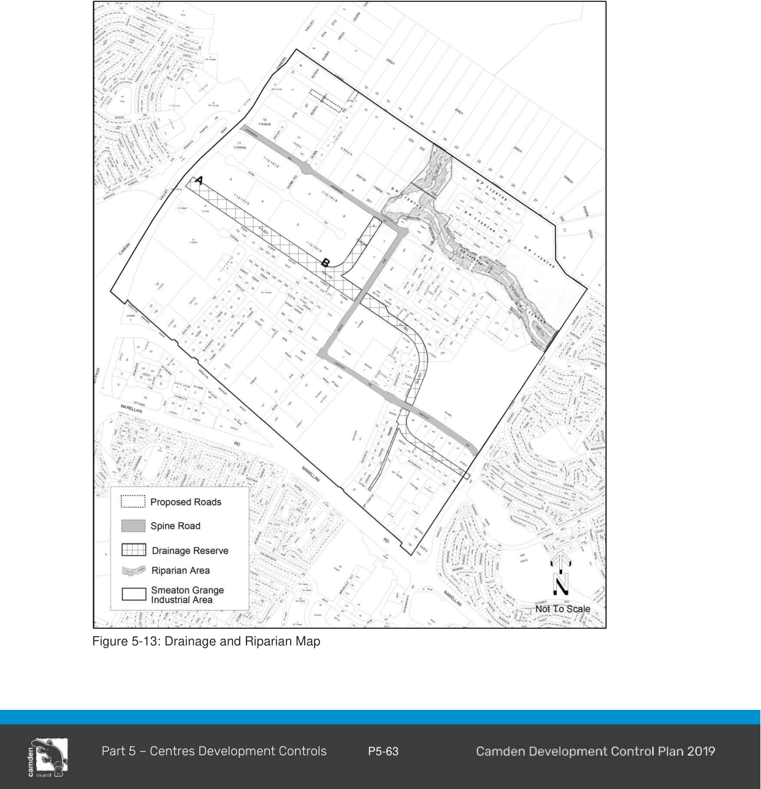

#### 5.6.2 Smeaton Grange

#### Desired Future Character Statement

The Smeaton Grange precinct as shown on Figure 6-4 will be the principal area for employment generation in Camden, providing a mix of lot sizes suitable for a broad range of industrial uses. Development within the precinct will strive for the highest standards of design, landscaping and environmental sustainability.

A consistently high standard of landscaping, which incorporates an ongoing maintenance program integrating useable areas of open space within developments, will work to unify development within the locality, particularly along major spine roads and sensitive interface areas such as Turner Road. Development will sensitively integrate with adjoining residential areas and business precincts.

> [Picture on page 66: a picture, saved as a picture (images/part-05-employment-zones-page-66-17.gif, 150 dpi).]

Figure 5-12: Smeaton Grange Industrial Area

#### Controls

#### Site Landscaping

1\. The road verge (i.e. footpath area) in front of each development site, must be turfed and planted with selected trees at the rate of 1 tree per 7 metres.

#### Visual Impact

2\. A landscaped visual buffer is required for land adjacent to Camden Valley Way and Turner Road in accordance with the Landscape Master Plan.

> [Picture on page 67: a picture, saved as a picture (images/part-05-employment-zones-page-67-8.gif, 150 dpi).]

Figure 5-13: Drainage and Riparian Map

#### Individual site development

3\. Development must provide minimum building setbacks and landscaping as outlined below:

a. 15 metre setback from any spine road, of which 10 metres must be utilised for landscaping;

b. 10 metre setback from any minor road, of which 5 metres must be utilised for landscaping;

c. 30 metre setback from Camden Valley Way, of which 15 metres must be utilised for landscaping;

d. 10 metres to existing alignment of Turner Road, of which 10 metres must be utilised for landscaping;

e. For land adjacent to the eastern boundary of the Smeaton Grange Industrial Precinct a 10 metre setback is required, of which 10 metres must be utilised for landscaping;

4\. For corner lots, the building setback to the secondary frontage must be:

a. 10 metres to a spine road;

b. 5 metres to any other road, other than Camden Valley Way or Turner Road;

c. 10 metres to main drainage channel marked (A)-(B) in Figure 6-5, of which 5 metres must be utilised for landscaping.

d. For the main drainage channel other than (A)-(B) the building setback is to be 5 metres of which 3 metres must be utilised for landscaping.

e. 10 metres to Smeaton Grange Road between Narellan Road and Anzac Avenue of which 7.5 metres must be utilised for landscaping.

5\. In assessing any application, Council will consider the visual impact of the height, bulk and scale of a proposed building to ensure that a high quality appearance is achieved, particularly as viewed from Turner Road, Camden Valley Way and Smeaton Grange Road.  In this regard, buildings should not dominate the skyline and should include roof lines and facades which provide visual interest and an appropriate sense of scale. Roof mounted equipment such as air conditioning units, stacks, distilling towers, silos, communication towers and the like which protrude above the general roof line of the building must not be permitted except where they are appropriately integrated with the design of the building.

#### Location of Certain Developments

6\. Industries whose principal function is the storage and/or processing of goods and materials not enclosed within a building, must not be located on land which fronts a spine road or land adjoining Camden Valley Way, Turner Road or Smeaton Grange Road.

#### Upgrade of Turner Road

7\. Any redevelopment of properties that have frontage to southern side of Turner Road, being:

a. Lot 6 DP 657664 (556 Camden Valley Way)

b. Lot 40 DP 28024 (36 Turner Road)

c. Lot 41 DP 28024 (42 Turner Road)

d. Lot 1 DP 603134 (52 Turner Road)

e. Lot 200 DP 746842 (62 Turner Road)

f. Lot 202 DP 746842 (66 Turner Road)

g. Lot 435 DP 1129749 (67 Anderson Road)

will be required, to upgrade half the road reserve to an industrial standard extending the width of the subject property. This is to be undertaken at either subdivision or building stage, whichever occurs first.

#### Stormwater Drainage (Properties fronting Turner Road)

8\. Any redevelopment of properties that have frontage to the southern side of Turner Road, being:

a. Lot 40 DP 28024 (36 Turner Road)

b. Lot 41 DP 28024 (42 Turner Road)

c. Lot 1 DP 603134 (52 Turner Road)

d. Lot 200 DP 746842 (62 Turner Road)

e. Lot 202 DP 746842 (66 Turner Road)

f. Lot 435 DP 1129749 (67 Anderson Road),

will acquire an easement to convey stormwater drainage from that property, through the adjoining properties fronting Anderson Road, to the south in the event drainage is required. Documentary evidence of the acquisition of this easement must be submitted with any Development Application for further development of these properties fronting Turner Road.

