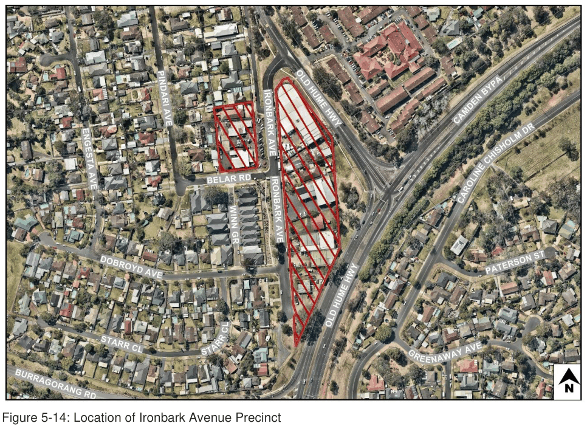
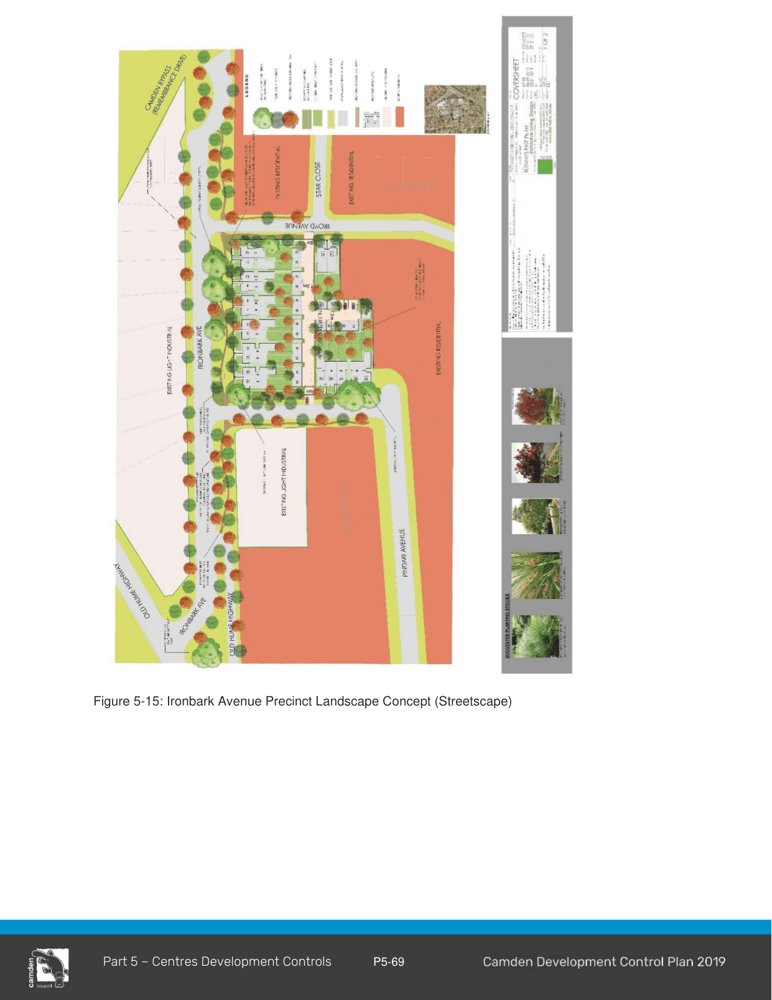

#### 5.6.3 Ironbark Avenue, Camden South

#### Background

The Ironbark Avenue Precinct comprises land zoned E3 Productivity Support, as shown with a red line in Figure 6-5 below.

> [Picture on page 70: a picture, saved as a picture (images/part-05-employment-zones-page-70-5.gif, 150 dpi).]

Figure 5-14: Location of Ironbark Avenue Precinct

#### Tree Planting

#### Background

The Ironbark Avenue Precinct contains scattered native vegetation. Opportunities do, however, exist to create an attractive streetscape for the precinct as depicted in Figure 6-6 below.

#### Objectives

a. To promote the landscape treatment of the Precinct by providing opportunities to increase landscaping within and external to sites.

b. To create a soft, informal separation and ascetically pleasing green interface between the residential and light industrial areas.

c. To provide a higher level of public amenity by creating a safe, functional and professionally landscaped road verge open space area.

#### Controls

1\. A Landscape Plan prepared for any development site within the Ironbark Avenue E3 zone is to compliment and to be generally in accordance with the concept landscape plan shown in Figure 6-6.

#### Acoustic Amenity

#### Background

Noise is a characteristic of the operation of certain industrial landuses and the accessing of such areas by industrial traffic. It must be managed so as to achieve established environmental objectives. It should be noted, however, that precise management measures for road related noise in particular will be dependent upon the type of industrial landuse.

In deriving acoustic strategies it will be important to avoid compromising proposed and existing industrial landuses and not unduly compromising the lifestyle of existing and future residential development.

#### Objectives

a) To establish design criteria for noise emissions from industrial or other employment-generating development within the Ironbark Avenue Precinct;

b) To establish acoustic environmental goals for existing and future developments adjacent to residential areas;

c) To minimise the adverse impact of noise emissions on surrounding residential enjoyment;

d) To ensure visual impacts are minimised in the development and implementation of acoustic strategies;

e) To ensure that development does not cause adverse environmental impacts from noise and vibration; and

f) To discourage the use of local streets by heavy vehicles.

#### Controls/Requirements

2\. Where it is considered likely that a development may cause an adverse impact on nearby residential areas, noise impact must be assessed in accordance with Council’s Environmental Noise Policy to determine if any acoustic assessment is required. Any required acoustic assessment must be submitted with the development application.

#### Site Development and Urban Design

#### Public Domain

#### Background

The proposed redevelopment of this area has incorporated a streetscape that has open parkland like atmosphere to enrich the local area. The landscape retains existing large significant Iron Bark trees, which are culturally significant to the name Ironbark Avenue. Increased public amenity has been provided with additional planting of evergreen and deciduous street trees and low maintenance ground cover grasses. The deciduous trees provide seasonality and fit in with the landscape style of Camden.

#### Objectives

g) To provide a clear, functional and safe accessibility network.

h) To provide and enhance amenity for the general community by retaining significant existing landscaping elements and trees and planting new trees and other landscaping within the open space areas.

i) To provide a pleasant, informal and green interface between the residential and light industrial sections.

#### Controls

3\. Any Landscape Plan prepared for the site is to be generally in accordance with the concept landscape plan shown in Figure 6-6.

> [Picture on page 73: a picture, saved as a picture (images/part-05-employment-zones-page-73-1.gif, 150 dpi).]

Figure 5-15: Ironbark Avenue Precinct Landscape Concept (Streetscape)

