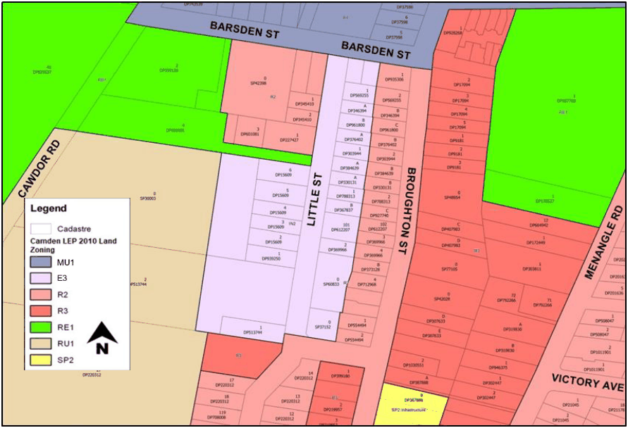

#### 5.6.4 Little Street Camden Zone E3 Productivity Support Land

#### Background

The Little Street industrial area is zoned light industrial under the Camden Local Environmental Plan 2010 and is made up of some residential uses, industrial uses and community type uses. This section applies to land zoned E3 Productivity Support on Little Street, Camden as shown in Figure 6-7. The land zoned light industrial is adjacent to the Camden Heritage Conservation Area. The broader precinct is also unique with an array of uses, such as mixed uses, detached dwellings, multi-dwelling housing, medical services, a NSW Ambulance station, rural uses and the Camden Hospital.

The below controls were developed with the aim of reducing the impact of new industrial developments on existing residential properties within Little Street and the surrounding area.

This section must be read in conjunction with Part 5.5 General Industrial Controls. In the event of any inconsistency between Part 5.5 and this section, the below controls prevail.

> [Picture on page 74: a picture, saved as a picture (images/part-05-employment-zones-page-74-13.gif, 150 dpi).]

Figure 5-16: Little Street Camden E3 Productivity Support Land

#### Objectives

To ensure that the use and development of the industrial land does not have an unacceptable detrimental impact on the amenity of the surrounding residential uses.

a. The bulk and scale of development must be in keeping with the mixed use character of the locality.

b. To recognise the significance of light industry in this location and minimise any adverse impacts of industry on other land uses.

c. To ensure that land use conflicts are appropriately managed.

#### Controls Operations

1\. Details of the proposed operation including, mechanical operations, deliveries, vehicle movements, acoustic impacts and hours of operation must be provided for all development.

2\. The maximum length of vehicles accessing properties from Little Street must not be longer than 12.5m.

3\. The maximum permitted hours of operation (including deliveries) for development opposite or adjacent to residential development are between the hours of 7:30 am to 5:30 pm Monday to Saturday with no operation permitted on Sundays.

4\. Where development is opposite or adjacent to a dwelling:

a. There must be no operations on public holidays.

b. Proposals to operate outside these hours will be required to demonstrate there will be no adverse impacts on adjoining dwellings.

c. Loading and unloading time is not to impact on the amenity of a dwelling. Schedules of vehicle movements and their routes are to be provided in the development application.

#### Building design

5\. A minimum 2 metre side setback is required for industrial development adjacent to an existing dwelling. Landscaping is to be used to soften the impact of the development to neighbouring lots.

6\. For industrial development which shares a common boundary with an existing dwelling, a minimum rear setback of 6 metres is required for any part of a building above 4.5 metres in height. It must be demonstrated that there will be no adverse impacts on adjoining dwellings from the operation of the use within the rear setback and the following Amenity controls are complied with.

#### Amenity

7\. Direct sunlight must reach at least 50% of the PPOS of any adjoining dwelling, for not less than 3 hours between 9:00am and 3:00pm on 21 June.

8\. At least one window to a living area of a dwelling on a neighbouring property must receive a minimum 3 hours of sunlight between 9:00am and 3:00pm on 21 June.

9\. There may be circumstances where existing solar access on neighbouring properties will not be able to be retained due to:

a. Existing living areas of neighbouring properties being inappropriately located with regard to solar access;

b. Existing site topography;

c. Existing shadowing from other buildings, dwellings, structures and trees; and

d. Orientation of existing lots

NOTE: All proposed developments must comply with Councils Acoustic Amenity controls within this DCP. Applications must comply with the NSW EPA Noise Policy for Industry (2017), or any other applicable policies. Council may require the submission of an Acoustic Report to support the development application.

#### Vehicle body repair workshops and vehicle repair station

10\. Council must not grant consent to development for the purpose of a vehicle body repair workshop or a vehicle repair station, if the land adjoins a dwelling, unless appropriate arrangements are made to store all vehicles awaiting or undergoing repair, awaiting collection, or otherwise involved with the development on the site of the proposed development, and they will be stored either:

a. Within a building, or,

b. Within a suitably screened area.

