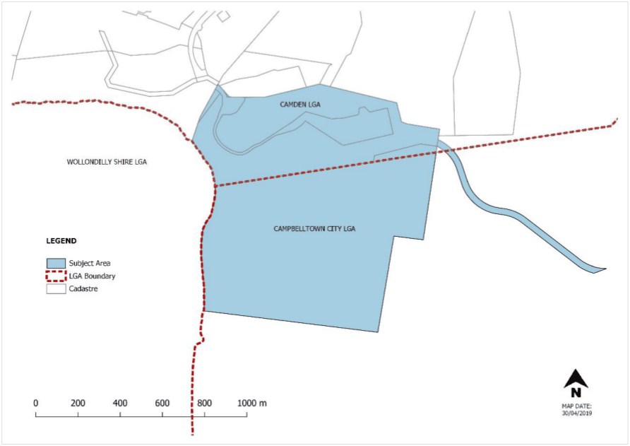
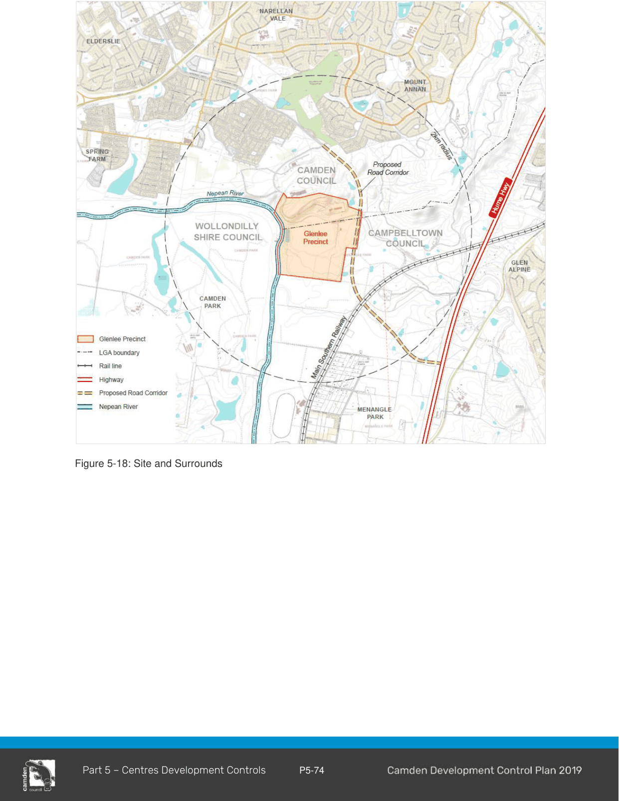
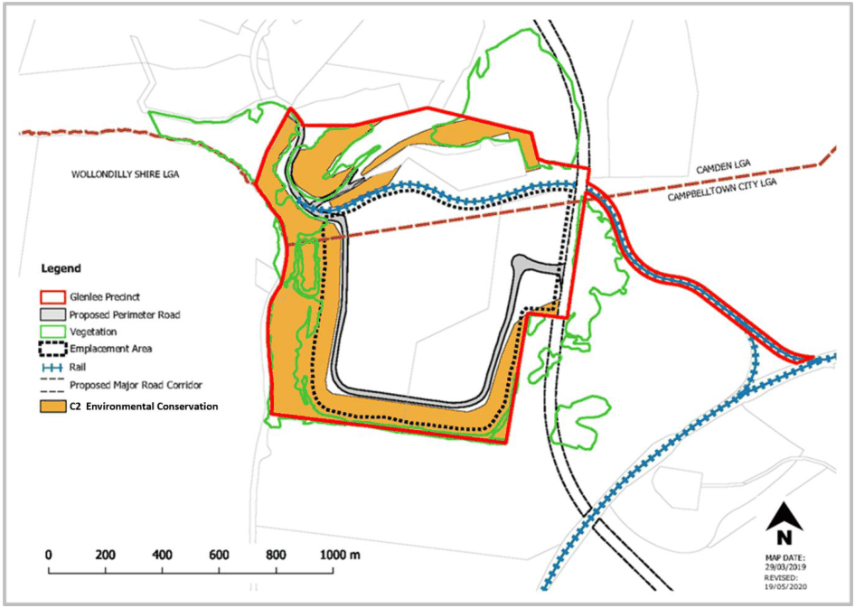
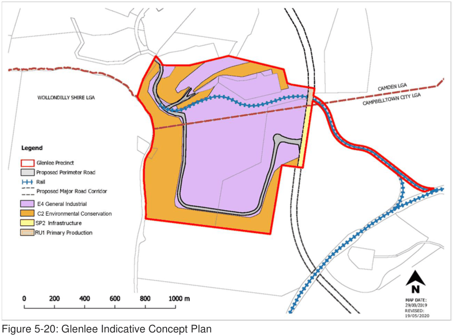
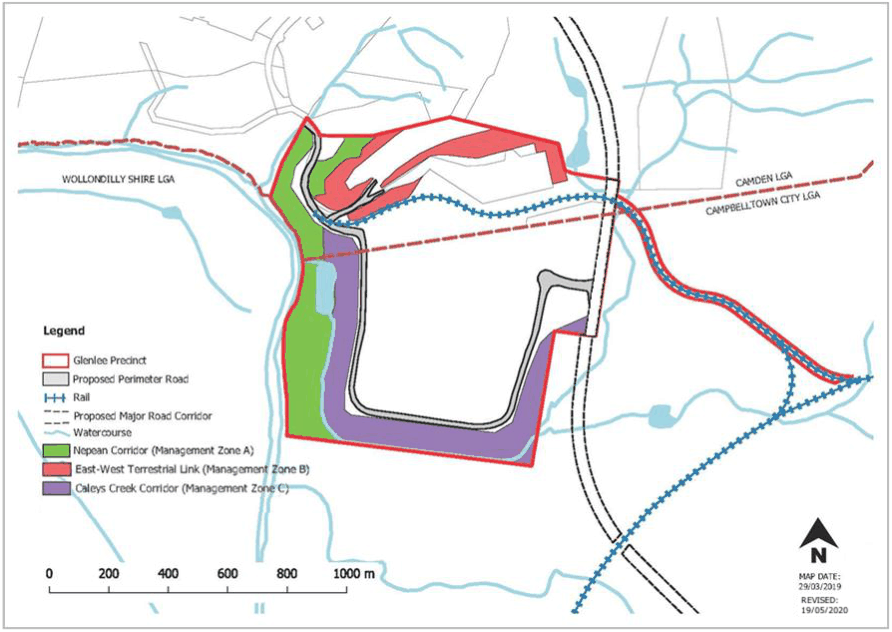
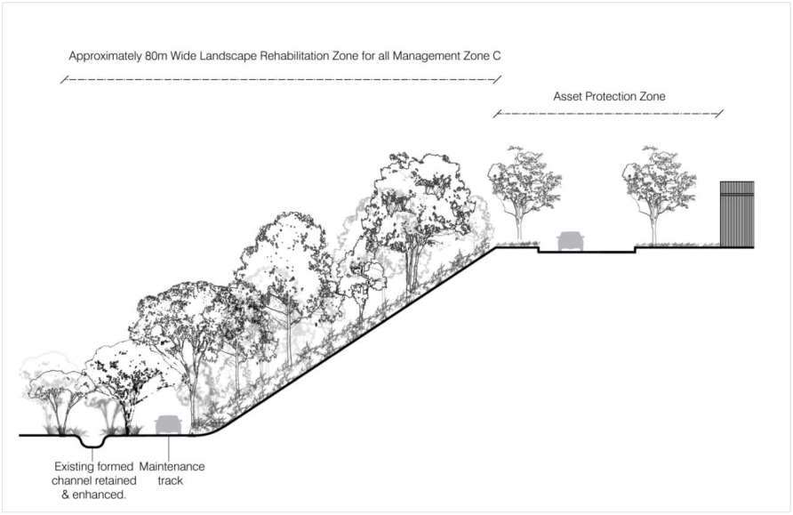
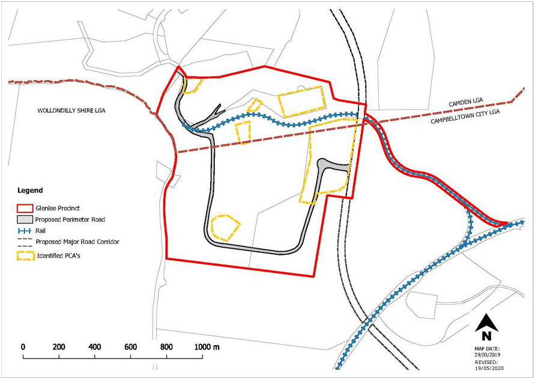
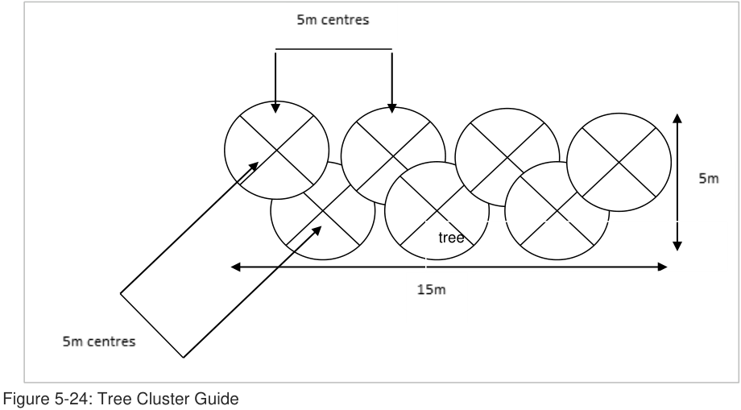

#### 5.6.5 Glenlee Industrial Precinct

#### Introduction and Application of this Section

The Glenlee Precinct is an Urban Release Area located to the south east of Spring Farm and is bound by Menangle Park to the east and Camden Park to the west. The Glenlee Precinct is partly within the Camden Local Government Area (LGA) and partly within the Campbelltown LGA.

> [Picture on page 77: a picture, saved as a picture (images/part-05-employment-zones-page-77-6.gif, 150 dpi).]

Figure 5-17: Glenlee - Where this Section Applies

The site comprises a raised coal emplacement platform with steep embankments on three sides (western, southern and eastern). A rail siding connects the northern part of the site with the Main Southern Railway line, and the western boundary adjoins the Nepean River. A riparian / environmental protection corridor runs along the western and southern perimeter of the site.

The controls in this subsection relate to the land contained within the Camden LGA only.

Where a development site falls within both LGAs the relevant control in each of the respective DCPs must be considered. A separate Development Application will need to be submitted concurrently to each Council with works proposed in each LGA clearly identified. It is recommended that a pre-DA be submitted for development that falls within both Councils.

> [Picture on page 78: a picture, saved as a picture (images/part-05-employment-zones-page-78-1.gif, 150 dpi).]

Figure 5-18: Site and Surrounds

> [Picture on page 79: a picture, saved as a picture (images/part-05-employment-zones-page-79-1.gif, 150 dpi).]

Figure 5-19: Location of Important Precinct Features

#### Desired Future Character Statement

#### Objectives

a. The Glenlee Precinct (the Precinct) will be an employment area with a mix of sustainable land uses within the landscape context of its elevated position, the Nepean River and the Australian Botanic Garden Mount Annan. These land uses will complement new residential areas currently being released, residential areas proposed to be released, existing rail infrastructure and proposed road infrastructure including the Spring Farm Parkway connection to the M31 Hume Motorway.

b. The Precinct will consist of a variety of industrial, warehouse and logistic development in a vegetated landscaped setting.

c. Landscaping will be incorporated throughout the Precinct to respond to sensitive cultural landscapes and form a distant backdrop when viewed from the M31 Hume Motorway, surrounding residential areas and the Australian Botanic Garden Mount Annan.

#### Development Objectives

#### Objectives

a. Facilitate new development and industries such as industrial, warehousing, logistic activities and the like, that meet the environmental management objectives contained in Part 2 of this DCP.

b. Provide a framework that will lead to a high standard of development in the Glenlee Precinct, encouraging local employment and creating an area which is pleasant, safe and efficient to work in.

c. Ensure that development takes account of the physical nature of the local environment, particularly the Nepean River, ridgelines and the natural landscape.

d. Ensure that development does not result in pollution of waterways, particularly the Nepean River, and protects, restores and enhances riparian corridors.

e. Promote the development of a visually attractive physical environment where the form, scale, colour, shape and texture of urban elements are managed in a way that will achieve an aesthetically pleasing place.

f. Developments must not further detract from views to and from surrounding areas, particularly Menangle Park, Glenlee Estate, Australian Botanic Garden Mount Annan and Camden Park Estate.

g. Ensure the stability of the Emplacement Area (see Figure 6-10) and stabilisation of embankments through revegetation.

h. Establish environmental criteria and controls for development within the area to ensure that the environmental qualities of adjoining areas are not compromised.

i. Promote the conservation of existing bushland and establish a vegetated corridor to allow for the movement of fauna from the Nepean River through to the Australian Botanic Garden Mount Annan.

j. Minimise the impact of development on areas of native vegetation including areas of high biodiversity, archaeological and heritage significance.

k. Encourage private ownership and maintenance of vegetated / landscaped areas throughout the Precinct.

l. Ensure a legible, safe and convenient pedestrian and cycle network, connecting with networks external to the Precinct.

m. Allow suitable vehicular, pedestrian and cycle connectivity to and from the site including the Macarthur Regional Recreational Trail (see below Note).

#### Note

A copy of The Macarthur Regional Recreational Trail Concept Report prepared by Clouston Associates dated November 2008 can be obtained by contacting Council.

> [Picture on page 81: a picture, saved as a picture (images/part-05-employment-zones-page-81-1.gif, 150 dpi).]

Figure 5-20: Glenlee Indicative Concept Plan

#### Related Studies

This section must be read in conjunction with the following supporting documents. These must be considered when preparing a development application:

1\. Visual and Landscape Assessment prepared by Musecape dated October 2016

2\. Riparian Corridor Study prepared by AECOM dated 16 May 2016

3\. Water Cycle Management Strategy prepared by AECOM dated 13 May 2015

4\. Ecological Assessment prepared by Ecological Australia dated 29 April 2016

5\. Bushfire Assessment prepared by Ecological Australia dated 29 April 2016 and Addendum 9 November 2016

6\. Land Capability Statement - Geotechnical Report prepared by AECOM dated 20 May 2016

7\. Traffic Impact Assessment prepared by AECOM dated 20 May 2016 and Addendum September 2016

8\. Aboriginal Heritage Due Diligence Assessment prepared by Cultural Heritage Connections dated July 2014

9\. Non-Indigenous Heritage Assessment prepared by Musecape dated 24 July 2014

10\. Air Quality Assessment prepared by AECOM dated 13 May 2016

11\. Civil Infrastructure Report prepared by AECOM dated 13 May 2016

12\. Remediation Strategy prepared by AECOM dated 13 May 2016

13\. Phase 1 Contamination Assessment prepared by AECOM dated 13 May 2016

14\. Phase 2 Contamination Assessment prepared by AECOM dated 13 May 2016

15\. Noise and Vibration Impact Assessment prepared by AECOM dated 6 May 2015

#### Planning and Design Subdivision, Lot Design and Development Objectives

a. Ensure the creation of lots does not impact adversely on natural and cultural features, existing biodiversity and views and vistas of heritage items.

b. Ensure that development occurs in a logical and staged manner.

c. Ensure that any development that may take place prior to any subdivision does not compromise the intended urban design outcome.

d. Ensure provision of a perimeter road that provides a bushfire asset protection zone, a legible road spine and the opportunity for buildings to address the E2 Environmental Conservation Zone.

e. Minimise the number of access points to major roads, whilst facilitating appropriate connectivity and permeability for all transport modes including pedestrians.

#### Controls

1\. Development must be consistent with the Indicative Concept Plan (Figure 6-11) and any Council approved Indicative Layout Plan for the site.

2\. The first Development Application must include an Indicative Layout Plan (ILP) for the approval of both Camden and Campbelltown Councils. The ILP will form the basis for urban development in the Precinct, including how the Precinct will be developed over time.

3\. Development applications for the site must show the vegetation Management Zones described in Environmental Protection Works.

4\. Development must ensure:

(a) proposed roads and driveways are connected to the perimeter road.

(b) that development of roads facilitates the development of adjoining lots.

(c) an attractive frontage to adjoining vegetation Management Zones or open space land.

(d) opportunities for passive surveillance to the public domain.

5\. Perimeter public roads must be subject to significant landscape treatment in accordance with an approved Vegetation Management Plan and be compatible with any bushfire management requirements.

6\. Battle-axe allotments must be avoided, where possible.

7\. Where a Strata or Community Title subdivision is proposed, parking, landscaping, access areas and directory board signs must be included as common property.

#### Stormwater Management Objectives

a. To manage the quantity and quality of surface stormwater run-off.

b. To manage flooding and stormwater run-of.

c. To require the implementation of Water Sensitive Urban Design (WSUD) strategies.

d. To ensure the geotechnical stability of future developments and Council infrastructure within the site.

#### Controls

8\. Development applications must comply with Camden Council’s Engineering Design and Construction Specifications for controls relating to detention, drainage and Water Sensitive Urban Design, unless an alternative holistic and sustainable strategy is prepared and approved by Council.

9\. On contaminated land, on-ground WSUD elements such as bio-retention facilities are not suitable unless the land is remediated and validated.

10\. A comprehensive drainage system must be installed within the Precinct, particularly in the Emplacement Area and shallow fill areas to manage potential risk. The drainage system must:

(a) efficiently manage the perched water table and any recharge.

(b) be designed and constructed to limit embankment erosion, run off and loss of debris from the site.

(c) form part of the integrated water cycle management strategy.

#### Related Studies

Refer to the Water Cycle Management Strategy prepared by AECOM dated 13 May 2015 when considering site specific methods to manage stormwater and pollution control.

#### Environmental Protection Works

#### Objectives

a. To protect, restore and enhance the environmental qualities of water courses, in particular the Nepean River.

b. To promote the conservation of urban bushland and establish vegetated corridors to allow for the movement of fauna.

c. To protect and preserve native vegetation and biological diversity in the Glenlee Precinct in accordance with the principles of ecologically sustainable development including the removal of weed infestations.

d. To maintain and enhance the ecological values within the Precinct and corridors for fauna and flora through revegetation and restoration work.

e. To ensure that all embankments are stabilised with vegetation and bush regeneration.

f. To ensure that adequate soil is provided or available to support landscaping required by this DCP.

#### Controls

11\. A Vegetation Management Plan (VMP) must be submitted to Council for approval with the first Development Application for Management Zones A, B and C.

12\. Environmental protection works must be carried out in accordance with the VMP.

13\. The VMP must be registered on the title of all lots identified as “Glenlee” on the Urban Release Area Maps (Camden Local Environmental Plan 2010) requiring compliance with the VMP.

14\. The VMP must:

(a) Include details on each management zone (A, B and C).

(b) specify what soil works are to be undertaken to support landscaping required to stabilise embankments and screen the site from views from surrounding areas.

(c) specify a vegetation landscape buffer along the boundaries of the Precinct in accordance with Control 2 under Visual Impact.

(d) show areas of vegetation that are to be fenced off and protected when earthworks and civil works are to be undertaken in close proximity.

(e) provide details on an ongoing weed control program for the precinct.

15\. All roads that traverse vegetation Management Zones must consider fauna crossings.

16\. The management of flora, fauna and the riparian corridors must be in accordance with the requirements below. The relevant locations of the Management Zones are contained in Figure 6-12:

(a) Management Zone A – Nepean River

(i) Bushfire asset protection zones must not be located within this Management Zone including vegetation retained for conservation in this zone.

(ii) An ongoing weed control program in perpetuity and revegetation measures are to be implemented to improve the ecological value of this corridor.

(iii) Planting mix is to comprise both upper storey (tree) and lower storey (shrubs and grasses) vegetation using local endemic species.

(iv) Undertake soil erosion control during construction, and maintain as required, to prevent sediment flow into this zone.

(v) Use of spray grass, hydro seeding geo fabrics or jute weed matting to minimise the loss of top soil while plant establishment takes place must be considered during construction. These management measures must be detailed in the Construction Certificate plans.

(vi) Water storage dams and related pumping infrastructure is to be located outside the conservation area.

(b) Management Zone B – East West Terrestrial Link

(i) Bushfire asset protection zones must not be located within this Management Zone including vegetation retained for conservation in this zone.

(ii) An ongoing weed control program in perpetuity and revegetation measures are to be implemented to improve the ecological value of this corridor, including existing African Olive weeds are to be removed and replaced by native shrub and ground layer species representative of Cumberland Plain Woodland.

(c) Management Zone C – Caleys Creek Corridor

(i) A riparian corridor must be applied from the Caley’s Creek watercourse to the top of the Emplacement Area, where the Creek is present or on the boundary of the Precinct (see Figure 6-10, Figure 6-12 and Figure 6-13).

(ii) Soil remediation is to be undertaken in this area to encourage growth of Cumberland Plain or River-Flat Eucalypt Forest community.

(iii) Restoration planting adjacent to the watercourse should comprise of plants in of the River-Flat Eucalypt Forest community.

(iv) Embankments must planted with a vegetation community reflective of the locality and be able to adapt to soil conditions and slope.

(v) The vegetation on the top of the Emplacement Area must comply with Bushfire Asset Protection Zone requirements.

(vi) An ongoing weed control program in perpetuity and revegetation measures are to be implemented to improve the ecological value of this corridor.

#### Related Studies

The recommendations contained in the following documents are to be used to inform the preparation of the Vegetation Management Plan:

Ecological Assessment prepared by Ecological Australia dated 29 April 2016;

Riparian Corridor Study prepared by AECOM and dated 16 May 2016;

Remediation Strategy prepared by AECOM dated 13 May 2016;

Phase 1 Contamination Assessment prepared by AECOM dated 13 May 2016; and

Phase 2 Contamination Assessment prepared by AECOM dated 13 May 2016.

> [Picture on page 86: a picture, saved as a picture (images/part-05-employment-zones-page-86-5.gif, 150 dpi).]

Figure 5-21: Location of Vegetation Management Zones in Glenlee

> [Picture on page 87: a picture, saved as a picture (images/part-05-employment-zones-page-87-1.gif, 150 dpi).]

Figure 5-22: Indicative Structure of the Riparian Corridor for Management Zone C

#### Contamination Objectives

a. To protect the environment by ensuring that Potentially Contaminated Areas (PCAs) within the Glenlee Precinct are remediated.

#### Controls

17\. Development Applications outside of Potentially Contaminated Areas (PCAs) identified at Figure 6-14, must be accompanied by a Stage 1 Preliminary Site Investigation prepared in accordance with State Environmental Planning Policy 55 – Remediation of Land and Council’s contamination policy – Management of Contaminated Lands.

18\. Development Applications within Potentially Contaminated Areas (PCAs) identified at Figure 6- 14, must be accompanied by a Stage 2 Detailed Site Investigation prepared in accordance with State Environmental Planning Policy 55 – Remediation of Land and Council’s contamination policy – Management of Contaminated Lands.

19\. Where remediation is required a Remediation Action Plan (RAP), prepared by a certified consultant, must be submitted with the development application.

#### Note

Developments relating to coal seam gas infrastructure are to be undertaken with consideration to the exclusion zones contained in State Environmental Planning Policy (Resources and Energy) 2021.

#### Related Studies

The following reports contain site specific recommendations which may help inform your RAP:

Remediation Strategy prepared by AECOM dated 13 May 2016;

Phase 1 Contamination Assessment prepared by AECOM dated 13 May 2016; and

Phase 2 Contamination Assessment prepared by AECOM dated 13 May 2016.

> [Picture on page 88: a picture, saved as a picture (images/part-05-employment-zones-page-88-6.gif, 150 dpi).]

Figure 5-23: Potentially Contaminated Areas in Glenlee

#### Geotechnical Works Objectives

a. To ensure the geotechnical stability of existing and future developments and Council infrastructure within the site.

b. To mitigate impacts associated with erosion and instability of subsoils.

c. To ensure that landscaping and vegetation are used to stabilise the Precinct.

#### Controls

20\. Development applications that involve the construction of new buildings, structures, roads or footpaths are to be accompanied by a geotechnical report, prepared by a suitably qualified consultant.

21\. A capping layer of granular fill at a minimum depth of 2m, or otherwise specified by a

geotechnical engineer, must be provided over the entire Emplacement Area.

22\. Embankments must be suitably stabilised to prevent erosion and addressed in the geotechnical report.

23\. Loose surface material must be suitably treated.

24\. Developments on the Emplacement Area must support the continued growth of vegetation.

25\. The new ground level resulting from ground level changes must be detailed as part of any development application.

#### Note

Developments relating to coal seam gas infrastructure are to be undertaken with consideration to the exclusion zones contained in State Environmental Planning Policy (Resources and Energy) 2021.

#### Transport Network Objectives

a. Ensure the transport network accommodates all transport modes.

b. To optimise access without compromising the safety and efficiency of the surrounding network.

c. To develop a legible, safe and convenient pedestrian and cycle network, connecting with networks external to the Precinct including the Macarthur Regional Recreational Trail.

d. To provide safe, efficient access and manoeuvring.

#### Controls

26\. The first Development Application must include a Transport Management Plan (TMP) for the approval of both Camden and Campbelltown Councils in conjunction with an Indicative Layout Plan as required in Control 2 in Subdivision, Lot Design and Development. The TMP must consider the location of public transport routes, pedestrian walkways and cycleways.

27\. A clear road hierarchy must be reinforced through landscape treatment including street trees.

28\. Road design must address all modes of transport.

29\. All roads must have a minimum carriageway width of 13m.

30\. Pedestrian and transport routes must have consideration to connections with the Macarthur Regional Recreational Trail (refer to Note).

31\. Roads that will connect to the future Spring Farm Parkway must be constructed to the boundary of the Spring Farm Parkway corridor (identified as “Area 1” on the Clause 7.10(1) Application Map in Camden Local Environmental Plan 2010).

#### Related Studies

Consideration should be given to the Traffic Impact Assessment prepared by AECOM dated 20 May 2016 and Addendum September 2016 when preparing a Transport Management Plan.

#### Note

Infrastructure such as roads, drainage and cycleways are to be designed in accordance with Camden Council’s Engineering Design and Construction Specification and Engineering Design Specification.

The Macarthur Regional Recreational Trail Concept Report prepared by Clouston Associates dated November 2008 can be obtained by contacting Council.

#### Site Specific Industrial Controls Visual Impact Objectives

a. To ensure that view corridors are sensitively managed and identified between Glenlee and surrounding significant rural and historic sites.

b. To mitigate visual impacts with vegetative screening.

c. To require well-designed development in visually prominent locations.

d. To ensure that light spill and glare from external lighting does not impact adversely upon the use and enjoyment of adjoining premises and surrounding areas, particularly residential and rural areas or compromise road safety.

#### Controls

32\. A Visual Analysis Report must be submitted with any development application for the construction of a new building or change in ground level. The report is to be prepared by a suitably qualified consultant and must identify visually prominent areas, potential view corridors and potential view impacts to and from Menangle Park, Glenlee Estate, the Australian Botanic Garden Mount Annan and Camden Park Estate as a result of new buildings or finished landforms.

33\. Vegetative screening must be provided along the southern and western perimeter of the Precinct and should incorporate upper, middle and lower canopy plantings. Details of the vegetative screening are to be included in the Vegetation Management Plan.

34\. Services and utilities must be placed underground, where feasible. If provided overhead, infrastructure must be designed to minimise visual impact, particularly in respect to significant sites surrounding the Precinct.

35\. Council may request an external lighting strategy be submitted with development applications. The strategy must detail the location and design of lighting and the proposed hours of operation with reference to AS 4282-1997 Control of the obtrusive effects of outdoor lighting.

#### Note

Remedial measures to reduce light spillage may include shielded street lighting, reduced height of light poles, directional lighting to avoid light spillage upwards or towards heritage items, box lighting and earth bunding.

#### Related Studies

Consideration should be given to the Visual and Landscape Assessment prepared by Musecape dated October 2016 when preparing a Visual Analysis Report.

#### Setbacks

#### Objective

a. To provide setbacks to facilitate appropriate landscaping and to allow buildings to sit appropriately within the landscape.

#### Control

36\. Front setbacks from the street must be a minimum of 10m. Secondary frontage setbacks, for corner allotments must be a minimum of 3m.

#### Building Design and Siting Objectives

a. To optimise integration of buildings with the natural topography, landscape and relative positioning of other buildings in the street and the surrounding context.

b. To require a high standard of architectural design, utilising quality materials and finishes.

c. To establish varied and articulated building frontages that address the existing or future public domain.

d. To require the design of attractive and appropriate amenities for staff.

e. To ensure fencing has been designed with regard to the desired future character of the Precinct.

#### Controls

37\. Architectural Design:

(a) Buildings are to be articulated to reduce the apparent height and scale of external walls.

(b) Plant and mechanical equipment, including exhausts, are to be screened or located appropriately so that they are not prominent features from the existing and future public domain.

(c) Materials and colours of buildings, utility and ancillary structures must adopt recessive toned colours such as earth tones (stone, browns, muted greens, sand, dark red / plums) or cool tones (soft greys, grey / blues).  All materials must be constructed of non-reflective materials.

(d) Building facades to the street must be predominately constructed of face brick, decorative masonry blocks (non-standard concrete blocks), precast panels (coloured and / or textured to a high-quality finish), glass, natural timber or other building materials that present attractively to the public domain.

38\. Siting / Building Orientation:

(a) Buildings must be integrated with the natural landscape and the existing and future streetscape with an articulated and landscaped appearance when viewed from the Vegetation Management Zones.

(b) Building elevations oriented towards residential areas must be minimised.  Where this is unavoidable, the building is to be designed to ameliorate negative impacts.

(c) Buildings must be designed to maximise solar efficiency, landscape design at the frontage and passive surveillance.

(d) Buildings and structures must be consistent with any future public roads on or adjacent to the Precinct.

(e) On lots with multiple street frontages, such as corner lots, buildings must be designed to address both streets.

39\. Fencing:

(a) Fencing is to be constructed of non-reflective materials, consistent with the colour pallet prescribed in Control 1 of Architectural Design (above).

(b) Fencing must be of an open form so as not impede sight lines for drivers.

(c) Fencing is to be contained wholly within the site.

(d) Fencing must be located behind required landscaped areas.

#### Landscaping Objectives

a. To create a landscape character and amenity that is appropriate to the scale and nature of the development.

b. Encourage development which provides attractive staff amenities through landscaping.

c. To minimise the visual impact of any development from the surrounding area.

d. To create habitat creation and encourage fauna movement.

#### Controls

40\. A detailed landscape plan, prepared by a suitably qualified consultant, must be submitted with all development applications for the subdivision of land and or erection of buildings. The landscape plan must detail landscaping and the location, height and type of fencing proposed within the site.

41\. Landscaping should provide sufficient vegetative screening of buildings, outdoor activities and structures when viewed from surrounding areas including Menangle Park, Glenlee Estate, the Australian Botanic Garden Mount Annan and Camden Park Estate.

42\. Details must be submitted demonstrating what soil works are required to support landscaping and street tree planting.

43\. Street setbacks are to comprise a minimum 50% of soft landscaping.

44\. Staff amenities and open spaces, such as break-out spaces must be incorporated into landscaped areas to provide attractive working environments.

45\. Fencing must be softened with landscaping and planting.

46\. Automatic irrigation systems must be installed for all landscaped areas.

47\. Local Cumberland Plain Woodland tree species are to be planted in clusters of 5 to 7 trees consisting of at least two varieties, planted at 5m centres (from tree trunk centre to tree trunk centre) in two informal staggered rows (see Figure 6-15). The clusters are to be positioned within the first 3m of the primary street setback. A 75mm layer of leaf mulch shall be applied evenly over the entire planting area after planting.  At the time of planting, the trees must have a minimum planted height of 2m with suitable hardwood stakes and ties. Tree stock to be sourced in minimum 75L container. Trees are to reach a mature height of at least 8m. Trees are to be located 0.5m from the back of kerb and a minimum of 1m from any other concrete surface. Positioning of the tree planting must ensure the following can be achieved:

(a) space for future driveways and waste storage collections points;

(b) street lighting, utilities, bus stops and pedestrian crossings; and

(c) appropriate sight distances in accordance with relevant standards.

The plantings are subject to a 12 months establishment and maintenance period at the end of which plantings must have signs of healthy and vigorous growth.

> [Picture on page 93: a picture, saved as a picture (images/part-05-employment-zones-page-93-5.gif, 150 dpi).]
> Words printed on the picture (copied from the PDF):
> tree

Figure 5-24: Tree Cluster Guide

#### -End of Part-

