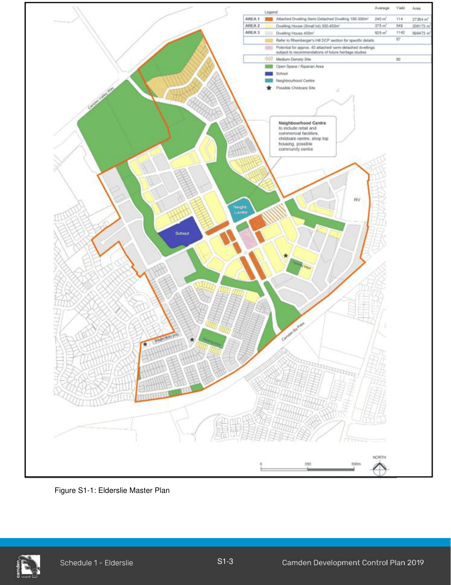

### S1.1 Introduction

The Elderslie release area is bounded by Studley Park Golf Course to the east, Camden Valley Way to the north, the Camden By-pass to the south, and the existing Elderslie residential area.  The site is in a variety of ownerships. Development in the public domain and residential areas of the Elderslie release area is to achieve the highest standards of urban design and environmental performance in accordance with principles relating to enhancing accessibility, achieving environmental sustainability and delivering social and economic benefits.

#### S1.1.1 Elderslie Planning Principles

1\. Development of the Elderslie release area will be in the form of an urban village, adjoining and connected to the existing suburban development in Elderslie and Narellan. The village will consist of a variety of housing forms, in landscaped garden and natural settings and a small neighbourhood centre.

2\. The new suburban area must integrate with the existing Elderslie and Narellan communities and with Kirkham Park by suitable low-level road, pedestrian and cycle links. Internally, the subdivision pattern will promote accessibility by pedestrians and cyclists. The areas of higher residential densities will be located close to the public transport corridors and within close proximity to the local commercial and educational facilities and the open space corridors.

3\. The urban village will be serviced by local and regional public transport services that provide a viable alternative to private vehicles. The Camden Valley Way—Camden By-pass link road will facilitate improved access to the Camden Bypass and form a natural extension linking with the Macarthur Centre.

4\. The visually and culturally significant “Rheinberger’s Hill”, the gateway to Camden from the north, must remain a visually prominent open landscape. Housing must not encroach on to Rheinberger’s Hill. Large lot housing should be sympathetically located behind the hill to the east of the saddle in the ridgeline. It must be of a density that provides a transition from the Studley Park Golf Course to the suburban housing area. Studley Park and Rheinberger’s Hill will form a significant open space break between Narellan and Elderslie.

5\. Hilder Street and Lodges Road continue to provide evidence of the historic development of the

area. While land in the vicinity of these roads will undergo development and change, the alignment of the roads must be maintained.

6\. Visually and ecologically significant vegetated areas must be preserved, by inclusion in the open space network, based principally on the creek lines as significant biological corridors.

7\. District views and view corridors between historic items and culturally significant places must be preserved.

8\. Stormwater management must be ecologically sustainable by using local control measures, which will relate strongly to the creek line corridors.

Related Studies

This section must be read in conjunction with the following supporting documents which contains controls, guidelines and recommendations. These are additional to those set out in this subsection and must be considered when submitting a development application:

• Landscape Master Report (December 2001) by Context Landscape Architects.

• Heritage Assessment Elderslie Urban Release Area (July 2001) Godden Mackay Logan.

• Heritage Report for 150 Lodges Road (August 2003) by Godden Mackay Logan.

• Heritage Report for Rheinberger’s Hill (November 2002) by Godden Mackay Logan.

• Water Cycle Master Plan Report (December 2001) by J. Wyndham Prince Pty Ltd.

• Traffic and Transport Report (September 2002) by Masson Wilson Twiney.

• Flora and Fauna Report (December 2001) by Conacher Travers.

Note: The Elderslie urban release area master plan is show in Figure S1-1. It identifies the road connections and indicative lot yield to be achieved. Variations to the master plan should be considered if the principles set out in this DCP are complied with.

> [Picture on page 5: a picture, saved as a picture (images/schedule-01-elderslie-page-5-1.gif, 150 dpi).]

Figure S1-1: Elderslie Master Plan

#### S1.1.2 Elderslie Residential Density Targets

A variety of lots sizes and types are to be provided to facilitate housing diversity and choice and meet the requirements of people with different housing needs. Smaller lots and medium density developments are to be located near the village centre, parks and areas of highest amenity proximity to facilities. To achieve this, lots must be consistent with the dwelling densities shown at Figure S1-1 and the residential lot types detailed below.

#### Controls

1\. The residential dwelling target for Elderslie is 1978 dwellings. To ensure this, subdivision applications are to demonstrate to Council that the dwelling targets shown in Figure S1-1 will be achieved. Subject to the agreement of Council and consultation with relevant landowners, dwelling yield may be ‘traded’ between development blocks, as long as it meets the overall targets and objectives of this DCP and Master Plan.

2\. Where variation to the block dwelling targets is proposed, an applicant is to demonstrate that:

a. the overall dwelling target of 1978 dwellings for Elderslie can still be achieved.

b. the proposed variation is consistent with the principles of the Elderslie Master Plan and provisions of this DCP.

Refer to Figure S1-1 which identifies Area 1, Area 2 and Area 3 further defined below.

#### Area 1:

#### Shop Top Housing – Village Centre (180/300m2)

This provides scope for shop top housing above retail or commercial uses.  Demand is unknown at this time but building forms must contain sufficient flexibility for later change of use as Elderslie develops.

#### Area 1:

#### Attached and Semi-Detached Dwellings (6-8m Wide Lot) from 180/240m2 to 200m²)

This provides opportunity for dwellings in small groups, duplexes or triplexes.  They are located in areas of high amenity, along the central village spine.  They may contain home work/business opportunities.

#### Areas 1 & 2:

#### Dwelling House (8-12.5m Wide Lot) (300/375m2)

This provides a small lot housing form generally with north facing (good solar access) rear yards and with rear lane car access or single stacked parking.  These are generally free standing are encouraged to have a zero lot line on one boundary.

#### Area 2:

#### Dwelling House (12.5 - 15m Wide Lot) (375/450m2)

This type comprises housing suitable for free standing small family housing.  This is a flexible and efficient housing form.

#### Area 3:

#### Dwelling House (15 - 18m Wide Lot) (450/540m2)

These are free standing traditional one and two storey dwellings often in prime or feature locations.  In some cases, they could sustain a duplex or a ‘big house’ (which contains 3 or 4 apartments) which fit comfortably within a large single house context.

#### Area 3:

#### Dwelling House (20m Plus Lot) (600+m2)

These are large lots that occupy prime sites (corner sites and avenues).  They provide opportunity for large family dwellings and could also include some discreet multi dwelling housing in ‘big home’ form.

#### Multi Dwelling Housing Site

A multi dwelling housing site has been identified on Lodges Road overlooking the riparian corridor.  The site has the potential for 78 dwellings in a two-storey development with a third storey located within the roof structure.

