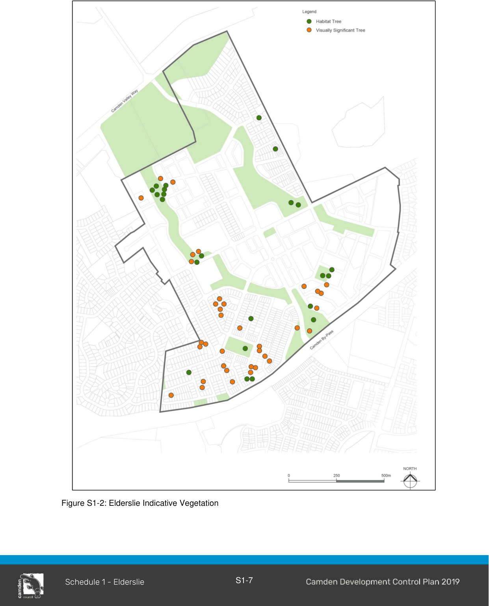
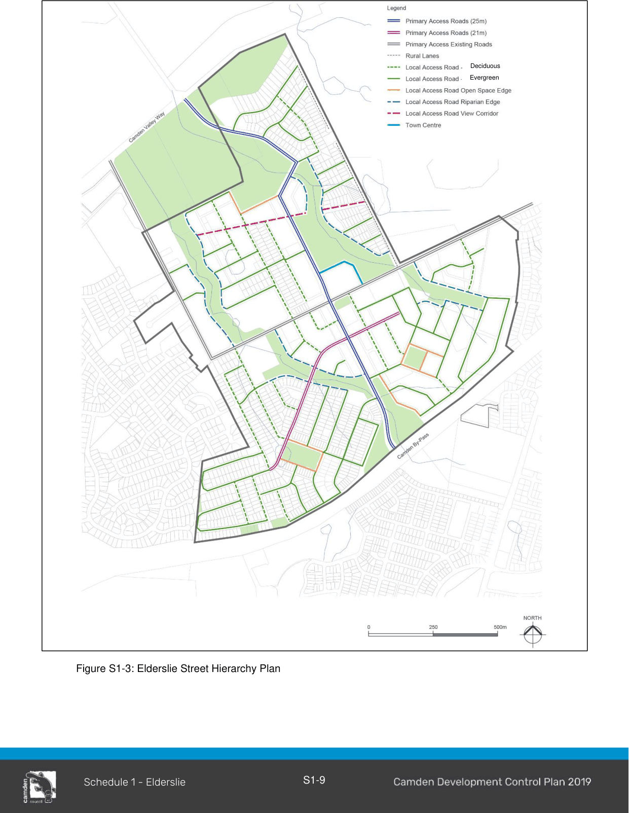
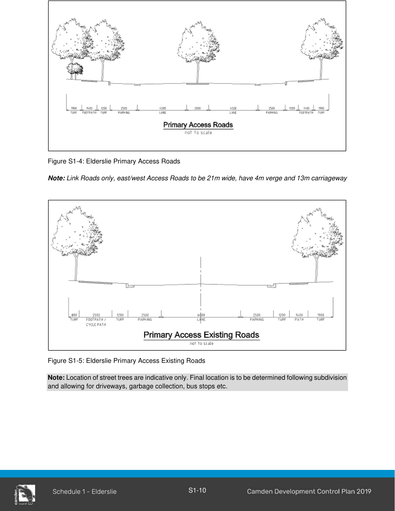
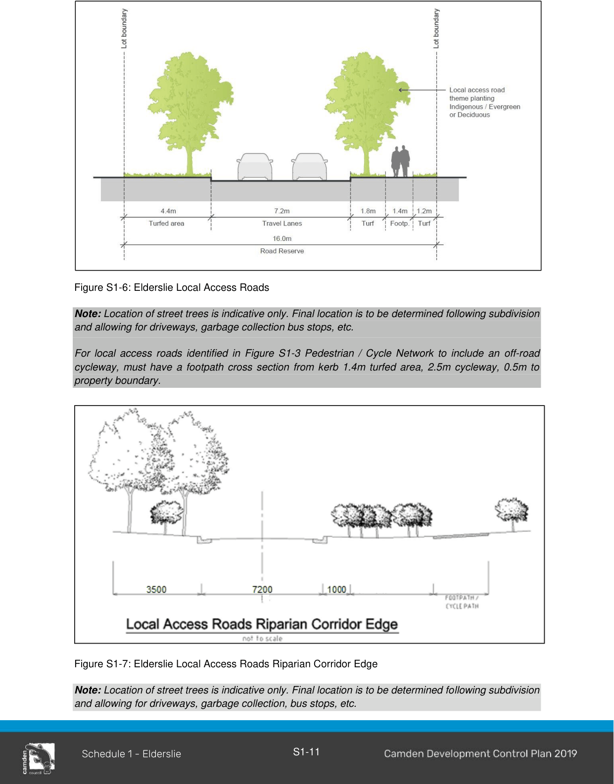
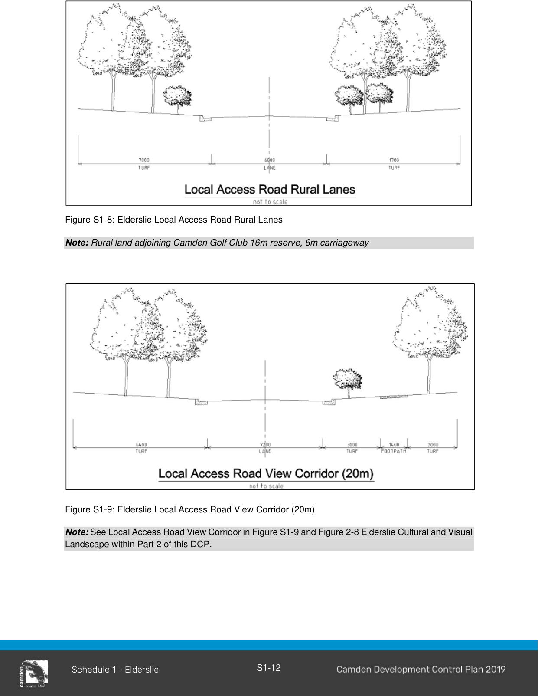
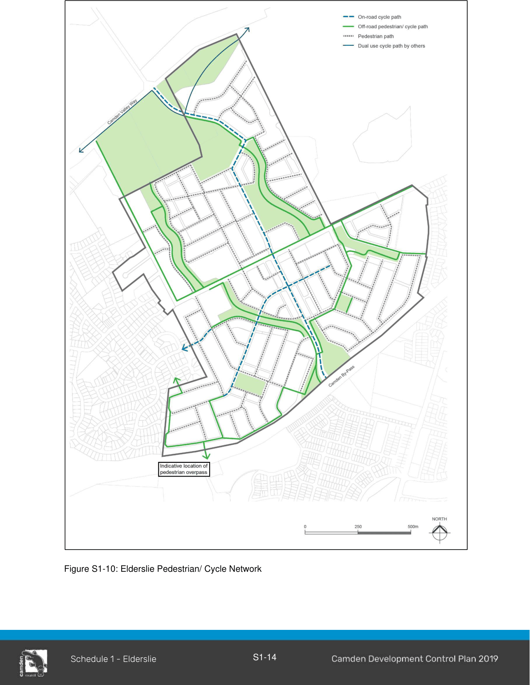
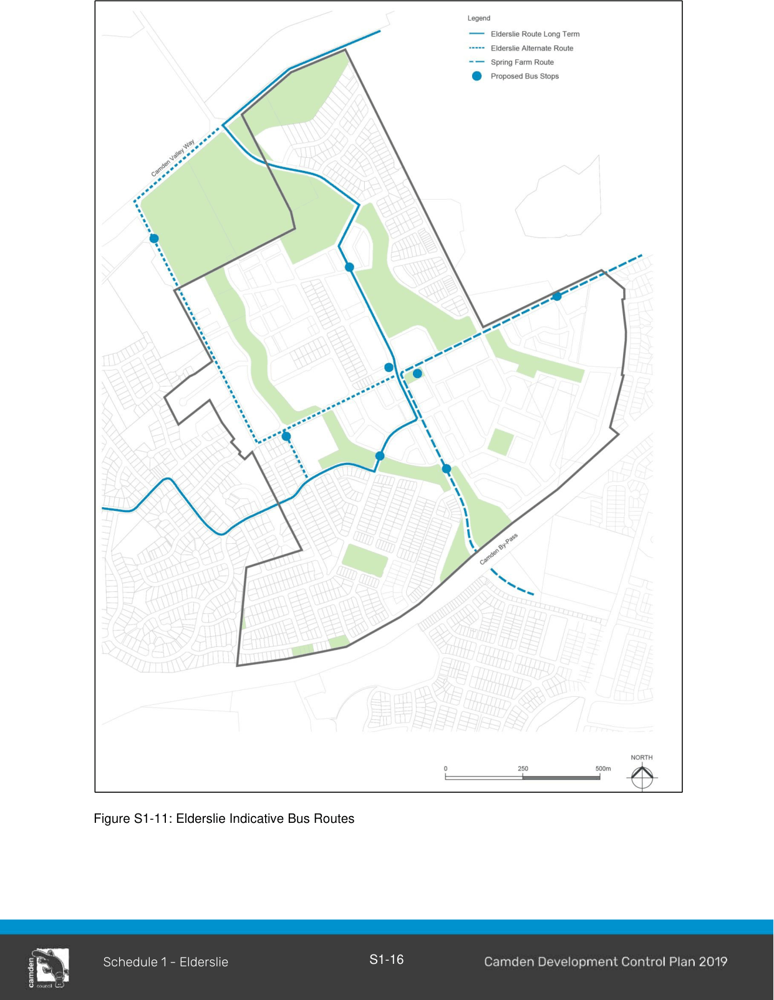
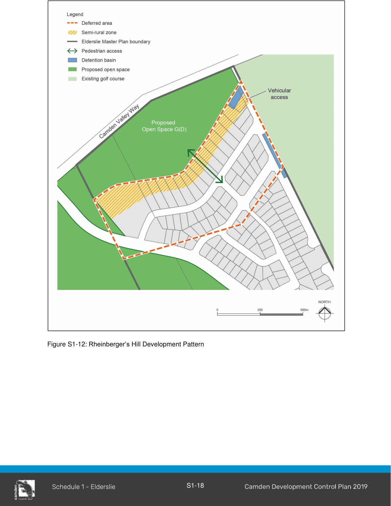

### S1.2 Subdivision Planning and Design

#### S1.2.1 Neighbourhood and Subdivision Design

#### Controls

1\. Smaller lots and housing types are to be located close to the neighbourhood centre, public transport and adjacent to higher amenity areas such as parks.

2\. The following minimum lot sizes apply under CLEP 2010:

a. attached dwellings - 180m2.

b. semi-detached dwellings - 200m2

c. dwelling houses - 300m2.

Note: These are minimum development standards as set out in the LEP 2010.  However, all subdivisions are to demonstrate compliance with the Elderslie Residential Density Target as specified in Part 1 of this Schedule.

3\. At subdivision/development stage, noise attenuation measures need to be developed for sites that fall within the criteria set out below:

a. applicants will be required to submit an acoustic impact assessment report for development:

b. within any commercial or neighbourhood centre areas.

i. adjacent to Camden Valley Way, Camden Bypass and/or Liz Kernohan Drive.

ii. for any non-residential use of any part within the area that this DCP covers.

iii. steep (1:10) or elevated land within 100 metres of a freeway, arterial or future arterial road.

c. Council will not consent to the subdivision/development of land to which this clause applies, unless a program, satisfactory to the Council, has been prepared proposing traffic noise attenuation devices for the development. The report must predict noise levels for a 10 year period and any attenuation measures must address these noise levels.

4\. The master plan aims to protect significant views, and these corridors must be protected in any subdivision application. Details such as fences, walls and tree plantings must also respect these corridors. Subdivision that is designed around heritage items and curtilages must be sympathetic in form, shape and lot size to the heritage places (see Part 2).

5\. The significant view corridors identified in Part 2 Environmental Heritage must be preserved in any development application for subdivision. Development adjoining existing development outside of this release area, is to be of a similar nature and scale to the adjoining area and to be located so as not to eliminate views from the existing residences. Refer to the Elderslie Master Plan (Figure S1-1) for locations that are restricted to single storey construction.

6\. To reinforce and enhance the identity of the area, mature vegetation must be preserved where possible and integrated into the new landscape in accordance with Figure S1-2.

> [Picture on page 9: a picture, saved as a picture (images/schedule-01-elderslie-page-9-3.gif, 150 dpi).]

Figure S1-2: Elderslie Indicative Vegetation

#### S1.2.2 Street Network and Design

Street network and design in the Elderslie release area has been designed to provide a safe and efficient movement for all users including vehicles, pedestrians and cyclists.

#### Controls

1\. Provide a road connection and pedestrian overbridge to the Spring Farm Release Area (Figure S1-10).

2\. Direct and clear street connections are made between the site and existing main routes to the:

a. North: To Camden Valley Way;

b. South: to the Camden Bypass and Spring Farm;

c. East: to Narellan; and

d. West: to existing Elderslie.

As indicated in Figure S1-1 – Elderslie Master Plan

3\. Other existing roads are extended or linked into the new street pattern. For example, Southdown and Coopworth Roads as indicated in the master plan.

4\. The old rural road known as Irvine Street is retained in the new street pattern, as are the reservations of Lodges Road and Hilder Street.

5\. New road connections to Camden Bypass and Camden Valley Way must be consistent with the master plan.

6\. No direct vehicular site access is permitted to Camden Bypass and Camden Valley Way.

7\. Figures S1-4 to S1-9 illustrate various street types and details which must be used throughout the design and construction phase. Detail must be submitted at the development application stage.

8\. Laneways are to be designed and built in accordance with the Camden Council’s Engineering Design and Construction Specifications. Where existing laneways have been built and need to continue through, they should align with the existing laneway cross section.

> [Picture on page 11: a picture, saved as a picture (images/schedule-01-elderslie-page-11-1.gif, 150 dpi).]
> Words printed on the picture (copied from the PDF):
> Deciduous
> Evergreen

Figure S1-3: Elderslie Street Hierarchy Plan

> [Picture on page 12: a picture, saved as a picture (images/schedule-01-elderslie-page-12-1.gif, 150 dpi).]

Figure S1-4: Elderslie Primary Access Roads

Note: Link Roads only, east/west Access Roads to be 21m wide, have 4m verge and 13m carriageway

Figure S1-5: Elderslie Primary Access Existing Roads

Note: Location of street trees are indicative only. Final location is to be determined following subdivision and allowing for driveways, garbage collection, bus stops etc.

> [Picture on page 13: a picture, saved as a picture (images/schedule-01-elderslie-page-13-1.gif, 150 dpi).]

Figure S1-6: Elderslie Local Access Roads

Note: Location of street trees is indicative only. Final location is to be determined following subdivision and allowing for driveways, garbage collection bus stops, etc.

For local access roads identified in Figure S1-3 Pedestrian / Cycle Network to include an off-road cycleway, must have a footpath cross section from kerb 1.4m turfed area, 2.5m cycleway, 0.5m to property boundary.

Figure S1-7: Elderslie Local Access Roads Riparian Corridor Edge

Note: Location of street trees is indicative only. Final location is to be determined following subdivision and allowing for driveways, garbage collection, bus stops, etc.

> [Picture on page 14: a picture, saved as a picture (images/schedule-01-elderslie-page-14-1.gif, 150 dpi).]

Figure S1-8: Elderslie Local Access Road Rural Lanes

Note: Rural land adjoining Camden Golf Club 16m reserve, 6m carriageway

Figure S1-9: Elderslie Local Access Road View Corridor (20m)

Note: See Local Access Road View Corridor in Figure S1-9 and Figure 2-8 Elderslie Cultural and Visual Landscape within Part 2 of this DCP.

#### S1.2.3 Pedestrian and Cycle Network

The Elderslie Release Area encourages walking and cycling by providing safe, convenient and legible routes to points of attraction within and beyond the suburb.

#### Controls

1\. The cycle network for the Elderslie Release Area is to be designed, constructed and clearly marked in accordance with Elderslie Release Area Pedestrian/Cycle Network Map (Figure S1- 10).

2\. Cycle paths shown in the Elderslie Release Area Pedestrian/Cycle Network that go through or parallel to open space, should be located either in the road reserve or in the open space/drainage land.

3\. Cycle and pedestrian bridges must be located above the 20 year ARI flood level.

> [Picture on page 16: a picture, saved as a picture (images/schedule-01-elderslie-page-16-1.gif, 150 dpi).]

Figure S1-10: Elderslie Pedestrian/ Cycle Network

#### S1.2.4 Public Transport Network

The development of the Elderslie Release Area involves the opportunity to provide for choice in mode of transport. As a result, convenient road connections to adjoining areas and other public transport routes will provide for ease of movement of buses between suburbs, link activity centres within and external to the suburb, and to the railway at Campbelltown and Macarthur. It will also ensure bus stops are located near neighbourhood parks, shops, and schools and are related to the main pedestrian routes.

#### Controls

1\. Bus routes and bus stops are designed, constructed and clearly marked in accordance with Figure S1-11 Elderslie Release Area Indicative Bus Routes.

2\. In addition to Figure S1-11, road reserves of streets linking with the surrounding areas must not prevent the operation of future potential bus routes.

3\. A development application must:

a. include a bus routes plan, showing how the route links with existing and/or proposed routes.

b. show location of bus stops and proportion of dwellings within the 400m catchment.

c. include a street network plan showing street reserve information.

d. include how bus stops relate to surrounding activities.

> [Picture on page 18: a picture, saved as a picture (images/schedule-01-elderslie-page-18-1.gif, 150 dpi).]

Figure S1-11: Elderslie Indicative Bus Routes

#### S1.2.5 Parks and Open Space

#### Objectives

a. Ensure the public open space network for the Elderslie Release Area addresses the recreational, aesthetic and natural systems of the area.

b. Ensure the functional requirements of these spaces accommodate sporting activities whilst creating memorable places that contribute to the legibility and character of the suburb.

#### Controls

1\. The landscape plans for the Elderslie parks and open space network must refer to the Landscape Master Report dated December 2001 and prepared by Context Landscape Architects.

2\. The design of the open space areas and riparian corridors with the existing bush remnants and proposed revegetation of Cumberland Plain Woodland must include a Management and Maintenance Plan. The Plan will identify short and long term management requirements and the associated costs including: rehabilitation and replanting methods: protection during construction requirements: weed and feral animal control: and a strategy to allow appropriate recreational use of the area.

3\. Two sports grounds are to be provided within Elderslie Release Area (Kirkham Park).

#### S1.2.6 Rheinberger’s Hill

#### Background

Rheinberger’s Hill has been identified as a potential Heritage Item and is a very significant visual element when viewed from Camden Valley Way and several other vantage points.

#### Objectives

a. To define the areas which need to be conserved.

#### Controls

1\. Development of the site must be consistent with Figure S1-12 and the “Camden Acres Housing Design Guidelines” prepared by Crownland Developments dated December 2002.

2\. Rheinberger’s Hill must be generally managed as an open space area by Council to protect the visual amenity and the rural ambience of the northern gateway to Camden

3\. The visual integrity of the site must be preserved when viewed from both North and South on Camden Valley Way.

> [Picture on page 20: a picture, saved as a picture (images/schedule-01-elderslie-page-20-1.gif, 150 dpi).]

Figure S1-12: Rheinberger’s Hill Development Pattern

