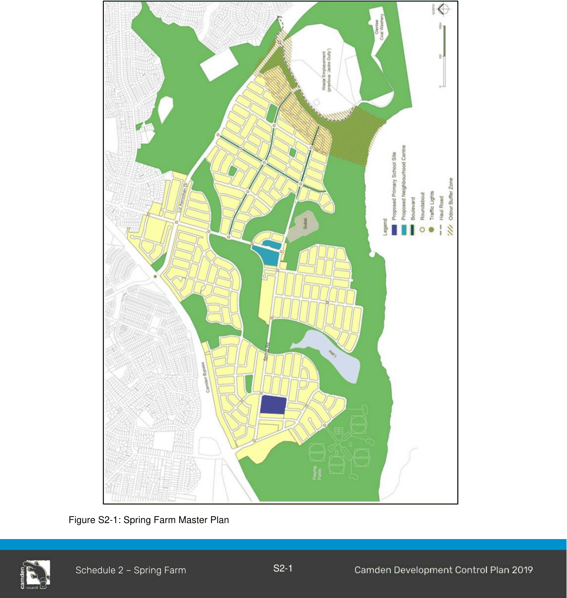
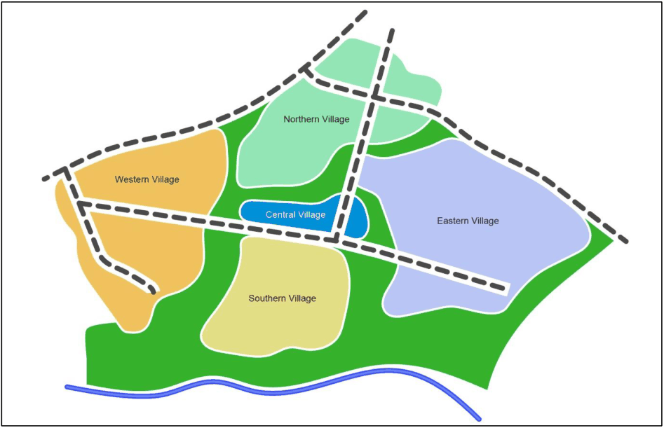

### S2.1 Introduction

The Spring Farm release area is bounded by Camden Bypass to the northwest, Narellan Vale to the northeast, Mount Annan and Macarthur Resource Recovery Park to the east, and the Nepean River to the south.

> [Picture on page 3: a picture, saved as a picture (images/schedule-02-spring-farm-page-3-6.gif, 150 dpi).]

Figure S2-1: Spring Farm Master Plan

#### Spring Farm Master Plan

The Spring Farm Master Plan shown at Figure S2-1 identifies a broad subdivision pattern for the area. The overall master plan was prepared with consideration to the State Government’s objective of achieving a target density of 15 dwellings per hectare in new subdivisions. Development applications for subdivision must generally comply with the master plan. Figure S2-2 below demonstrates the basic relationship between the four villages - the Village Centre, main roads, bush corridor and river.

> [Picture on page 4: a picture, saved as a picture (images/schedule-02-spring-farm-page-4-7.gif, 150 dpi).]

Figure S2-2: Spring Farm Master Plan Concept Sketch

Relationship to Other Plans

This section must be read in conjunction with:

• The Spring Farm Local Environment Study (Oct 2000) by Patterson Britton and Partners Pty Ltd.

• Landscape Master Plan Report (Dec 2003) by Context Landscape Design.

• Heritage Assessment (June 2002) by Godden Mackay Logan.

• Aboriginal Archaeological Assessment (Jan 2002) by Mary Dallas and Paul Irish.

• Water Cycle Master Plan Report (Oct 2002) by J. Wyndham Prince Pty Ltd.

• Traffic and Transport Report (Oct 2002) by Masson Wilson Twiney.

• Spring Farm Conservation Strategy Documents (26 Sep 2003) by Anne Clements and Associates Pty Ltd.

• Fauna Habitat Study (Aug 2002) by Conacher Travers.

• Geotechnical Assessment: Spring Farm Release Area (including groundwater, salinity, instability, contamination) (Feb 2002) by SMEC Testing Services.

• Spring Farm Sydney: Assessment of Market Potential for a Retail Centre by Jebb Holland Dimasi.

• Spring Farm Urban Release Open Space and Social Plan (Aug 2002) by BBC Consultants.
