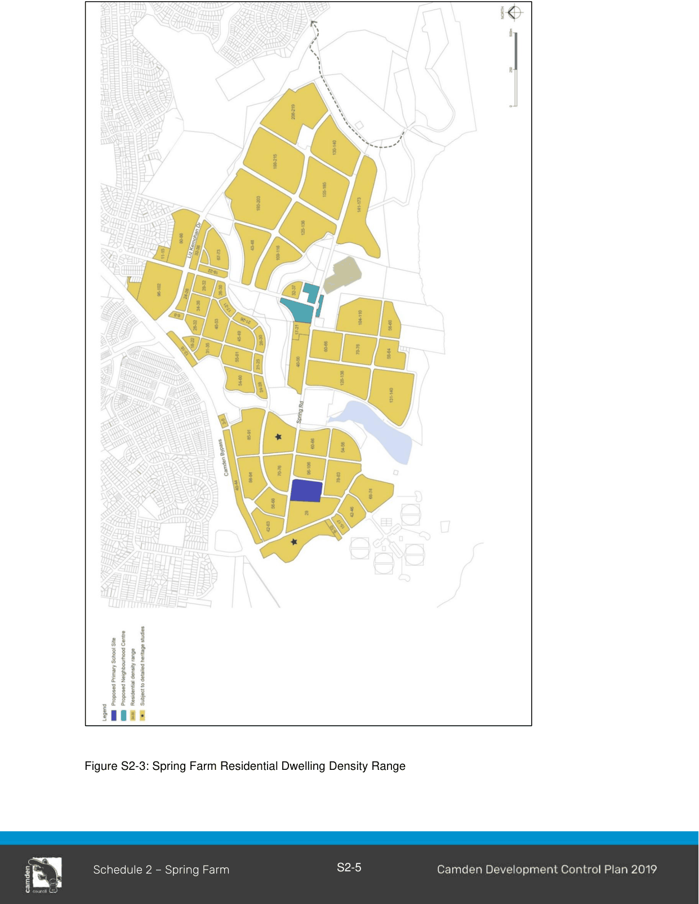

#### S2.1.2 Residential Density Targets

#### Objective

a. Ensure the dwelling density target for Spring Farm is achieved.

#### Controls

1\. Residential subdivision in Spring Farm must provide a dwelling target range of 3717-4083 (Figure S2-3). To ensure this, subdivision applications are to demonstrate to Council that the dwelling targets shown in Figure S2-3 will be achieved.  Subject to the agreement of Council and consultation with relevant landowners, dwelling yield may be ‘traded’ between development blocks, as long as it meets the overall targets and objectives of the DCP and Master Plan.

2\. Where variation to the block dwelling targets is proposed, the applicant is to demonstrate the proposed variation is consistent with the principles of the Spring Farm Master Plan and provisions of this DCP.

> [Picture on page 7: a picture, saved as a picture (images/schedule-02-spring-farm-page-7-1.gif, 150 dpi).]

Figure S2-3: Spring Farm Residential Dwelling Density Range

