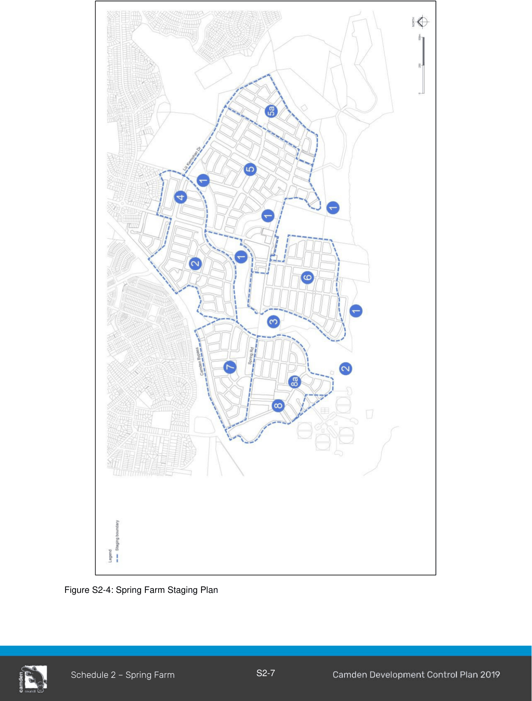

#### S2.1.3 Staging of Development

#### Objective

a. Ensure the orderly development of the land and assist in the coordinated programming and provision of necessary infrastructure and sequencing.

b. Ensure staging of works protects the amenity of future residents from the effects of mining, industrial and waste disposal activities.

c. Ensure services and works are carried out in logical and related stages.

d. Ensure the overall order of residential subdivision includes the putting in place of the “living” infrastructure to deal with stormwater drainage in an ecologically sensitive manner.

#### Controls

The overall stages proposed are as follows and are illustrated in the Figure S2-4:

1\. Bush Corridors and knoll relocation

2\. Link Road, residential subdivision stage, sewer pumping station, rebuilding dam wall.

3\. Lower Springs Road and commence regrading of sand mined areas.

4\. Residential subdivision stage

5\. Residential subdivision stage including Village Centre

a. Further residential subdivision after odour mitigation occurs (See LEP 2010)

6\. Residential subdivision stage

7\. Residential subdivision stage

8\. Residential subdivision stage

a. Further residential subdivision after sand mining rehabilitation works are completed (See LEP 2010)

Note: One residential stage does not need to be completely built out before another can proceed. The staging may be varied where it can be demonstrated the objectives are addressed.

> [Picture on page 9: a picture, saved as a picture (images/schedule-02-spring-farm-page-9-1.gif, 150 dpi).]

Figure S2-4: Spring Farm Staging Plan

