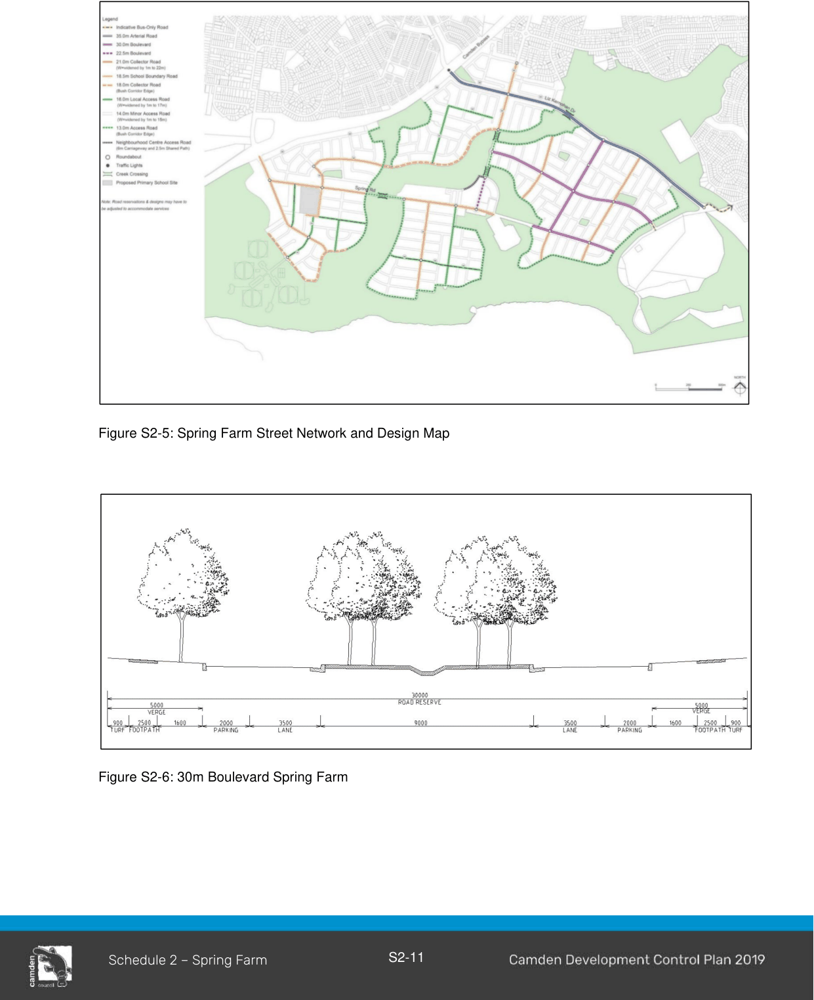
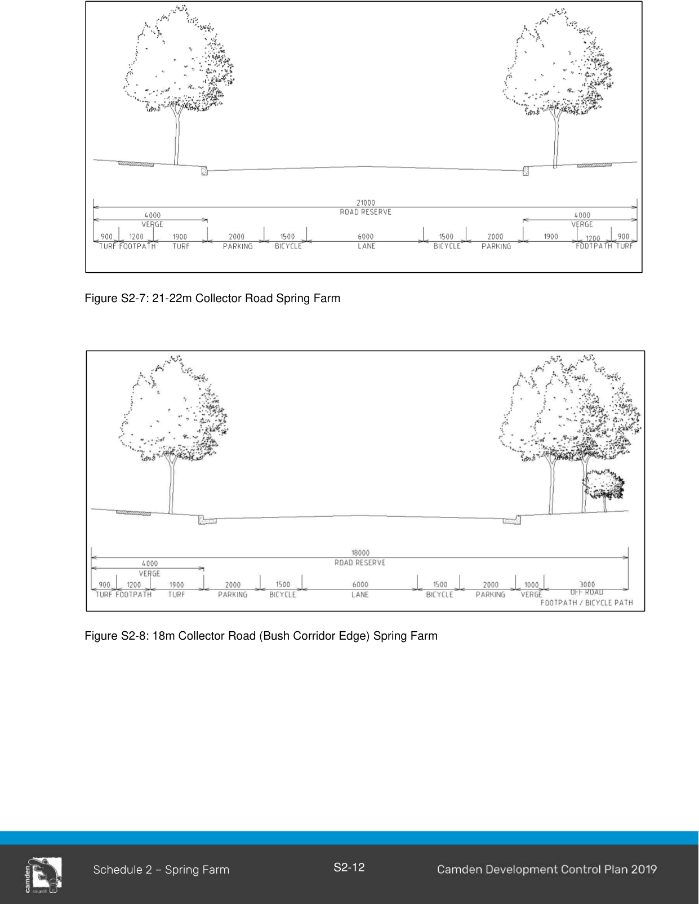
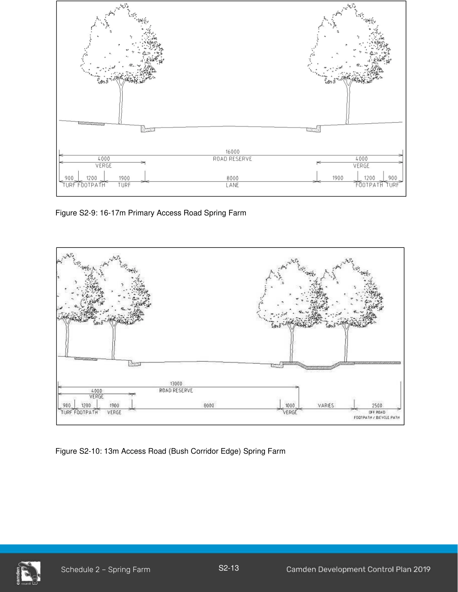
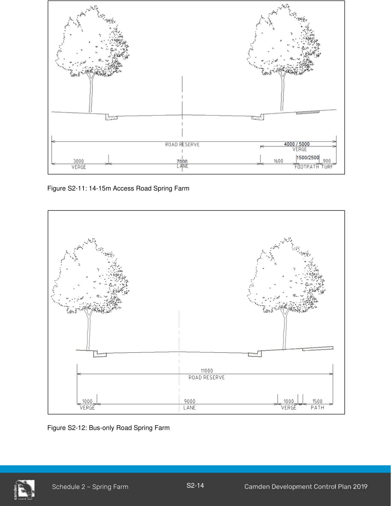

#### S2.2.3 Street Network and Design

The street network and design in Spring Farm will provide connections to its surrounding localities. This will be fulfilled through a clear hierarchy system, which will facilitate accessibility, movement flows and visual connections in the area.

Figures S2-5 to S2-17 illustrate the desired outcome for the road network and design within Spring Farm.

#### Controls

1\. Provide a road connection and pedestrian overbridge to the Elderslie release area.

2\. The existing alignments of Richardson Road and Springs Road are to be retained. Ettlesdale Road is to be retained.

3\. Macarthur Road is to be retained to represent the settlement pattern of the early colonial era at Spring Farm.

4\. New road connections to Camden By-Pass and Liz Kernohan Drive (Spring Farm Link road) must be consistent with the Master Plan.

5\. Kerb returns of 8.5m radius for intersections between streets must be provided.

6\. Streets are to be constructed in accordance with Figures S2-5 to S2-12. In certain sections, some cross sections are to be widened by 1m in accordance with Figure S2-5 Spring Farm Street Network and Design Map.

7\. The school boundary road around the eastern and southern boundaries of the future school site in Spring Farm may require widening to facilitate indented bus bays.

> [Picture on page 13: a picture, saved as a picture (images/schedule-02-spring-farm-page-13-3.gif, 150 dpi).]

Figure S2-5: Spring Farm Street Network and Design Map

Figure S2-6: 30m Boulevard Spring Farm

> [Picture on page 14: a picture, saved as a picture (images/schedule-02-spring-farm-page-14-1.gif, 150 dpi).]

Figure S2-7: 21-22m Collector Road Spring Farm

Figure S2-8: 18m Collector Road (Bush Corridor Edge) Spring Farm

> [Picture on page 15: a picture, saved as a picture (images/schedule-02-spring-farm-page-15-1.gif, 150 dpi).]

Figure S2-9: 16-17m Primary Access Road Spring Farm

Figure S2-10: 13m Access Road (Bush Corridor Edge) Spring Farm

> [Picture on page 16: a picture, saved as a picture (images/schedule-02-spring-farm-page-16-1.gif, 150 dpi).]

Figure S2-11: 14-15m Access Road Spring Farm

Figure S2-12: Bus-only Road Spring Farm

