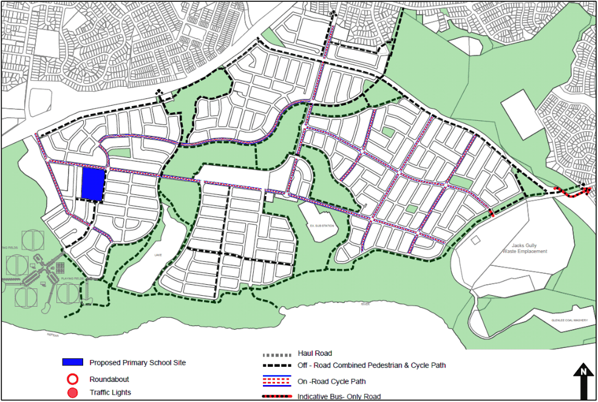

#### S2.2.4 Pedestrian and Cycle Network

#### Controls

1\. The pedestrian and cycle path network for Spring Farm is to be constructed to comply Figure S2- 13.

2\. Cycle and pedestrian bridges must be located above the 20 year ARI flood level.

> [Picture on page 17: a picture, saved as a picture (images/schedule-02-spring-farm-page-17-6.gif, 150 dpi).]

Figure S2-13: Spring Farm Pedestrian and Cycle Path Network
