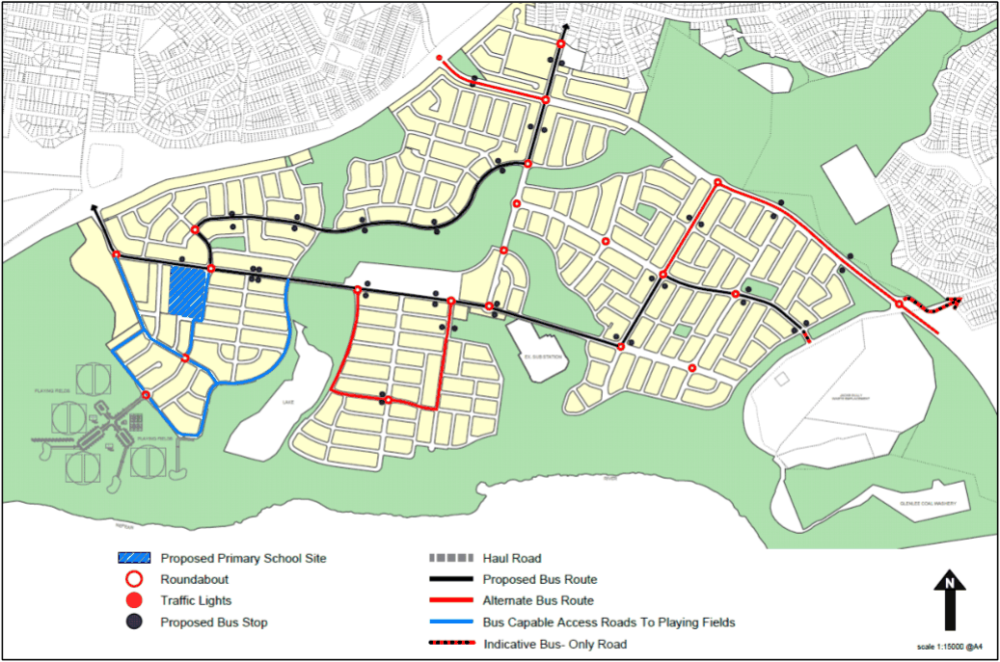

#### S2.2.5 Public Transport Network

#### Controls

1\. Figure S2-14 illustrates the proposed bus routes through Spring Farm and the connections to the surrounding areas.

2\. A bus only link is to be created to Mount Annan as shown below.

> [Picture on page 18: a picture, saved as a picture (images/schedule-02-spring-farm-page-18-1.gif, 150 dpi).]

Figure S2-14: Spring Farm Indicative Bus Route
