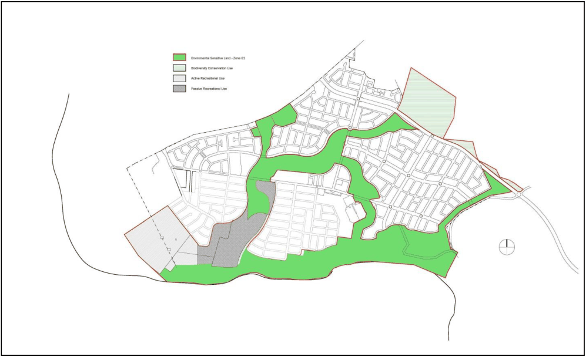
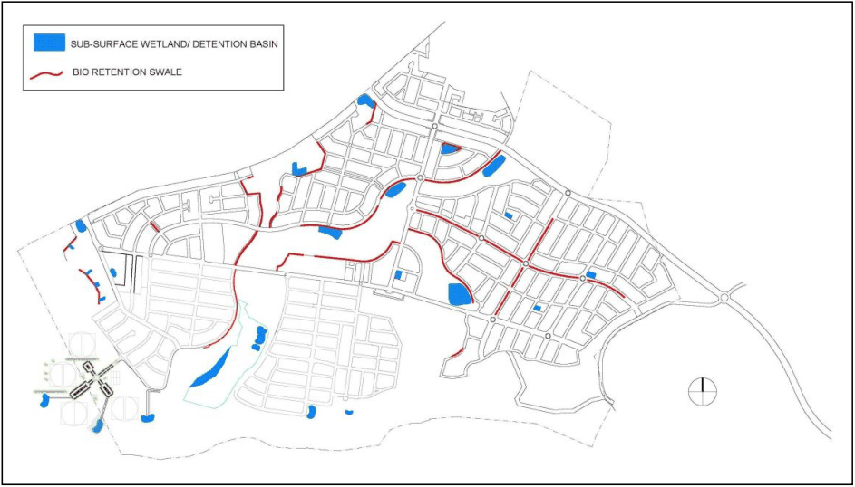

#### S2.2.7 Bush and Riparian Corridors in Spring Farm

#### Background

The Spring Farm Bush Corridor is a significant environmental corridor that serves biodiversity conservation, fauna movements and natural drainage through bushland restoration, enhancement and reinstatement.

> [Picture on page 19: a picture, saved as a picture (images/schedule-02-spring-farm-page-19-15.gif, 150 dpi).]

Figure S2-15: Spring Farm Riparian and Bush Corridor Land Uses

#### Objectives

a. Ensure protection and management of environmentally sensitive land for the principal purpose of biodiversity conservation, where this land has been identified for this purpose on the Riparian Area and Bush Corridor Land Uses Map shown at Figure S2-15.

b. Conserve, restore and enhance native flora and fauna habitat and the ecological viability of land identified for biodiversity protection purposes.

c. Provide a buffer around areas identified for biodiversity protection purposes.

d. Provide for development in locations identified on Figure S2-15 that will not destroy, damage or compromise:

i. the extent, quality or integrity of the ecological attributes of the land or watercourses.

ii. the potential for restoration and enhancement of native fauna and flora habitat on the land identified for biodiversity protection.

e. Provide links with other natural areas, as part of an open space and bush corridor network.

f. Ensure viable management, long-term survival and enhancement of the bush corridor through the preparation and implementation of plans of management.

g. Facilitate passive recreation, pedestrian and cyclist access within the bush corridor, to link the urban villages and beyond, with minimal impact on the bushland.

#### Controls

1\. Remnant vegetation must be protected and management plans must be established in accordance with the Spring Farm Conservation Strategy Documents (Anne Clements & Associates, December 2003).

2\. The bush corridor must be designed to accommodate stormwater flows and natural functions for Spring Farm.

3\. Crossings of the bush corridors must be minimised and limited only to critical locations to minimise disturbance to existing vegetation. Bush corridor/creek crossings and service corridors must be co-located.

4\. Pedestrian and cycle paths must be located on desire lines and integrated with existing vegetation, landform and landscaping.

5\. Screen planting and landscape structures must be used to screen the Integral Energy substation compound.

6\. Acoustic barriers and screen planting must be used to minimise acoustic and visual impact on nearby dwellings.

7\. When designing bush and riparian corridors, reference must be made to the Water Cycle Master Plan prepared by Wyndham Prince as shown at Figure S2-16.

8\. A riparian zone of 20m on either side of a minor stream bank and 40m from a major stream bank must be preserved, or as negotiated with the Department of Environment, Climate Change and Water (DECCW).

9\. Bio-retention swales are to be located adjacent to public reserves/bush corridor and/or within central medians of wide roads.

10\. Off-line bio-retention basins are to be located within public reserves, public roads, or adjacent to bush corridors.

> [Picture on page 21: a picture, saved as a picture (images/schedule-02-spring-farm-page-21-8.gif, 150 dpi).]

Figure S2-16: Spring Farm Bush Corridor Water Management Features

