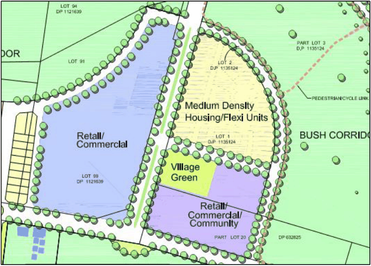

### S2.3 Centre Development Controls

#### Background

The Spring Farm E1 Local Centre will form part of the Spring Farm Urban Release Area. It is located as shown in Figure S2-17 below. The Centre is classified as a Neighbourhood Centre (Large) as per Chapter 5.1 of this DCP. The Spring Farm Neighbourhood Centre is to allow for a mix of retail, commercial, residential, community and recreational facilities and civic uses. It is intended to located shopping and entertainment/recreation facilities, a childcare centre, preschool, multi-function hall, sports centre/youth centre, village green, residential uses (including opportunities for flexi-units) and off-street parking areas.

> [Picture on page 22: a picture, saved as a picture (images/schedule-02-spring-farm-page-22-10.gif, 150 dpi).]

Figure S2-17: Proposed Spring Farm Neighbourhood Centre

#### Controls
