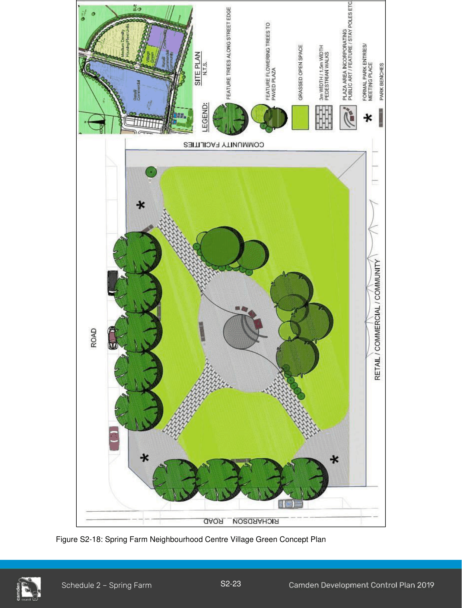

#### S2.3.2 Built Form and Appearance

1\. Subject to compliance with the building height limits contained in LEP 2010, development within the neighbourhood centre should have a range of building heights up to a maximum of 3 storeys.

Note:  Clause 4.3B of CLEP 2010 contains specific provisions for building height at specific sites in Spring Farm

2\. All development in the neighbourhood centre should respect the human scale and limit the visual impact of building height and mass, as to create a sense of visual comfort to the public.

3\. Buildings are to be visible from and address the street frontages. Where buildings are not proposed to be built to the street frontage, setbacks are to be minimised. Buildings are also to be designed and located to take advantage of proximity to open space areas, including riparian corridors.

4\. Blank walls visible from principal streets and the public domain are to be limited. Large format retail premises are to be sleeved, where appropriate, with active uses. In other circumstances, careful building design and landscaping must be used to minimise the extent and visibility of blank walls.

5\. Dedicated service access to loading facilities for retail and commercial buildings must be provided via back or side lanes that are screened from view on the main street. The potential for service traffic to conflict with other vehicle movements is to be minimised.

6\. Development within the Retail/Commercial precincts must be built to the street alignment.

7\. Important public buildings should be designed as landmark buildings which exhibit high quality design, are preferably two storeys in height, and sited at visually prominent locations such as corners and entries.

8\. Street trees providing shelter from both sun and rain are important to encourage pedestrian use of the neighbourhood centre.

9\. Development must use design solutions to reduce opportunities for crime and reduce the perception of crime within the community. Housing designs must provide casual surveillance over adjacent streets and public spaces. Public spaces must also have good linkages i.e. the village green with the adjoining retail/commercial/community precincts to reinforce the concept of safety and accessibility.

10\. The neighbourhood centre must be provided with on-street parking that is conveniently located, attractive and open for surveillance.

11\. Development located on the edges of the neighbourhood centre must consider the surrounding environment, in order to address the potential for land use conflict and to ensure that the neighbourhood centre relates sympathetically to the surrounding development, providing for an appropriate visual transition between areas.

12\. An allocation of 6,200sqm of land must be provided for the combined area of the Village Green, Multi-Purpose Community Facility and Youth Recreation Facility. Should the Youth Recreation Facility not be required at Spring Farm the surplus land allocation must be incorporated into the Village Green.

> [Picture on page 25: a picture, saved as a picture (images/schedule-02-spring-farm-page-25-1.gif, 150 dpi).]

Figure S2-18: Spring Farm Neighbourhood Centre Village Green Concept Plan

